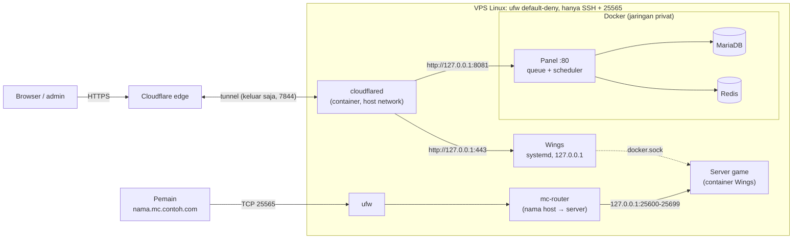

# Pterodactyl Panel + Wings + server Minecraft di satu VPS Linux

Repositori ini memasang dan mengoperasikan **Pterodactyl Panel 2.0** (Docker), **Wings** (biner + systemd di host), dan, secara opsional, **server Minecraft langsung dari modpack CurseForge atau Modrinth** yang masing-masing punya nama domain sendiri. Semuanya dijalankan lewat satu skrip, `./ptero`, yang memeriksa keadaan sebelum bertindak, tidak menyimpan rahasia di command line, dan tidak pernah menghapus data Anda.

> [!WARNING]
> **Panel 2.0 masih beta.** Per 2026-10-20 versi yang dipatok adalah `v2.0.0-beta.2`; rilis stabil upstream adalah `1.15.1`, dan upstream menyarankan panel produksi tetap di 1.x. Repositori ini menargetkan jalur 2.0 dan menolak berjalan sampai Anda menulis `PTERO_ACCEPT_BETA=yes`. Baca [Versi dan risiko beta](docs/architecture.md#versi-dan-risiko-beta) sebelum memutuskan.

## Status proyek

Tabel ini meringkas apa yang sudah dijalankan pada komponen asli dan apa yang belum. Definisi label ada di [docs/README.md](docs/README.md#konvensi-dokumentasi); bukti dan batas pengujian ada di [docs/verification.md](docs/verification.md).

| Area | Status | Catatan |
|---|---|---|
| Stack Panel (Panel, MariaDB, Redis) | **Nyata** | `setup`, `backup`/`restore`, `update --check`, ekstensi dan tema dijalankan dengan image yang dipatok |
| Wings | **Nyata** di container systemd uji; **belum diuji** di host Linux | pemasangan biner dengan sha256, konfigurasi dari Panel nyata, koneksi dua arah dengan Panel |
| Firewall (ufw), dead-man switch, egress guard | **Nyata** di container uji dengan ufw, systemd, dan iptables asli; **belum diuji** di host VPS | aplikasi pertama di VPS memerlukan sesi SSH cadangan |
| Router game (mc-router) | **Nyata** | nama terdaftar diteruskan; IP langsung, nama tak dikenal, dan nama kosong ditolak |
| Install modpack lewat Wings | **Nyata** (Forge 1.20.1) | installer juga diuji dengan jaringan nyata untuk Fabric, NeoForge, dan Forge 1.12.2 |
| Menjalankan server game lewat Wings | **Belum diuji** | tidak bisa dicoba di Docker Desktop (bind `/etc/machine-id` gagal); uji pertama di VPS |
| Cloudflare Tunnel dengan akun nyata, Access, WAF | **Belum diuji** | memerlukan akun Anda; `cloudflared` hanya diuji menolak token tidak valid |
| CurseForge dengan kunci nyata | **Belum diuji** | alur diuji dengan mock; Modrinth dan tautan langsung diuji nyata |
| Test otomatis | **Otomatis** | 524 pemeriksaan shell dan 45 test unit Python, semuanya lulus pada 2026-10-20 |

## Yang Anda dapatkan

- **Satu perintah untuk seluruh siklus hidup:** `init`, `setup`, `status`, `verify`, `backup`, `restore`, `update`, `diagnose`, dan seterusnya. Daftar lengkap: [docs/commands.md](docs/commands.md).
- **Panel di balik Cloudflare Tunnel.** Tidak ada port web yang terbuka di VPS. Panel dan Wings API hanya mendengar di `127.0.0.1`.
- **Wings sebagai layanan systemd** dengan biner yang diverifikasi sha256, konfigurasi dari Panel yang diperiksa dan ditambal, serta unit yang tetap mencoba setelah reboot.
- **Firewall yang tidak mengunci Anda:** SSH dideteksi dan diizinkan sebelum ufw dinyalakan, dan *dead-man switch* mematikan ufw lagi bila Anda tidak mengonfirmasi dari sesi baru.
- **Isolasi server game:** egress guard memblokir jaringan game dari host, LAN, dan metadata cloud.
- **Server Minecraft dari modpack** (opsional): satu port publik, satu nama per server, dibuat dengan satu perintah. Detail: [docs/games.md](docs/games.md).
- **Ekstensi dan tema Panel** yang dipasang otomatis dari daftar terkunci hash: [docs/extensions.md](docs/extensions.md).
- **Backup konsisten** (basis data, `APP_KEY`, ekstensi, konfigurasi) dengan restore yang meminta konfirmasi dan membuat safety backup lebih dulu.
- **Versi dipatok dengan digest.** Image yang mengambang di `:latest` ditolak validasi.

## Model akses

Dari internet hanya tiga hal yang dapat dijangkau. Semua yang lain (Panel, Wings API, SFTP, basis data, Redis, server game) mendengar di `127.0.0.1` atau jaringan Docker internal.

1. **SSH.** Tidak diubah dan tidak diputus oleh skrip ini.
2. **HTTPS lewat Cloudflare Tunnel** untuk Panel dan Wings (gerbang web). Tunnel hanya membuat koneksi keluar.
3. **Satu port game (25565)** milik `mc-router`, yang meneruskan koneksi hanya bila nama server yang dikirim klien dikenal (gerbang game). Koneksi lewat IP langsung ditolak.



Matriks port, alur traffic, dan alasan setiap pilihan desain: [docs/architecture.md](docs/architecture.md).

## Prasyarat

| Kebutuhan | Keterangan |
|---|---|
| Server Linux | Ubuntu 22.04, 24.04, atau 26.04, atau Debian 12 atau 13 (daftar upstream untuk Wings); x86_64 atau arm64; KVM atau bare metal, bukan OpenVZ atau LXC |
| Docker Engine + Compose v2 (2.20 atau lebih baru) | Dipasang manual dari [dokumentasi Docker](https://docs.docker.com/engine/install/). Skrip ini tidak memasang Docker |
| `ufw` dan `iptables` | `apt install ufw iptables`. Hanya dipakai oleh perintah `firewall` |
| `bash` 4.4+, `python3` 3.8+, `curl`, `openssl`, `tar`, `gzip`, `sha256sum` | Ada di instalasi standar Ubuntu dan Debian |
| RAM 2 GB atau lebih (di luar RAM server game), disk bebas 10 GB atau lebih | Diperiksa preflight (`MIN_FREE_DISK_GB`) |
| Akun Cloudflare dengan domain (zone) berstatus **Active** | Tidak bisa diotomatisasi: [docs/cloudflare.md](docs/cloudflare.md) |
| Jam sistem tersinkron (NTP) | Token Wings, token Panel, dan TLS bergantung pada jam yang benar |
| Hak akses | Pengguna di grup `docker` untuk perintah Panel; **root** untuk `wings ...`, `firewall ...`, dan `games timer ...` |

## Langkah inti

Urutan berikut ringkas dan tanpa keluaran yang diharapkan. Untuk pemasangan pertama, ikuti [tutorial instalasi lengkap](docs/installation.md): setiap langkah di sana punya pemeriksaan hasil dan jalan keluar bila gagal.

```bash
git clone your_repository_url_here pterodactyl && cd pterodactyl
./ptero init                      # config/deploy.env + secrets/ (password acak); tidak menimpa apa pun
$EDITOR config/deploy.env         # PANEL_FQDN, WINGS_FQDN, ADMIN_EMAIL, PTERO_ACCEPT_BETA=yes
./ptero tunnel set-token          # token tunnel Cloudflare (input tersembunyi)
./ptero setup                     # preflight, pull, basis data, migrasi, start, ekstensi, health check
./ptero tunnel info               # dua route yang ditambahkan di dashboard Cloudflare
./ptero admin create              # administrator pertama
./ptero verify                    # jalur publik: DNS, HTTPS Panel, endpoint Wings
sudo ./ptero wings install --config node.yml    # setelah membuat node di Panel
./ptero firewall plan             # lalu: sudo ./ptero firewall apply  (dengan sesi SSH cadangan)
```

Menjalankan `setup`, `wings install`, atau `firewall apply` ulang aman: `APP_KEY` tidak diganti, migrasi tidak diulang, data tidak ditimpa, aturan Anda sendiri tidak dihapus.

## Peta dokumentasi

| Butuh | Dokumen |
|---|---|
| Memasang dari nol, langkah demi langkah | [Instalasi lengkap](docs/installation.md) |
| Tunnel, route, DNS, Access | [Cloudflare](docs/cloudflare.md) |
| Server Minecraft dari modpack | [Server Minecraft](docs/games.md) |
| Backup, restore, update, rollback, firewall, troubleshooting | [Operasi](docs/operations.md) |
| Semua perintah `./ptero` | [Referensi perintah](docs/commands.md) |
| Semua variabel, rahasia, dan berkas | [Referensi konfigurasi](docs/configuration.md) |
| Desain, port, alur traffic, versi | [Arsitektur](docs/architecture.md) |
| Model ancaman, kontrol, respons insiden | [Keamanan](docs/security.md) |
| Bukti pengujian dan celahnya | [Verifikasi](docs/verification.md) |
| Ekstensi dan tema Panel | [Ekstensi dan tema](docs/extensions.md) |
| Pindah dari stack WSL2 lama | [Migrasi](docs/migration.md) |
| Mengubah kode dan menjalankan test | [Pengembangan](docs/development.md) |
| Istilah | [Glosarium](docs/glossary.md) |

Indeks lengkap, jalur baca per peran, dan pencarian berdasarkan gejala: [docs/README.md](docs/README.md).

## Perintah harian

| Perintah | Fungsi |
|---|---|
| `./ptero status` | Kesehatan semua komponen; exit 1 bila ada yang tidak sehat |
| `./ptero verify` | Jalur publik lewat Cloudflare (tanpa kredensial) |
| `./ptero audit` | Semua yang terjangkau dari luar loopback; exit 1 bila ada yang tak terduga |
| `./ptero logs [-f] [--tail N] [layanan\|wings]` | Log container atau journal Wings |
| `./ptero backup [--label x]` | Backup konsisten, tidak pernah menghapus backup lain |
| `./ptero restore <backup>` | Mengganti basis data dan `APP_KEY` dari backup, setelah konfirmasi dan safety backup |
| `./ptero update [--check]` | Backup wajib, pull image sesuai pin, migrasi, restart |
| `sudo ./ptero wings update` | Mengganti biner Wings ke versi yang dipatok |
| `./ptero game create ...` | Server modpack baru lengkap dengan nama domainnya |
| `./ptero diagnose [--output f]` | Laporan bantuan dengan rahasia disamarkan |
| `./ptero up` / `down` | Menyalakan atau menghentikan container (`down` tidak menghapus data) |

Semua perintah, opsi, hak akses, dan kode keluar: [docs/commands.md](docs/commands.md).

## Isi repositori

```text
ptero                      skrip utama (./ptero help)
compose.yml                Panel, MariaDB, Redis, cloudflared (profil tunnel), mc-router (profil games)
config/versions.env        versi dan digest yang dipatok (dilacak Git)
config/deploy.env.example  contoh konfigurasi tanpa rahasia (dilacak Git); deploy.env buatan Anda tidak dilacak
lib/                       logika: common, config, preflight, stack, backup, wings, diag, games, firewall, egg, ext (.sh)
                           dan wings_config.py, games.py, egg_build.py, ext_vet.py, redact.py
eggs/modpack-installer/    egg Pterodactyl: installer.py (sumber), egg.template.json, modpack-installer.egg.json (dihasilkan)
extensions/                extensions.lock (paket yang boleh dipasang, sha256) dan tema unix (sumber serta paket jadi)
systemd/                   templat unit dan timer: wings, egress guard, sinkronisasi nama server
tests/                     bash tests/run.sh: pemeriksaan otomatis dengan tiruan docker, curl, systemctl, ufw, iptables, dan test Python
docs/                      seluruh dokumentasi (mulai dari docs/README.md)
tools/                     alat stack lama (arsip, tidak dipakai)
secrets/ backups/ runtime/ dibuat saat runtime, tidak dilacak Git
```

## Menjalankan test

```bash
bash tests/run.sh               # tidak butuh Docker nyata, jaringan, atau domain
```

Test memakai `docker`, `curl`, `systemctl`, `ufw`, dan `iptables` tiruan di `tests/fakebin/` serta salinan repositori di direktori sementara, sehingga tidak menyentuh layanan atau data nyata. Hasil, pemeriksaan pada stack nyata, dan daftar hal yang belum teruji: [docs/verification.md](docs/verification.md).

## Batasan yang perlu Anda ketahui

- Repositori ini tidak membuat akun, domain, zone, atau tunnel Cloudflare, dan tidak meminta API token Cloudflare. Langkah itu manual: [docs/cloudflare.md](docs/cloudflare.md).
- Skrip tidak mengubah konfigurasi SSH, kernel, atau memasang paket sistem (Docker, ufw, iptables).
- Retensi dan salinan backup di luar server tidak diotomatisasi. Skrip tidak pernah menghapus backup.
- Backup mencakup Panel saja. Data game server (dunia, mod) dicadangkan lewat fitur Backups di Panel dan berada di sisi Wings.
- IP server terlihat lewat DNS untuk nama game (record wildcard harus *DNS only*). Penjelasan dan alternatifnya ada di [docs/games.md](docs/games.md#jujur-soal-ip).
- Panel 1.x tidak didukung.
- Daftar lengkap yang belum teruji: [docs/verification.md](docs/verification.md#belum-diverifikasi).

## File lama

`docs/Pterodactyl-Docker-WSL2-Deployment-Guide.md`, `docs/Analisis Dokumentasi ... .md`, dan `tools/` adalah catatan dan alat dari setup Windows/WSL2 sebelumnya. Isinya diarsipkan sebagai referensi dan **tidak dipakai** oleh deployment ini. Cara memindahkan data dari stack lama: [docs/migration.md](docs/migration.md).
