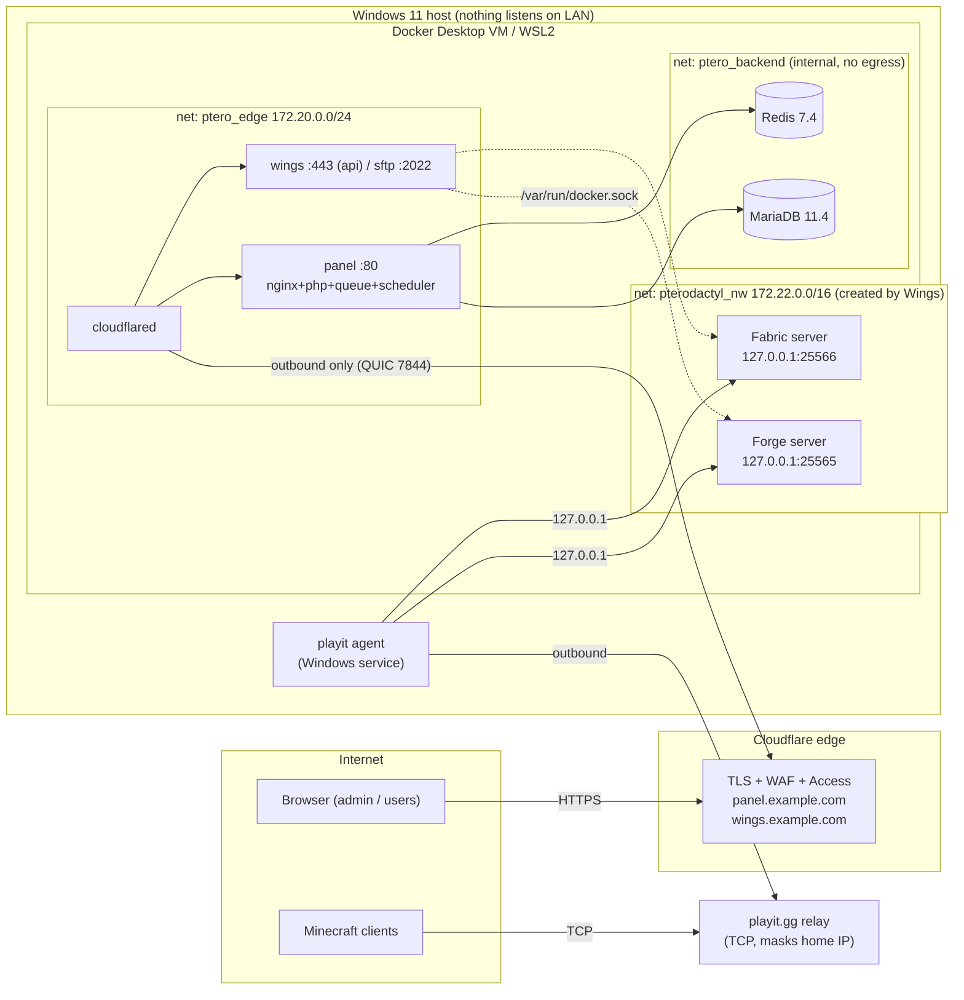

# Pterodactyl 2.0 on Windows 11 — Fully Containerized Deployment (WSL2 + Docker Desktop)

> **Panel + Wings + MariaDB + Redis + Cloudflare Tunnel, modded Minecraft (Forge & Fabric), zero inbound ports on the home router.**

| | |
|---|---|
| **Target host** | Windows 11 · WSL2 (Ubuntu 24.04) · Docker Desktop (WSL2 backend) |
| **Panel** | `ghcr.io/pterodactyl/panel:v2.0.0-beta.2` (Pterodactyl 2.0 **open beta**) |
| **Wings** | `ghcr.io/pterodactyl/wings:v1.13.4` (docs list 1.13.2–1.13.4 as tested with Panel 2.0) |
| **Ingress (web)** | Cloudflare **named** Tunnel (`cloudflared`, outbound-only) + Cloudflare Access |
| **Ingress (game)** | Same PC: `127.0.0.1:<port>`. Friends: playit.gg tunnel (primary) · frp on a VPS / port-forward (alternatives) · optional SRV name on your own domain (§5.2.1) |
| **UX / extensions** | CSS-only `unix` theme extension (day/night built in) + official extensions only; reCAPTCHA + Cloudflare layered in front (Phase 5) |
| **Modpack automation** | `tools/mc-deploy.py` — CurseForge / Modrinth pack → Panel server → install → start, in one command (Phase 6) |
| **Last verified** | 2026-10-19 — Phases 0–6 executed on a real host; docs checked 2026-10-18 against `docs.pterodactyl.io/v2` and the `v2.0.0-beta.2` repo tag |
| **Audience** | Backend/infra engineer — no beginner explanations |

> [!WARNING]
> Pterodactyl 2.0 is **beta**. Treat this as a lab/home deployment. Pin image tags, back up `APP_KEY`, and re-read the release notes before every bump. See [Appendix C](#appendix-c--provenance-what-is-verified-vs-assumed) for what in this guide is verified vs. assumed.

### Where this deployment stands (2026-10-19)

| Area | State |
|---|---|
| Control plane (Panel, MariaDB, Redis) | ✅ up, healthy, Panel image pinned by digest; idle footprint measured (§4.3) |
| Cloudflare Tunnel + public hostnames (`panel.`, `wings.`) | ✅ 4 tunnel connections; Panel reachable publicly; node heartbeat green through the tunnel (§3.6, §5.1) |
| Wings + egress guard | ✅ node `local-node` (10 240 MB / 40 960 MB, no over-allocation); guard rules validated (§6.5) |
| Servers | ✅ `deceasedcraft` (Forge 1.20.1, 235 mods) started and reached `Done`; `fabric-121` installed after the egg fix; its start is not re-verified (§4.1, §4.3) |
| Theme + extensions | ✅ `unix` theme active; `announcements`, `custom-buttons` enabled (§7.3, §7.11) |
| Modpack automation | ✅ `modpack.py` + `mc-deploy.py`, verified against a mock *and* the real CurseForge + Panel APIs (Phase 6) |
| Friends can join from the internet | ⏳ not set up — needs a playit/ngrok tunnel; SRV name optional (§5.2, §5.2.1) |
| Account hardening | ⏳ 2FA not required (`0`); reCAPTCHA still on the Panel's shared keys; whitelist not enforced (§6.10) |
| Mail | ⏳ Gmail SMTP entered in Admin → Settings → Mail; delivery not confirmed end-to-end (§7.6) |
| Cloudflare WAF / Bot Fight / Access on `/admin` | ⏳ dashboard steps not done (§5.4, §7.7) |
| Off-box encrypted backup | ⏳ local backups exist (`./stack.sh backup`); nothing leaves the laptop yet (§6.3) |
| Windows host | ⚠️ an unrelated inbound firewall allow rule for MySQL `3306`/`33060` exists (§6.10) |

---

## Table of Contents

1. [Architecture Overview](#1-architecture-overview)
2. [Phase 0 — Host Preparation (Windows / WSL2 / Docker Desktop)](#2-phase-0--host-preparation)
3. [Phase 1 — Full Docker Architecture](#3-phase-1--full-docker-architecture)
4. [Phase 2 — Modded Minecraft: Forge & Fabric](#4-phase-2--modded-minecraft-forge--fabric)
5. [Phase 3 — External Access (Zero Trust)](#5-phase-3--external-access-zero-trust)
6. [Phase 4 — Hardened Security](#6-phase-4--hardened-security)
7. [Phase 5 — Extensions, Themes & Panel Baseline](#7-phase-5--extensions-themes--panel-baseline)
8. [Phase 6 — Modpack Automation (CurseForge & Modrinth → running server)](#8-phase-6--modpack-automation-curseforge--modrinth--running-server)
9. [Appendix A — Command Cheat Sheet](#appendix-a--command-cheat-sheet)
10. [Appendix B — Troubleshooting Matrix](#appendix-b--troubleshooting-matrix)
11. [Appendix C — Provenance: what is verified vs. assumed](#appendix-c--provenance-what-is-verified-vs-assumed)

---

## 1. Architecture Overview

### 1.1 Topology



### 1.2 Design decisions (and why)

| Decision | Rationale |
|---|---|
| **No published port binds to `0.0.0.0`.** Every `ports:` entry is `127.0.0.1:…`. | Docker Desktop forwards published ports to the Windows host. Binding loopback means the LAN cannot reach anything even if Windows Firewall is misconfigured. |
| **Three Docker networks**: `ptero_edge`, `ptero_backend` (`internal: true`), `pterodactyl_nw` (Wings-managed). | DB and Redis have no route to the outside world and are unreachable from Wings, cloudflared and game containers. |
| **Panel *and* Wings both exposed through the same Cloudflare tunnel.** | Browser opens a websocket **directly** to Wings for the console. With an HTTPS panel the node must also be HTTPS (mixed content) and reachable from the user's browser. |
| **Game traffic bypasses Cloudflare.** | Free Cloudflare Tunnel only proxies HTTP(S). Raw TCP/UDP for Minecraft needs playit.gg / ngrok / a VPS relay. |
| **Allocations bind `127.0.0.1`.** | The tunnel agent runs on the same Windows host and dials loopback. Game ports are never on the LAN interface. |
| **Named volumes for stateful services; bind mounts only where Wings requires path identity.** | Named volumes live on the VM's ext4 (fast, correct permissions). Bind mounts crossing the Windows/9p boundary are slow and break `chown`. |

### 1.3 Port & address plan

| Purpose | Bind | Exposed to |
|---|---|---|
| Panel (local debug) | `127.0.0.1:8081 → panel:80` | Windows loopback only |
| Wings API (local debug) | `127.0.0.1:8080 → wings:443` (container port = `api.port` = the node's Daemon Port) | Windows loopback only |
| Wings SFTP | `127.0.0.1:2022 → wings:2022` | Windows loopback only |
| Forge (`deceasedcraft`) | `127.0.0.1:25565` | The PC itself; playit agent on the same host for friends |
| Fabric (`fabric-121`) | `127.0.0.1:25566` | Same |
| Public panel | `https://panel.example.com` → tunnel origin `http://panel:80` | Internet via Cloudflare Tunnel |
| Public Wings | `https://wings.example.com` → tunnel origin `http://wings:443` | Internet via Cloudflare Tunnel |

---

## 2. Phase 0 — Host Preparation

### 2.1 `%UserProfile%\.wslconfig`

Size this to your laptop. Budget: ~1.5 GB for the control plane + sum of server heaps × ~1.2.

```ini
[wsl2]
memory=12GB            # hard cap for the whole Docker Desktop VM
processors=6
swap=4GB
# networkingMode=nat is the default — keep it. Do NOT use "mirrored":
# mirrored mode puts the VM on the host's network namespace and weakens isolation.

[experimental]
autoMemoryReclaim=gradual
sparseVhd=true
```

Apply: `wsl --shutdown`, then restart Docker Desktop.

### 2.2 Docker Desktop settings checklist

- [x] **General → Use the WSL 2 based engine**
- [x] **General → Start Docker Desktop when you sign in** (servers die when the VM dies)
- [x] **Resources → WSL integration** → enable **only** the Ubuntu distro you'll operate from
- [ ] **General → Expose daemon on tcp://localhost:2375 without TLS** → **OFF**
- [ ] **Resources → File sharing** → don't add extra Windows drives
- **Docker Engine** (`daemon.json`):

```json
{
  "log-driver": "local",
  "log-opts": { "max-size": "10m", "max-file": "3" },
  "no-new-privileges": true
}
```

Also: Windows **Power & sleep → Never sleep when plugged in**, and enable **BitLocker** — the WSL/Docker `.vhdx` files contain every secret in this guide.

### 2.3 Operating shell

Everything below runs in **WSL2 Ubuntu** (`wsl -d Ubuntu`), with the project on the Linux filesystem (`~/pterodactyl-stack`), **never** under `/mnt/c`.

Shell pitfalls hit while executing this guide:

| Pitfall | What happened | Do instead |
|---|---|---|
| **Git Bash `~`** | `cat > ~/pterodactyl-stack/wings/etc/config.yml` from Git Bash wrote into `C:\Users\<you>\pterodactyl-stack`, not into the WSL home — Wings then started with no config | Open an Ubuntu shell first (`wsl -d Ubuntu`); `pwd` must print `/home/<you>/pterodactyl-stack`. To copy something from Windows: `cp /mnt/c/Users/<you>/… ~/pterodactyl-stack/…` |
| **Quoting through `wsl -- bash -c '…'`** | Nested quotes and `$` were mangled by PowerShell/Git Bash | Put the commands in a file and run `wsl -d Ubuntu -- bash /mnt/c/…/script.sh` |
| **`sudo` asks for a password** | Non-interactive steps stall | Use a throw-away root container for host paths, e.g. `docker run --rm -v /var/lib:/h alpine …` (§2.4) |
| **Pasting placeholders** | `modpack.py curseforge <SLUG> …` was run literally; bash read `<SLUG>` as a redirect (`No such file or directory`) | Replace every `<…>` before running; commands in Phase 6 show real example values |

### 2.4 The one thing that can silently break Wings: path identity

Wings starts game containers as **siblings** through the Docker socket and bind-mounts host paths such as `/var/lib/pterodactyl/volumes/<uuid>`. Those source paths are resolved **by dockerd**, but Wings writes the files through **its own** mount. Both must point at the same physical directory. Docker Desktop's WSL integration can rewrite bind-mount sources from your distro, which would split them.

Run this probe once, from the shell you will use for `docker compose`:

```bash
sudo mkdir -p /var/lib/pterodactyl && echo ok | sudo tee /var/lib/pterodactyl/probe >/dev/null

# 1) Path as resolved for a container started from this shell
docker run --rm -v /var/lib/pterodactyl:/p alpine cat /p/probe

# 2) Path as resolved by dockerd for a *sibling* started over the socket (what Wings does)
docker run --rm \
  -v /var/run/docker.sock:/var/run/docker.sock \
  -v /var/lib/pterodactyl:/var/lib/pterodactyl \
  docker:cli sh -c 'docker run --rm -v /var/lib/pterodactyl:/p alpine cat /p/probe'
```

| Result | Meaning | Action |
|---|---|---|
| Both print `ok` | Path identity holds | Continue with Docker Desktop as written |
| (1) `ok`, (2) empty / `No such file` | Paths diverge — servers would install into one directory and run from another | Use **Fallback: Docker Engine inside WSL2** below |

**Result — run 2026-10-18 on this host (Windows 11 · WSL2 Ubuntu · Docker Desktop 29.8.2):** ✅ **path identity holds.** Probe (1) printed `ok`, probe (2) printed `ok`. Continue with Docker Desktop; the Fallback below is not needed.

Run notes:
- Ubuntu's `sudo` asks for a password, so step 0 was done through a root container instead: `docker run --rm -v /var/lib:/h alpine sh -c "mkdir -p /h/pterodactyl && echo ok > /h/pterodactyl/probe"`. Same effect, no host sudo. Use this line on any machine where `sudo` prompts.
- The probe image `docker:cli` is pulled on first use (step 2), so the first run needs network access.
- The probe passing proves only the bind-mount path. Re-check after Wings is live: create a test server and confirm its files appear under `/var/lib/pterodactyl/volumes/<uuid>` inside the Ubuntu distro.
- `/var/lib/pterodactyl/probe` is left in place. Wings will own that directory; delete the file with `docker run --rm -v /var/lib:/h alpine rm -f /h/pterodactyl/probe` if you want a clean tree.

**Fallback — Docker Engine in WSL2 (recommended if the probe fails).** One daemon, one filesystem, no translation layer:

```bash
# /etc/wsl.conf in the Ubuntu distro
# [boot]
# systemd=true
curl -fsSL https://get.docker.com | sudo sh
sudo usermod -aG docker "$USER"
sudo systemctl enable --now docker
```

Disable Docker Desktop's integration for that distro. Everything else in this guide is unchanged (all commands and the compose file are identical).

---

## 3. Phase 1 — Full Docker Architecture

### 3.0 Pre-flight (30 seconds, saves a failed Wings start)

The stack pins three subnets: `172.20.0.0/24` (edge), `172.21.0.0/24` (backend), `172.22.0.0/16` (game network Wings creates). Docker refuses overlaps, and Wings' own default (`172.18.0.0/16`) collides with any compose project that already took it — **it did on the host this guide was tested on** (`Pool overlaps with other one on this address space`).

```bash
for n in $(docker network ls --format '{{.Name}}'); do
  printf '%-28s %s\n' "$n" "$(docker network inspect "$n" --format '{{range .IPAM.Config}}{{.Subnet}} {{end}}')"
done
# Any line overlapping 172.20.0.0/24, 172.21.0.0/24 or 172.22.0.0/16? → pick another free /16 and
# change it consistently in: .env (GAME_SUBNET/GAME_GATEWAY), compose.yml (edge/backend), Wings config (3.6).
docker compose version        # tested with v5.6.0; any Compose v2+ works
```

### 3.1 Layout

```text
~/pterodactyl-stack/
├── compose.yml          # entire ecosystem
├── .env                 # stack secrets — chmod 600, never commit
├── .cf-dns.env          # Cloudflare DNS token for mc-srv.sh (optional, §5.2.1) — chmod 600
├── .curseforge.env      # CURSEFORGE_API_KEY (Phase 6) — chmod 600
├── .panel-api.env       # Panel URL + API keys for mc-deploy.py (Phase 6) — chmod 600
├── .gitignore
├── stack.sh             # up | down | status | backup
├── themes/unix/         # theme SOURCE + packed unix.pteroext (Phase 5, §7.3) — not mounted into any container
├── tools/               # ops scripts (Phase 5 + 6): modpack.py, mc-deploy.py, mk-client-key.py,
│                        #   modrinth-url.sh, mc-srv.sh, autosuspend.sh — sources ship next to this guide
├── ext/                 # downloaded extension zips awaiting review (Phase 5, §7.2)
├── staging/             # scratch space of the modpack tools; emptied after every run
├── backups/             # ./stack.sh backup output (DB dump + panel_var with APP_KEY)
└── wings/etc/config.yml # pasted from the Panel in step 3.6
```

The key files are created by hand (`umask 077`, then `chmod 600`) when the phase that needs them starts; each is described in [§3.2.1](#321-credentials-map).

### 3.2 Secrets and environment

```bash
# bind-mount sources must exist and be yours — otherwise Docker creates them root-owned
mkdir -p ~/pterodactyl-stack/{wings/etc,themes,tools,ext,backups,staging} && cd ~/pterodactyl-stack

# .*.env covers .cf-dns.env / .curseforge.env / .panel-api.env
printf '.env\n.*.env\nbackups/\nwings/\next/\nstaging/\n__pycache__/\n' > .gitignore

umask 077
# NOTE: this heredoc is UNQUOTED on purpose (so $(openssl …) expands) → never put backticks or $ in its comments
cat > .env <<EOF
# ── identity ─────────────────────────────────────────
PANEL_FQDN=panel.example.com
WINGS_FQDN=wings.example.com
ADMIN_EMAIL=you@example.com
APP_TIMEZONE=Asia/Jakarta

# ── secrets (generated) ──────────────────────────────
DB_PASSWORD=$(openssl rand -hex 24)
REDIS_PASSWORD=$(openssl rand -hex 24)

# ── tunnel (paste after Phase 3.1) ───────────────────
CF_TUNNEL_TOKEN=
CLOUDFLARED_TAG=            # pin to a release tag from github.com/cloudflare/cloudflared/releases

# ── which optional services start with a bare "docker compose up -d"
# bootstrap: leave empty. After Wings is configured: wings,tunnel  (add ,guard if 6.5 works; ,jobs for 7.5.5)
COMPOSE_PROFILES=

# ── game network (created by Wings). Must be free on THIS host — see the pre-flight check above
GAME_SUBNET=172.22.0.0/16

# ── temporary local test (empty = use https://PANEL_FQDN). Clear it once the public hostname works
APP_URL_OVERRIDE=http://127.0.0.1:8081

# ── Phase 5 (optional) ───────────────────────────────
PTERODACTYL_EXTENSIONS_ENABLED=true   # kill-switch: set false, then re-run "docker compose up -d", if an extension breaks the Panel
AUTOSUSPEND_API_KEY=                  # root-admin CLIENT key (ptlc_…), see 7.5.5
AUTOSUSPEND_DRY_RUN=1                 # 1 = log only
EOF
chmod 600 .env
```

> [!NOTE]
> `docker compose config` prints interpolated secrets. Don't paste its output anywhere.

#### 3.2.1 Credentials map

Seven different secrets show up in this guide. They are easy to mix up — most failures in Phases 3 and 6 were "right key, wrong place".

| Secret | Looks like | Created where | Stored in | Used by |
|---|---|---|---|---|
| DB / Redis passwords | 48 hex chars | generated by §3.2 | `.env` | `compose.yml` |
| `APP_KEY`, `HASHIDS_SALT` | `base64:…` | generated by the Panel image on first start | volume `panel_var` → `/app/var/.env` (**back up**, §3.5) | Panel |
| Cloudflare **tunnel token** | long base64 | Zero Trust → Tunnels → *your tunnel* (Docker tab) | `.env` → `CF_TUNNEL_TOKEN` | `cloudflared` |
| Cloudflare **DNS API token** | 40 chars | My Profile → API Tokens → *Edit zone DNS*, scoped to **one zone, DNS: Edit** | `.cf-dns.env` → `CF_API_TOKEN`, `CF_ZONE_ID`, `CF_ZONE_NAME` | `mc-srv.sh` |
| Wings **node token** | `token_id` + `token` in `config.yml` | Node → Configuration | `wings/etc/config.yml` (600) | Wings |
| Panel **Application** API key | `ptla_…` | Admin → Application API → Create | `.panel-api.env` → `PANEL_KEY` | `mc-deploy.py` (create server, read nodes/eggs/users) |
| Panel **Client** API key | `ptlc_…` (identifier + secret) | Account → API Credentials (root admin); fallback `tools/mk-client-key.py` | `.panel-api.env` → `PANEL_CLIENT_KEY`; `.env` → `AUTOSUSPEND_API_KEY` | `mc-deploy.py` (power signal), `autosuspend.sh` |
| **CurseForge** API key | `$2a$10$…` (bcrypt-looking) | console.curseforge.com → API keys | `.curseforge.env` → `CURSEFORGE_API_KEY` | `modpack.py` |

Rules that came out of the real run:

- **`ptla_` ≠ `ptlc_`.** An Application key gets `403` on the Client API (verified), so it cannot send the power signal that starts a server. `mc-deploy.py` therefore takes both keys and checks the client key *before* it creates anything.
- Create key files with `umask 077` and verify with `stat -c '%a %n' .*.env` → `600`. The Application-key permissions it needs are: *Servers* read+write, *Users* read, *Nodes* read (+ write only if you use `--create-port`), *Eggs* read.
- **Use only your own CurseForge key.** A key found in a public paste is someone else's credential: using it is unauthorized use, and it gets revoked at any moment. Getting your own is free and takes a minute.
- The CurseForge key is sent **only** to `api.curseforge.com`; file downloads (`fetch` in `modpack.py`) go to the CDN without it.
- If a secret ever lands in a chat, log or commit: rotate it (dashboard → *Refresh/Regenerate*), then overwrite the file.

### 3.3 `compose.yml`

Derived from the upstream `docker-compose.example.yml` at tag `v2.0.0-beta.2` (MariaDB 11.4, Redis 7.4 with AOF, healthchecks, 90 s grace period, same volume set), with the network isolation, loopback-only publishing, resource limits and Wings/tunnel services added.

```yaml
name: pterodactyl

# ──────────────────────────────────────────────────────────────────────────────
# Shared service defaults
# ──────────────────────────────────────────────────────────────────────────────
x-base: &base
  restart: unless-stopped
  security_opt: ["no-new-privileges:true"]
  logging:
    driver: json-file
    options: { max-size: "10m", max-file: "3" }

# Panel environment — variable names taken from the v2.0.0-beta.2 example file.
x-panel-env: &panel-env
  # APP_URL_OVERRIDE lets you test locally (e.g. http://127.0.0.1:8081) before the public hostname exists.
  # Leave it empty in production — the tunnel URL is then used.
  APP_URL: ${APP_URL_OVERRIDE:-https://${PANEL_FQDN:?set PANEL_FQDN in .env}}
  APP_TIMEZONE: ${APP_TIMEZONE:-UTC}
  APP_SERVICE_AUTHOR: ${ADMIN_EMAIL:?set ADMIN_EMAIL in .env}
  APP_ENV: production
  APP_DEBUG: "false"
  APP_ENVIRONMENT_ONLY: "false"          # settings live in the DB, editable from the UI
  # cloudflared reaches the panel from ptero_edge; trust only that subnet for X-Forwarded-*
  TRUSTED_PROXIES: 172.20.0.0/24
  # Database
  DB_HOST: database
  DB_PORT: "3306"
  DB_DATABASE: panel
  DB_USERNAME: pterodactyl
  DB_PASSWORD: ${DB_PASSWORD:?set DB_PASSWORD in .env}
  # Redis for cache + sessions + queue
  CACHE_STORE: redis
  SESSION_DRIVER: redis
  SESSION_CONNECTION: sessions
  QUEUE_CONNECTION: redis
  REDIS_HOST: cache
  REDIS_PASSWORD: ${REDIS_PASSWORD:?set REDIS_PASSWORD in .env}
  # Single replica → this container runs both. Exactly "true"/"false".
  QUEUE_WORKER_ENABLED: "true"
  SCHEDULER_ENABLED: "true"
  # ── Phase 5 baseline (all documented in docs.pterodactyl.io/v2 / config/*.php @ v2.0.0-beta.2)
  PTERODACTYL_TELEMETRY_ENABLED: "false"                                    # anonymous stats off
  PTERODACTYL_EXTENSIONS_ENABLED: ${PTERODACTYL_EXTENSIONS_ENABLED:-true}   # emergency kill-switch lives in .env
  APP_ACTIVITY_PRUNE_DAYS: "365"                                            # audit-trail retention (default 90)
  APP_ACTIVITY_HIDE_ADMIN: "false"                                          # keep staff actions visible to server owners
  APP_BACKUP_DRIVER: wings                                                  # or s3 (+ AWS_* vars) — see 6.8
  # Mail: configure from the admin UI, or uncomment + fill:
  # MAIL_MAILER: smtp
  # MAIL_HOST: smtp.example.com
  # MAIL_PORT: "587"
  # MAIL_USERNAME: ...
  # MAIL_PASSWORD: ...
  # MAIL_ENCRYPTION: tls
  # MAIL_FROM_ADDRESS: noreply@example.com

services:
  # ═══════════════════════════ CONTROL PLANE ═══════════════════════════
  database:
    <<: *base
    image: mariadb:11.4
    # Small-footprint tuning (≈100–200 MB saved vs. defaults on a Panel-sized dataset)
    command:
      - --innodb-buffer-pool-size=256M
      - --max-connections=60
      - --performance-schema=OFF
      - --skip-name-resolve
    environment:
      MARIADB_DATABASE: panel
      MARIADB_USER: pterodactyl
      MARIADB_PASSWORD: ${DB_PASSWORD}
      MARIADB_RANDOM_ROOT_PASSWORD: "1"     # root password is never stored anywhere
    volumes:
      - db_data:/var/lib/mysql
    networks: [backend]                      # internal only: no egress, no published ports
    mem_limit: 1g
    pids_limit: 256
    healthcheck:
      test: ["CMD", "healthcheck.sh", "--connect", "--innodb_initialized"]
      interval: 10s
      timeout: 5s
      retries: 10
      start_period: 30s

  cache:
    <<: *base
    image: redis:7.4-alpine
    command: ["redis-server", "--appendonly", "yes", "--requirepass", "${REDIS_PASSWORD}"]
    environment:
      REDIS_PASSWORD: ${REDIS_PASSWORD}
    # Run as the image's own redis user (uid 999 / gid 1000) so the root→setpriv entrypoint branch is skipped.
    # (Tested: root + cap_drop ALL + CHOWN/SETUID/SETGID starts once, then dies on the NEXT start with
    #  "find: ./appendonlydir: Permission denied" because /data is 0700 redis-owned and root lacks DAC_OVERRIDE.)
    user: "999:1000"
    cap_drop: [ALL]
    volumes:
      - redis_data:/data                     # new named volume inherits redis ownership from the image
    networks: [backend]
    mem_limit: 256m
    pids_limit: 64
    healthcheck:
      test: ["CMD-SHELL", "redis-cli -a \"$$REDIS_PASSWORD\" --no-auth-warning ping | grep -q PONG"]
      interval: 10s
      timeout: 5s
      retries: 5

  panel:
    <<: *base
    image: ghcr.io/pterodactyl/panel@sha256:b3f1229ab8143615a93d8207096059e9903b5b7868cfb34ae0152d22203618c0   # = v2.0.0-beta.2, digest-pinned (§6.4); upstream example uses :latest
    stop_grace_period: 90s                            # let queue jobs finish
    depends_on:
      database: { condition: service_healthy }
      cache:    { condition: service_healthy }
    environment: *panel-env
    ports:
      - "127.0.0.1:8081:80"                           # local debug only; public path is the tunnel
    volumes:
      - panel_var:/app/var                            # .env with APP_KEY + HASHIDS_SALT  ← BACK UP
      - panel_nginx:/etc/nginx/http.d
      - panel_logs:/app/storage/logs
      - panel_extensions:/app/extensions
      - panel_extension_assets:/app/public/assets/extensions
    networks: [edge, backend]                         # edge for egress (mail, Wings via tunnel)
    mem_limit: 1g
    pids_limit: 512

  # ═══════════════════════════ DATA PLANE ═══════════════════════════
  wings:
    <<: *base
    profiles: [wings]
    image: ghcr.io/pterodactyl/wings:v1.13.4
    tty: true
    environment:
      TZ: ${APP_TIMEZONE:-UTC}
      WINGS_UID: "988"
      WINGS_GID: "988"
      WINGS_USERNAME: pterodactyl
    ports:
      - "127.0.0.1:8080:443"                          # API (debug). Container port = api.port = Panel Daemon Port (443)
      - "127.0.0.1:2022:2022"                         # SFTP — loopback only
    volumes:
      - /var/run/docker.sock:/var/run/docker.sock
      - /var/lib/docker/containers/:/var/lib/docker/containers/
      - ./wings/etc:/etc/pterodactyl
      # PATH IDENTITY REQUIRED (see 2.4): host path == container path for these three
      - /var/lib/pterodactyl:/var/lib/pterodactyl
      - /tmp/pterodactyl:/tmp/pterodactyl
      - /var/log/pterodactyl:/var/log/pterodactyl
      - /etc/ssl/certs:/etc/ssl/certs:ro
      - /run/wings:/run/wings
    networks: [edge]
    mem_limit: 1g

  # ═══════════════════════════ INGRESS ═══════════════════════════
  cloudflared:
    <<: *base
    profiles: [tunnel]
    # `:-` (not `:?`) on purpose: Compose interpolates the whole file even for inactive profiles,
    # so a `:?` here would block the bootstrap before the tunnel exists. stack.sh enforces both
    # values whenever the `tunnel` profile is active.
    image: cloudflare/cloudflared:${CLOUDFLARED_TAG:-latest}
    command: tunnel --no-autoupdate run
    environment:
      TUNNEL_TOKEN: ${CF_TUNNEL_TOKEN:-}
    cap_drop: [ALL]
    read_only: true
    networks: [edge]
    mem_limit: 128m
    depends_on: [panel]

  # Optional (profile `jobs`): daily idle-server suspender. Script + policy in 7.5.5. Ships in DRY-RUN.
  autosuspend:
    <<: *base
    profiles: [jobs]
    image: alpine:3.20
    command:
      - sh
      - -c
      - apk add --no-cache curl jq >/dev/null && while true; do /tools/autosuspend.sh || true; sleep 3600; done
    environment:
      PANEL_URL: http://panel
      PANEL_API_KEY: ${AUTOSUSPEND_API_KEY:-}
      IDLE_DAYS: "14"
      DRY_RUN: ${AUTOSUSPEND_DRY_RUN:-1}
    volumes:
      - ./tools:/tools:ro
      - autosuspend_state:/state
    networks: [edge]
    mem_limit: 64m

  # Optional: block game containers from reaching RFC1918/LAN/Windows host. See 6.5.
  egress-guard:
    profiles: [guard]
    image: alpine:3.20
    network_mode: host                                # = the Docker Desktop VM's netns
    cap_add: [NET_ADMIN]
    restart: unless-stopped
    environment:
      GAME_SUBNET: ${GAME_SUBNET:-172.22.0.0/16}      # must equal docker.network.interfaces.v4.subnet in Wings' config.yml (3.6)
    command:
      - sh
      - -c
      - |
        apk add --no-cache iptables >/dev/null
        GAME="$$GAME_SUBNET"
        until iptables -S DOCKER-USER >/dev/null 2>&1; do sleep 2; done
        for d in 10.0.0.0/8 172.16.0.0/12 192.168.0.0/16 169.254.0.0/16 100.64.0.0/10; do
          iptables -C DOCKER-USER -s $$GAME -d $$d -j DROP 2>/dev/null || \
          iptables -I DOCKER-USER -s $$GAME -d $$d -j DROP
        done
        # replies to inbound (DNAT'd) player traffic must still pass → keep this FIRST
        iptables -C DOCKER-USER -m conntrack --ctstate ESTABLISHED,RELATED -j RETURN 2>/dev/null || \
        iptables -I DOCKER-USER -m conntrack --ctstate ESTABLISHED,RELATED -j RETURN
        exec sleep infinity

networks:
  edge:
    name: ptero_edge
    driver: bridge
    ipam:
      config: [{ subnet: 172.20.0.0/24 }]
  backend:
    name: ptero_backend
    internal: true                                    # no default route → DB/Redis cannot egress
    ipam:
      config: [{ subnet: 172.21.0.0/24 }]

volumes:
  db_data:
  redis_data:
  panel_var:
  panel_nginx:
  panel_logs:
  panel_extensions:
  panel_extension_assets:
  autosuspend_state:
```

> [!NOTE]
> The upstream example may contain variables not listed here (e.g. `REDIS_QUEUE_RETRY_AFTER`, `HASHIDS_SALT`, `LE_EMAIL`). Diff against the tagged file before first start:
> `curl -fsSL https://raw.githubusercontent.com/pterodactyl/panel/v2.0.0-beta.2/docker-compose.example.yml`.
> `LE_EMAIL` stays unset on purpose — TLS terminates at Cloudflare, and the docs say to leave it empty behind a reverse proxy. `APP_KEY`/`HASHIDS_SALT` are generated on first start into `/app/var/.env`.

### 3.4 `stack.sh` — start / stop / status / backup

```bash
cat > stack.sh <<'EOF'
#!/usr/bin/env bash
set -euo pipefail
cd "$(dirname "$0")"

case "${1:-}" in
  up)
    # Compose won't catch this for us (see the `:-` note on the cloudflared service)
    set -a; . ./.env; set +a
    case ",${COMPOSE_PROFILES:-}," in *,tunnel,*)
      [ -n "${CLOUDFLARED_TAG:-}" ] && [ -n "${CF_TUNNEL_TOKEN:-}" ] || \
        { echo "profile 'tunnel' needs CLOUDFLARED_TAG and CF_TUNNEL_TOKEN in .env" >&2; exit 1; } ;;
    esac
    docker compose up -d --remove-orphans
    ;;
  down)
    # Game servers are siblings spawned by Wings, NOT compose services:
    # `compose down` alone leaves them running. Stop them first (SIGTERM → world save).
    docker ps -q --filter network=pterodactyl_nw | xargs -r docker stop -t 60
    # '*' = every profile, so profile-gated services (cloudflared, egress-guard…) are stopped too.
    # Without it, a container from an inactive profile keeps its network (ptero_edge) busy.
    docker compose --profile '*' down              # volumes are preserved; add -v ONLY to wipe everything
    ;;
  status)
    docker compose ps
    docker ps --filter network=pterodactyl_nw --format 'table {{.Names}}\t{{.Status}}\t{{.Ports}}'
    ;;
  backup)
    ts=$(date +%F-%H%M); mkdir -p backups; umask 077
    sql="backups/panel-$ts.sql.gz"; var="backups/panel_var-$ts.tgz"
    # write to *.tmp and only rename on success → a failed dump never leaves a plausible-looking empty file
    if ! docker compose exec -T database sh -c \
        'mariadb-dump --single-transaction --no-tablespaces -u"$MARIADB_USER" -p"$MARIADB_PASSWORD" "$MARIADB_DATABASE"' \
        | gzip > "$sql.tmp"; then
      rm -f "$sql.tmp"; echo "DB dump FAILED" >&2; exit 1
    fi
    mv "$sql.tmp" "$sql"
    # APP_KEY lives here — a DB dump WITHOUT it is useless for encrypted columns
    # The container (not this shell) creates the file → umask 077 doesn't apply. Tested: it came out root:root 0644,
    # i.e. APP_KEY readable by every local user. Hand it back to you and lock it down explicitly.
    docker run --rm -e U="$(id -u)" -e G="$(id -g)" -v pterodactyl_panel_var:/v:ro -v "$PWD/backups":/b alpine \
      sh -c 'f="/b/$1"; tar czf "$f" -C /v . && chown "$U:$G" "$f" && chmod 600 "$f"' _ "$(basename "$var")"
    echo "$sql  $var"
    ;;
  *) echo "usage: $0 {up|down|status|backup}" >&2; exit 1 ;;
esac
EOF
chmod +x stack.sh
```

| Intent | Command |
|---|---|
| Start entire ecosystem | `./stack.sh up` (= `docker compose up -d`) |
| Stop entire ecosystem (incl. game servers) | `./stack.sh down` |
| Stop but keep containers | `docker compose stop` |
| Restart one piece | `docker compose restart panel` |

### 3.5 Bootstrap the control plane

> [!IMPORTANT]
> `APP_URL` is `https://${PANEL_FQDN}`. The UI will not render correctly over plain `127.0.0.1:8081` (absolute asset URLs, CSRF). **Do [§5.1](#51-web-panel--cloudflare-tunnel-named-tunnel) steps 1–4 now** (≈5 min), set `CF_TUNNEL_TOKEN`, `CLOUDFLARED_TAG` and `COMPOSE_PROFILES=tunnel`, then continue.

```bash
cd ~/pterodactyl-stack

# 1. data stores first; wait until both report "healthy"
docker compose up -d database cache
docker compose ps

# 2. schema + seeders (container does NOT migrate on start — once per deployment)
docker compose run --rm panel php artisan migrate --seed --force --no-interaction

# 3. first root admin (interactive)
docker compose run --rm panel php artisan p:user:make

# 4. start the panel (+ cloudflared if COMPOSE_PROFILES=tunnel)
docker compose up -d
curl -sI http://127.0.0.1:8081 | head -n1          # sanity: HTTP/1.1 200/302

# 5. save APP_KEY + HASHIDS_SALT OFF this machine (password manager)
docker compose exec panel grep -E '^(APP_KEY|HASHIDS_SALT)=' /app/var/.env
./stack.sh backup
```

> [!CAUTION]
> `APP_KEY` encrypts API keys, node tokens and 2FA secrets. If it is lost, those values are unrecoverable **even with a perfect database backup.** Also: never run `key:generate` on an existing install.

#### 3.5.1 Wrong e-mail, lost password

The reset-by-mail flow needs working SMTP (§7.6). Until then, set the values from inside the Panel — type the password **inside tinker**, never on a shell command line (it would land in shell history):

```bash
docker compose exec panel php artisan tinker
```

```php
$u = \Pterodactyl\Models\User::where('username', 'YOUR_USERNAME')->firstOrFail();
$u->email    = 'new@example.com';                                   // only if the e-mail was wrong
$u->password = \Illuminate\Support\Facades\Hash::make('NEW_PASSWORD');
$u->save();
```

`p:user:make` creates *another* user (flags: `--email --username --name-first --name-last --password --admin --no-password`); it does not edit one. 2FA locked you out → `p:user:disable2fa`.

A "forgot password" request queues a job; with no working mailer it shows up as `SendPasswordReset … FAIL` in the Panel log and lands in `failed_jobs` with `Connection could not be established with host "127.0.0.1:2525"` — the Panel's mail default points at a local test SMTP that does not exist here. Configure SMTP (§7.6), then clear the dead jobs: `docker compose exec panel php artisan queue:flush`.

### 3.6 Create the node and start Wings

1. **Admin → Nodes → Create.** Two modes exist; the Panel derives `api.port` / `api.ssl` in `config.yml` from these fields, and the tunnel origin / port publishing must agree with them:

   | Field | **Public mode** (this guide's target) | Local-only mode (bootstrap, no domain yet) |
   |---|---|---|
   | FQDN | `wings.example.com` | `wings` — add `127.0.0.1 wings` to `C:\Windows\System32\drivers\etc\hosts` so the browser's console websocket finds it |
   | Communicate over SSL | *Use SSL* | *HTTP* |
   | Behind Proxy | *Behind Proxy* (Panel writes `api.ssl.enabled: false`; Wings serves plain HTTP, Cloudflare terminates TLS) | off |
   | **Daemon Port** | **`443`** → Panel writes `api.port: 443` | `8080` → `api.port: 8080` |
   | Compose port mapping | `127.0.0.1:8080:443` (as in §3.3) | change to `127.0.0.1:8080:8080` |
   | Tunnel origin for the node (§5.1) | `http://wings:443` | — (no tunnel) |
   | Panel URL | `https://panel.example.com` | `.env` → `APP_URL_OVERRIDE=http://127.0.0.1:8081` |

   Both modes: **Daemon SFTP Port** `2022`, **Daemon Server File Directory** `/var/lib/pterodactyl/volumes`. Memory / disk: leave headroom below the VM size (§4.3); over-allocation `0 %`. This host: node `local-node`, **10 240 MB** RAM, **40 960 MB** disk.

   > [!WARNING]
   > The node scheme must match how the browser reaches it. A node saved as *Use SSL* while the tunnel/origin speaks plain HTTP (or the reverse) shows **Unavailable** in the Panel and `502` at the edge. Panel rewrites `api.port` from *Daemon Port* on **every** node save — re-copy the config (or re-check `api.port`) after editing the node.
2. **Node → Allocation:** IP `127.0.0.1`, ports `25565-25566` (add more when you add servers), **IP Alias** = your public playit address or SRV name (cosmetic: shows players where to connect).
3. **Node → Configuration:** copy the YAML to `~/pterodactyl-stack/wings/etc/config.yml` (`chmod 600` — it contains the node token). Do it from an **Ubuntu** shell — see the Git Bash `~` pitfall in §2.3.
4. Check the keys below (verified final values from the running host; `allowed_origins` lists every origin a browser loads the Panel from):

```yaml
api:
  host: 0.0.0.0
  port: 443                  # = the node's Daemon Port. The tunnel origin must be http://wings:443
  ssl: { enabled: false }    # Behind Proxy
  upload_limit: 100          # MB — Cloudflare's request cap (§7.6)
  trusted_proxies: ["172.20.0.0/24"]   # real client IPs in the activity log (cloudflared's subnet)
remote: "http://panel:80"    # the URL WINGS uses to call the Panel — see the note below
allowed_origins:             # browser origins allowed to open the console websocket
  - https://panel.example.com
  - https://wings.example.com
  - http://127.0.0.1:8081    # local debug; drop these two when you no longer use them
  - http://localhost:8081
```

   > [!NOTE]
   > **`remote`.** The docs' form is the public Panel URL. This stack runs the **internal** service URL `http://panel:80` instead (verified: heartbeat green, installs report back, no Cloudflare round-trip for Wings → Panel calls). The browser-facing side is covered by `allowed_origins`. If you pick the public URL, it must equal the browser URL exactly, without a trailing slash.

   **Also move Wings' game network off the default `172.18.0.0/16`** (this host already had it in use — see §3.0). Wings only applies this when it *creates* `pterodactyl_nw`, so set it **before the first start**. Match `.env` `GAME_SUBNET`:

```yaml
docker:
  network:
    interface: 127.0.0.1                # host address Wings binds server ports to. NOT the gateway: Docker Desktop rejects binds to 172.22.0.1 (500)
    enable_icc: false                   # game containers can't reach each other (Forge ↔ Fabric)
    interfaces:
      v4:
        subnet: 172.22.0.0/16
        gateway: 172.22.0.1             # required: with only `subnet`, Wings fails on "invalid gateway"
```

   The generated file also contains `docker.network.interfaces.v6` (`fdba:17c8:…/64`) and `dns: [1.1.1.1, 1.0.0.1]`; leave both.

5. Start it, then add the tunnel route for Wings ([§5.1](#51-web-panel--cloudflare-tunnel-named-tunnel) step 5):

```bash
sed -i 's/^COMPOSE_PROFILES=.*/COMPOSE_PROFILES=wings,tunnel/' .env
docker compose up -d
docker compose logs -f wings        # expect: "configuring internal webserver … host_port=443"; no "failed to configure HTTPS"
```

6. **Node page** should flip to a green heartbeat. Quick check that Wings answers through the tunnel: `curl -s -o /dev/null -w '%{http_code}\n' https://wings.example.com/` → **`401`** (alive, unauthenticated; it becomes `403`/`404` once the §7.7 allow-list rule is on). If the Panel shows a red "error connecting" / **Unavailable**, see [Appendix B](#appendix-b--troubleshooting-matrix).

> [!NOTE]
> Wings' log may print `ssh: overflow reading version string` on the SFTP port. That is non-SSH traffic (a TCP probe or scanner) hitting `2022`; it is noise unless real SFTP logins also fail.

> [!NOTE]
> Alternative to pasting: `docker compose --profile wings run --rm wings configure --panel-url https://panel.example.com --token <token> --node 1` (add `--override` to replace an existing file). **Verified:** the `wings` image's entrypoint is `/usr/bin/wings` (default `CMD` is `--config /etc/pterodactyl/config.yml`), so `configure` works as a compose `run` argument; flags are `--panel-url/-p`, `--token/-t`, `--node/-n`, `--override`, `--config-path/-c`, `--allow-insecure`. The image runs as root and has no shell entrypoint script, so `WINGS_UID/GID/USERNAME` in the compose file are harmless pass-throughs, not a user switch.

Wings creates the game network `pterodactyl_nw` (`172.22.0.0/16`, gateway `172.22.0.1` with the config above) itself on first start. Container DNS defaults to `1.1.1.1/1.0.0.1`.

### 3.7 Verification record — Phase 1 as executed

Every block in §3.0–§3.5 was extracted from this document and run, unmodified, on a Windows 11 / WSL2 Ubuntu / Docker Desktop 29.8.2 / Compose v5.6.0 host (2026-10-18), using the placeholder domain `panel.example.com`.

| Check | Result |
|---|---|
| `docker compose config -q`, default profile and `--profile wings --profile tunnel --profile jobs --profile guard` | OK; default services `cache database panel` |
| Pinned images pull (`panel:v2.0.0-beta.2`, `mariadb:11.4`, `redis:7.4-alpine`, `wings:v1.13.4`) | all exist (panel 550 MB, mariadb 455 MB, redis 58 MB, wings 47 MB) |
| DB + cache healthchecks | healthy in ≈20 s |
| MariaDB tuning applied | `innodb_buffer_pool_size=256M`, `max_connections=60`, `performance_schema=OFF`, `skip_name_resolve=1` |
| Redis | `NOAUTH` without password, `PONG` with it; AOF data survives 3 consecutive `down`/`up` cycles |
| Isolation | `ptero_backend` `Internal=true`; DB has no egress; **0** published bindings on `0.0.0.0`; only `127.0.0.1:8081`; Windows LAN IP refused the port |
| Hardening applied | `no-new-privileges` on all; `cap_drop ALL` + uid 999 on Redis; `mem`/`pids` limits as written |
| `migrate --seed --force` | exit 0, 39 tables, 14 eggs |
| Image entrypoint created `/app/var/.env` | `APP_KEY` + `HASHIDS_SALT` present (so `docker compose run` is safe for bootstrap) |
| Panel process set | supervisord → php-fpm, nginx, **queue-worker**, **scheduler** (single container, as designed); `/auth/login` HTTP 200, also with `X-Forwarded-Proto: https` (no redirect loop) |
| Scheduler | `model:prune ActivityLog` daily (so `APP_ACTIVITY_PRUNE_DAYS` takes effect) |
| `./stack.sh backup` → restore drill | gzip valid, 39 `CREATE TABLE`; restored into a throwaway MariaDB: 39 tables / 14 eggs = live; files mode `600` |
| `./stack.sh down` → `up` | data and `APP_KEY` hash unchanged |

**Bugs found by this run and fixed in the blocks above** (each reproduced before fixing):

1. `.env` heredoc is unquoted → a backticked `docker compose up -d` in a *comment* was executed by the shell during file creation.
2. `${VAR:?}` on `cloudflared` aborted every `docker compose` call before a tunnel existed (inactive profiles are still interpolated).
3. Redis (root + `cap_drop ALL`) started once, then crash-looped on the next start (`appendonlydir: Permission denied`).
4. `stack.sh backup` left `panel_var-*.tgz` — which contains `APP_KEY` — as `root:root 0644`; a failed dump would also leave a valid-looking empty `.gz`.
5. `./themes` bind mount: Docker would create it root-owned (and the path isn't used by the Panel at all — §7.3).
6. Wings' default game subnet `172.18.0.0/16` overlaps an existing network on this host (`Pool overlaps with other one on this address space`) — now parameterised (`GAME_SUBNET`, §3.0/§3.6).

**Second pass, on the live stack with a real domain (2026-10-18/19)** — the parts that needed things only the operator has were then executed too: Cloudflare named tunnel (4 registered connections), first admin (`p:user:make`), node creation, Wings start, public Panel and Wings hostnames, node heartbeat through the tunnel. Bugs found there, all fixed in the blocks above:

7. `cat > ~/pterodactyl-stack/wings/etc/config.yml` run from **Git Bash** wrote into `C:\Users\<you>\…` — Wings started without a config (§2.3).
8. Wings failed on `invalid gateway` until `docker.network.interfaces.v4.gateway` was set next to `subnet` (§3.6).
9. Wings could not start servers with `docker.network.interface: 172.22.0.1` (`ports are not available … 500`): Docker Desktop will not bind to the bridge gateway. `127.0.0.1` works (§3.6, §6.10).
10. Cloudflare's *Published application* form rejected `panel:80` with `Invalid service URL` — the scheme is mandatory (`http://panel:80`) (§5.1).
11. Node showed **Unavailable** / tunnel `502`: node scheme and `api.port` did not match the tunnel origin (§3.6 warning, §5.1).
12. `https://<domain>` → `DNS_PROBE_POSSIBLE`/NXDOMAIN: the Cloudflare zone was still *Pending* because the registrar still pointed at its old nameservers (§5.1, step 0).
13. `./stack.sh down` left `cloudflared` running: a profile-gated container is invisible to a plain `docker compose down` — hence `--profile '*'` (§3.4).
14. "Forgot password" failed with `127.0.0.1:2525` refused: no SMTP configured (§3.5.1, §7.6).

---

## 4. Phase 2 — Modded Minecraft: Forge & Fabric

### 4.1 Eggs

| Loader | Source | Notes |
|---|---|---|
| **Forge** | Seeded with the Panel (`database/Seeders/eggs/minecraft/egg-forge-minecraft.json`) | Appears under the **Minecraft** tag. Handles 1.17+ via `unix_args.txt`. |
| **Fabric** | Import: `https://raw.githubusercontent.com/parkervcp/eggs/master/game_eggs/minecraft/java/fabric/egg-fabric.json` (PTDL_v2) | **Admin → Eggs → Import** (assign the Minecraft tag). |

**Forge egg variables:** `SERVER_JARFILE` (`server.jar`), `MC_VERSION` (`latest`), `BUILD_TYPE` (`recommended`/`latest`), `FORGE_VERSION` (blank; e.g. `1.20.1-47.3.0` — overrides the two above).
Installer image `eclipse-temurin:8-jdk-jammy`; for 1.17+ it symlinks `unix_args.txt` into the server root and the **startup command** switches to `@unix_args.txt` automatically.

**Fabric egg variables:** `SERVER_JARFILE` (`server.jar`), `MC_VERSION` (`latest`), `FABRIC_VERSION` (installer, `latest`), `LOADER_VERSION` (`latest`).
Installer produces `fabric-server-launch.jar` (renamed to `server.jar`) + `minecraft-server.jar`, and writes `fabric-server-launcher.properties` → `serverJar=minecraft-server.jar`.

#### Egg edits you should make (Admin → Eggs → *egg*)

> [!WARNING]
> **The imported Fabric egg does not install out of the box.** Its install script runs in the container image `openjdk:11-jdk-slim`, which no longer exists on Docker Hub. Symptom (observed): the server ends at **Install failed**, and the Wings log shows an image-pull error for `openjdk:11-jdk-slim` (`not found`) before any line of the script ran. This was the cause of `fabric-121` failing on this host. A stale copy of that egg (`fabric-egg.json`: PTDL_v2, `java_8…java_18` only, `-Xmx{{SERVER_MEMORY}}M`) is also easy to re-import by accident — patch the egg *after* every import, or fix the JSON before importing.

1. **Fabric — Install script container (required).** *Admin → Eggs → Fabric → **Install Script** tab → **Script Container*** → `eclipse-temurin:11-jdk` (Ubuntu-based, so the script's `apt` calls work; the installer itself only needs a JDK ≥ 8). Keep the entrypoint `bash`. Save, then **reinstall** the failed server (server *Settings → Reinstall*, or *Admin → Servers → Manage*). Verified: after this change `fabric-121` installed (status back to ready). Its first start after the fix is not re-checked in this record.

2. **Fabric — Docker Images.** The fetched version lists only `java_8 … java_18`. Add what you need (1.20.5+ needs 21):

   ```text
   Java 21 | ghcr.io/pterodactyl/yolks:java_21
   Java 17 | ghcr.io/pterodactyl/yolks:java_17
   ```

3. **Fabric — Startup Command.** Replace the old `-Xmx{{SERVER_MEMORY}}M` (heap = 100 % of the container limit → OOM-kill under mod load) with a percentage and sane GC:

   ```text
   java -Xms128M -XX:MaxRAMPercentage=85.0 -XX:+UseG1GC -XX:+ParallelRefProcEnabled -XX:MaxGCPauseMillis=200 -XX:+DisableExplicitGC -Dterminal.jline=false -Dterminal.ansi=true -jar {{SERVER_JARFILE}}
   ```

4. **Forge — Startup Command.** The seeded egg uses `MaxRAMPercentage=95.0`. For heavy modpacks change `95.0` → `80`–`85` and append the same GC flags *before* the `$( [[ ! -f unix_args.txt ]] … )` expression. (`tools/mc-deploy.py` sets `80.0` per server on its own, §8.) Seeder runs (`migrate --seed`) **overwrite bundled eggs** — export your edited copy first (Admin → Eggs → Export) or clone it to a custom egg.

### 4.2 Java version matrix

| Minecraft | Yolk image |
|---|---|
| 1.12.2 – 1.16.5 | `ghcr.io/pterodactyl/yolks:java_8` |
| 1.17.x | `java_16` (or `java_17`) |
| 1.18 – 1.20.4 | `java_17` |
| 1.20.5 – 1.21.x | `java_21` |
| Newest releases | Check Mojang's notes — the Forge egg already ships `java_25` |

### 4.3 Create the servers

**Admin → Servers → Create New** (twice) — or skip the form for modpack servers: `tools/mc-deploy.py` ([§8](#8-phase-6--modpack-automation-curseforge--modrinth--running-server)) creates the server through the Application API with these same fields. Template values (the as-deployed numbers are below the table); everything except name, allocation, egg and variables is identical in structure:

| Field | Forge server | Fabric server |
|---|---|---|
| Name | `forge-1201` | `fabric-121` |
| Owner | your user | your user |
| Node | `wings.example.com` | same |
| Default allocation | `127.0.0.1:25565` | `127.0.0.1:25566` |
| **Memory** | `6144` MB | `4096` MB |
| Swap | `0` | `0` |
| **Disk** | `20480` MB | `10240` MB |
| **CPU limit** | `400` (= 4 threads; `100` = 1) | `300` |
| CPU pinning | blank | blank |
| Block IO weight | `500` | `500` |
| OOM killer | leave default | leave default |
| Feature limits | DB `0` · Allocations `0` · Backups `3` | same |
| Egg | Forge Minecraft | Fabric |
| Docker image | `java_17` | `java_21` |
| `MC_VERSION` | `1.20.1` | `1.21.1` |
| Loader pin | `BUILD_TYPE=recommended` (or `FORGE_VERSION=1.20.1-47.3.0`) | `LOADER_VERSION=latest` |
| Start after install | off (add mods first) | off |

Memory sizing rule of thumb: container limit = heap ÷ 0.85. Wings applies an overhead multiplier on top of the value you enter; `MaxRAMPercentage=85` keeps metaspace, thread stacks and off-heap (mod natives, Netty buffers) inside the limit.

**Memory budget — measured, not guessed.** Idle control plane on this host (`docker stats`): Panel ≈ 144 MB, MariaDB ≈ 97 MB, Wings ≈ 13 MB, cloudflared ≈ 18 MB, Redis ≈ 4 MB, egress-guard ≈ 3 MB → **≈ 0.3 GB of containers**, ≈ 1.1 GB used in the whole VM with no game running. Budget `1.5 GB` for the control plane (headroom for Panel under load), then the game servers on top. The binding limit is the **node** record, not the VM: a new server is refused by the Panel when `sum(server memory) > node memory × (1 + over-allocation)`.

| | |
|---|---|
| VM (Docker Desktop) | ≈ 13.6 GiB visible |
| Node `local-node` (Admin → Nodes) | 10 240 MB memory · 40 960 MB disk · over-allocation 0 % |
| `deceasedcraft` — Forge 1.20.1, 235 mods | **8192** MB · 20 480 MB disk · CPU 400 · `java_17` · `127.0.0.1:25565` |
| `fabric-121` — Fabric 1.21.1 | **2048** MB · 10 240 MB disk · CPU 300 · `java_21` · `127.0.0.1:25566` (was 4096; lowered to make room — `PATCH /api/application/servers/{id}/build`, or Admin → Servers → Build Configuration) |

`8192 + 2048 = 10 240`: the node is exactly full. To add a third server, either raise the node's memory limit (and the VM, `.wslconfig`) or shrink another server. Pick the Forge size from the mod count (what `mc-deploy.py` does when you omit `--memory`): `< 120` mods → 4096 MB, `120–199` → 6144 MB, `≥ 200` → 8192 MB.

Wait for the install to finish (console shows the installer; the server status goes *Installing → Offline*).

> `server.properties` → `server-port` and `server-ip` are rewritten by the egg's config-file parser to the allocation. Don't edit them by hand.

### 4.4 Installing mods

**Get files in:**

| Method | Use for |
|---|---|
| **SFTP** `127.0.0.1:2022` — user `<panel-username>.<8-char-server-id>`, password = Panel password | Large files and modpacks. Not subject to Cloudflare's 100 MB request cap. Works only from the laptop itself (SFTP isn't proxied by the tunnel). Use WinSCP/FileZilla. |
| **File Manager → Pull** (download from URL) | Modrinth/CurseForge direct links — the server fetches them itself, no upload. |
| **File Manager → Upload** | Small jars (≤100 MB through the tunnel). |

**Forge (`/mods`):**

1. Pick mods built for **exactly** the same MC version + **Forge** (e.g. `1.20.1` / Forge 47.x). Mixed loaders = crash on load.
2. Drop jars in `/mods`. Skip client-only mods (minimaps, shaders, HUD, Sodium-likes) — they throw `Mod X requires client side`/missing-class errors on a dedicated server.
3. Start the server once → it halts at the EULA (`You need to agree to the EULA in order to run the server`, container exits). That is by design: accepting Mojang's EULA is **your** decision. Set `eula=true` in `eula.txt` (File Manager, or the volume one-liner in [§8.5](#85-the-eula-step-deliberately-manual)) and start again.
4. Modpack **server pack** (CurseForge/FTB): prefer [Phase 6](#8-phase-6--modpack-automation-curseforge--modrinth--running-server) — it downloads, verifies, aligns the egg's `MC_VERSION`/`FORGE_VERSION` with the pack's Forge and copies the files with the right owner. By hand: upload the zip → **Unarchive** (mind the 100 MB Cloudflare cap — use SFTP), then align the egg's `MC_VERSION`/`FORGE_VERSION` with the pack's Forge. If the pack ships `run.sh`/`user_jvm_args.txt`, ignore them — JVM flags are in the Startup tab and the egg launches via `unix_args.txt`. For packs that don't map cleanly to the plain Forge egg, use the `curseforge`/`ftb`/`neoforge` eggs from the same repo (`game_eggs/minecraft/java/`).

> [!CAUTION]
> **Never `unzip` straight into `/var/lib/pterodactyl/volumes/<uuid>` from your own shell.** The volume is owned by uid/gid `988` (Wings' `system.user`), so a normal-user `unzip` dies with `checkdir error: … Permission denied`, and a `sudo`/root `unzip` leaves root-owned files the server cannot write. Either go through SFTP / the Panel, or use `tools/modpack.py` (§8), which copies as root and hands every file back to the volume's own owner. A hard-coded `chown 999:999` is also wrong here — the owner on this host is `988:988`.

**Fabric (`/mods`):**

1. **Fabric API is a separate jar** and required by most mods — download the build matching your MC version from Modrinth and put it in `/mods` first.
2. Same rules: right MC version, Fabric (not Forge/Quilt) builds, no client-only mods.
3. Config lives in `/config/`.

**Both — triage when a mod breaks startup:**

```text
/logs/latest.log          ← first "Exception", "Missing or unsupported mandatory dependencies"
/crash-reports/           ← full stack, offending mod id
```

Bisect by moving half of `/mods` to `/mods-disabled`. Install **Spark** (profiler) and **Chunky** (pre-generate the world before opening to players) on both loaders.

### 4.5 Server hygiene (day 1)

Set in `server.properties` / console: `online-mode=true` (keep auth on — you'll be behind a tunnel), `white-list=true`, `enforce-whitelist=true`, `enable-rcon=false`, `op` only yourself. See §6.8.

---

## 5. Phase 3 — External Access (Zero Trust)

### 5.1 Web Panel — Cloudflare Tunnel (named tunnel)

> [!IMPORTANT]
> **"Quick Tunnel" vs. named tunnel.** A true quick tunnel (`cloudflared tunnel --url …`) gives a random `*.trycloudflare.com` hostname that changes on every restart, no account, no SLA — and Pterodactyl hard-codes the public origin in `APP_URL`, each node's FQDN, and Wings' `remote`. A rotating hostname breaks CSRF (419), node auth and CORS every time. **Use a free named tunnel** (needs a domain whose DNS is on Cloudflare). A quick tunnel is fine only as a 2-minute smoke test (§5.1.1).

0. **The zone must be *Active* first.** Cloudflare → *Add a domain* gives you two nameservers (`xxx.ns.cloudflare.com`). At the **registrar**, replace *all* existing nameservers with those two. Until Cloudflare shows the zone as **Active**, no record it hosts resolves — the symptom is a browser `DNS_PROBE_POSSIBLE` / `NXDOMAIN` on a hostname that looks perfectly configured in the tunnel UI (hit on this host: the zone said *Pending* while the registrar still served its default nameservers). Check from a shell: `nslookup -type=NS example.com 1.1.1.1` must list the Cloudflare pair; propagation can take from minutes to a day or two.
1. **Cloudflare → Zero Trust → Networks → Tunnels → Create a tunnel → Cloudflared** (in the connector chooser pick **Docker**). Name it `pterodactyl`. Copy the **token** (the long string after `--token`, not the whole `docker run …` line) into `.env` as `CF_TUNNEL_TOKEN`.
2. Pin the image: `CLOUDFLARED_TAG=<latest release tag>` in `.env` (from `github.com/cloudflare/cloudflared/releases`; ≥2 weeks old is a good rule; this host runs `2026.10.1`).
3. In the tunnel's **Published application routes** (older UI: *Public Hostname*) add — the **service URL must include the scheme**, or the form refuses it with `Invalid service URL`:

   | Public hostname | Service URL |
   |---|---|
   | `panel.example.com` | `http://panel:80` |
   | `wings.example.com` | `http://wings:443` (= `api.port` in `config.yml`, which Panel writes from the node's **Daemon Port**) |

   > [!WARNING]
   > The tunnel origin port **must equal** `api.port`. Panel rewrites `api.port` from the node's *Daemon Port* on every node save, so set both to `443` (Cloudflare proxies only 443 for HTTPS hostnames). A mismatch shows as `502` at the edge and `dial tcp … connection refused` in the cloudflared log.

   Service names resolve because `cloudflared` is on `ptero_edge` with both containers. Websockets work out of the box. Cloudflare auto-creates the proxied CNAMEs.
4. `sed -i 's/^COMPOSE_PROFILES=.*/COMPOSE_PROFILES=tunnel/' .env && ./stack.sh up` → `docker compose logs cloudflared` should show *"Registered tunnel connection"* ×4. (`stack.sh up` refuses to start the `tunnel` profile while `CLOUDFLARED_TAG` or `CF_TUNNEL_TOKEN` is empty.)
5. Add the `wings.example.com` hostname **after** the node exists (3.6). Panel → Wings traffic also goes out through Cloudflare and back (hairpin) — expected.
6. **Cloudflare → SSL/TLS:** *Always Use HTTPS* on, *Minimum TLS 1.2*, enable HSTS. The tunnel's hop to the origin is plain HTTP on a private Docker bridge on the same machine.

**Changing the domain later** (done once on this host) touches five places — miss one and something fails in a way that does not mention the domain:

| # | Where | Change |
|---|---|---|
| 1 | `.env` | `PANEL_FQDN`, `WINGS_FQDN`; clear `APP_URL_OVERRIDE`; `./stack.sh up` |
| 2 | Cloudflare tunnel | New public hostnames → the same two origins |
| 3 | Admin → Nodes → *node* | FQDN; then re-copy the config (Panel rewrites `api.port`) |
| 4 | `wings/etc/config.yml` | `allowed_origins`; `remote` if you used the public URL; `docker compose restart wings` |
| 5 | reCAPTCHA keys, Access apps, WAF rules, `.panel-api.env` `PANEL_URL`, `.cf-dns.env` `CF_ZONE_*` | New domain / zone |

Known limits on a proxied hostname: **100 MB max request body** (use SFTP/Pull for big files), and Wings' file uploads from the browser are bound by it too.

#### 5.1.1 Smoke test with a quick tunnel (optional, throw-away)

```bash
docker run --rm --network host cloudflare/cloudflared:<TAG> tunnel --url http://127.0.0.1:8081
# prints https://<random>.trycloudflare.com — Panel will render but login will 419 (APP_URL mismatch). Transport test only.
```

### 5.2 Game Servers — recommended: playit.gg (masks your IP, no router changes)

#### 5.2.0 Who connects how

| Who | Address | What it needs |
|---|---|---|
| **You, on this PC** | `127.0.0.1:25565` (Forge) · `127.0.0.1:25566` (Fabric) — add as *Direct Connection* in Minecraft | Nothing: the allocation is bound to Windows loopback. Works the moment the server shows `Done`. |
| Another device on your LAN | ✗ refused — by design | Binding `0.0.0.0` would undo the loopback guarantee (§5.3 C). Use a tunnel instead, even for LAN friends. |
| **Friends on the internet** | the tunnel address (`<name>.gl.at.ply.gg:<port>`) or your SRV name (§5.2.1) | A tunnel agent on this PC (below) or a VPS relay / port forward (§5.3). |

**Why the domain's Cloudflare Tunnel cannot carry Minecraft for friends.** The free Tunnel publishes HTTP(S) hostnames. A raw-TCP route exists, but every player would have to run `cloudflared access tcp` on their own machine first. Orange-cloud (proxied) DNS is HTTP-only too, and Cloudflare Spectrum (TCP proxying) is a paid product. A plain `A` record to your home IP would work only with a router port-forward — and publishes that IP. Hence a separate game relay; your domain can still provide a *name* for it via an SRV record (§5.2.1).

The agent runs on **Windows** (not in Docker) and dials the loopback-bound allocations. Nothing listens on your LAN.

1. Download the Windows agent from `playit.gg/download`; run it, open the claim URL it prints, log in. Install it as a **service / autostart at login** so it survives reboots.
2. Dashboard → **Tunnels → Add**:

   | Tunnel | Type | Local address |
   |---|---|---|
   | `forge` | Minecraft Java (TCP) | `127.0.0.1` : `25565` |
   | `fabric` | Minecraft Java (TCP) | `127.0.0.1` : `25566` |

3. Give players the assigned address (`<name>.joinmc.link` or `<sub>.gl.at.ply.gg:<port>`). Put it in the allocation's **IP Alias**.
4. Verify from outside the LAN (phone on mobile data): add the server in Minecraft, or run `nmap -p <port> <address>`.

Trade-offs: the relay sees your game traffic (use `online-mode=true`; it's already encrypted after login); your server logs show the **relay's** IP, not the player's — so **ban/whitelist by UUID/name, never by IP**; free plans have tunnel-count and bandwidth limits.

> [!NOTE]
> Status on this host: the playit agent is **not installed yet**, so friends cannot join. Everything up to `127.0.0.1:<port>` is verified (`deceasedcraft` reached `Done` and answered on `25565`). Do the five steps above, then §5.2.1 if you want a name.

#### 5.2.1 A name on your own domain (SRV record)

Minecraft **Java** resolves `_minecraft._tcp.<name>` SRV records before connecting, so players can type `play.example.com` with no port, and you can change the tunnel behind it by editing one record. The record must be **DNS-only** (grey cloud) — Cloudflare cannot proxy it — and its target must be a hostname, which is what playit gives you.

```text
_minecraft._tcp.play.example.com.   SRV   priority 0  weight 5  port <playit port>  target <name>.gl.at.ply.gg.
```

`tools/mc-srv.sh` creates it through the Cloudflare API. Where the token goes: a chmod-600 file next to `.env`, never in the script or the shell history.

```bash
cd ~/pterodactyl-stack && umask 077
cat > .cf-dns.env <<'EOF'
CF_API_TOKEN=            # My Profile → API Tokens → "Edit zone DNS" template, restricted to THIS zone (DNS: Edit only)
CF_ZONE_ID=              # zone Overview page, right-hand column
CF_ZONE_NAME=example.com
EOF
chmod 600 .cf-dns.env        # then fill in the three values

set -a; . ./.cf-dns.env; set +a
tools/mc-srv.sh play <name>.gl.at.ply.gg <playit-port>        # label must be 3–32 chars of a–z 0–9 -
nslookup -type=SRV _minecraft._tcp.play.example.com 1.1.1.1     # verify
```

Put the name into the allocation's **IP Alias** (cosmetic). Status on this host: token file prepared; **the script has not been run against Cloudflare** (no playit address to point at yet), so the SRV payload shape is still unverified — check the response `success: true` on first use.

### 5.3 Alternatives

#### A. ngrok TCP

```powershell
ngrok tcp 127.0.0.1:25565        # prints tcp://N.tcp.ngrok.io:PORT
```

Needs a verified account for TCP endpoints; the address changes per run unless you reserve one. Fine for a quick session, poor for a standing server.

#### B. Your own VPS relay with frp (masks home IP, you own the relay)

On a cheap VPS (public IP, firewall allows only `7000/tcp` from your home IP + `25565-25566/tcp` from anywhere):

```toml
# frps.toml (VPS)
bindPort = 7000
auth.method = "token"
auth.token  = "<long random>"
```

On the laptop (Windows service or WSL):

```toml
# frpc.toml
serverAddr = "<vps-ip>"
serverPort = 7000
auth.method = "token"
auth.token  = "<same token>"

[[proxies]]
name = "mc-forge"
type = "tcp"
localIP = "127.0.0.1"
localPort = 25565
remotePort = 25565

[[proxies]]
name = "mc-fabric"
type = "tcp"
localIP = "127.0.0.1"
localPort = 25566
remotePort = 25566
```

Players use `<vps-ip>:25565`; your residential IP is never exposed. Optional: point a DNS `A` + SRV record at the VPS.

#### C. Direct port forwarding (exposes your public IP — only if you accept that)

1. Reserve a DHCP lease for the laptop. Router: forward **TCP** `25565-25566` → laptop LAN IP only. Disable UPnP.
2. Allocations must now bind something reachable from the LAN — change the allocation IP from `127.0.0.1` to `0.0.0.0` (or the LAN IP). **This undoes the loopback guarantee.**
3. Windows Defender Firewall (admin PowerShell), scoped, inbound only for these ports:

```powershell
New-NetFirewallRule -DisplayName "MC Forge/Fabric" -Direction Inbound -Protocol TCP `
  -LocalPort 25565,25566 -Action Allow -Profile Private
```

4. Run with `online-mode=true` + whitelist, enable the egress guard (§6.5), and consider a DDNS name you can rotate. Your home IP is discoverable by anyone who connects.

### 5.4 Cloudflare Access on the admin area

Zero Trust → **Access → Applications → Self-hosted**:

- **Application domain:** `panel.example.com`, **path** `admin` (and any other admin-only path in the 2.0 UI — verify the actual paths in your install)
- **Policy:** *Allow* → Emails → *you*; session 24 h; one-time-PIN or your IdP.

Do **not** put Access in front of `wings.example.com` or the whole panel domain: browsers and the Panel's server-side calls authenticate to Wings with JWTs and can't complete an interactive Access flow.

---

## 6. Phase 4 — Hardened Security

### 6.1 Threat model

| Asset | Threat | Primary controls |
|---|---|---|
| Windows host & LAN | Malicious mod / compromised container pivots out | Loopback-only ports · egress guard · no host mounts · NAT WSL networking |
| `APP_KEY`, DB, node tokens | Credential theft, loss | `.env` 600 · isolated DB net · off-box `APP_KEY` copy · BitLocker |
| Panel login | Brute force, phishing | Cloudflare Access on `/admin` · WAF rate limit · mandatory 2FA |
| Docker socket (Wings) | Container escape ≈ root on the VM | Treat the Docker Desktop VM as the blast radius; keep the Windows side empty of mounts |
| Public IP | Disclosure / DDoS | Tunnels (no inbound) · playit/VPS relay |

### 6.2 Network isolation (already encoded in `compose.yml`)

| Network | Members | Property |
|---|---|---|
| `ptero_backend` | `database`, `cache`, `panel` | `internal: true` → no default route; DB/Redis can't reach the internet or be reached by anything but the panel |
| `ptero_edge` | `panel`, `wings`, `cloudflared` | Only place with egress; subnet pinned so `TRUSTED_PROXIES` and `api.trusted_proxies` are exact |
| `pterodactyl_nw` | game containers | Created by Wings; ICC can be disabled (`docker.network.enable_icc: false` in `config.yml`) so Forge and Fabric can't talk to each other |

Verify:

```bash
docker network inspect ptero_backend --format '{{.Internal}} {{range .Containers}}{{.Name}} {{end}}'
# true pterodactyl-database-1 pterodactyl-cache-1 pterodactyl-panel-1
docker compose exec database sh -c 'getent hosts example.com || echo "no egress (expected)"'
```

### 6.3 Secrets & environment variables

- `.env` → `chmod 600`, gitignored, lives on the WSL ext4 filesystem (never `/mnt/c`, which is world-readable to Windows processes).
- All passwords are `openssl rand -hex 24`. MariaDB root is random-per-init and never written down.
- `docker inspect` exposes env vars to anyone in the `docker` group — keep that group to yourself.
- Don't paste `docker compose config` output. Don't bake secrets into images.
- Keep an **encrypted off-box copy** of `APP_KEY`/`HASHIDS_SALT`:

```bash
./stack.sh backup
age -p -o backups/panel_var.tgz.age backups/panel_var-*.tgz     # or: gpg -c
```

- Rotate: Cloudflare tunnel token (dashboard → *Refresh token*), node tokens (Node → Configuration → *Reset token*), DB password (`ALTER USER` + `.env` + restart).

### 6.4 Container hardening

Already applied: `no-new-privileges` everywhere, `cap_drop: ALL` on `cloudflared` and Redis (Redis also runs as uid 999, no capabilities re-added), `read_only` rootfs on `cloudflared`, `pids_limit`/`mem_limit` on everything, log rotation, pinned tags.

To go further:

```bash
# pin by digest once you've validated a tag
docker buildx imagetools inspect ghcr.io/pterodactyl/panel:v2.0.0-beta.2 | grep Digest
# → image: ghcr.io/pterodactyl/panel@sha256:…        (a tag can be re-pushed; a digest cannot)
```

Applied on this host: `image: ghcr.io/pterodactyl/panel@sha256:b3f1229ab8143615a93d8207096059e9903b5b7868cfb34ae0152d22203618c0` (= `v2.0.0-beta.2`). The `@sha256` form replaces the tag; keep the tag in a trailing comment so the next upgrade knows what the digest was. Re-resolve the digest on every Panel bump.

Panel and MariaDB images run entrypoints that chown/drop privileges, so blanket `cap_drop: ALL` there will crash-loop; test per image before tightening. Wings must stay root-capable (Docker socket).

### 6.5 Containing game servers (egress guard)

Anything on `pterodactyl_nw` can by default route to RFC1918 space — including your router admin page, Windows SMB (`445`) and anything on `host.docker.internal`. A hostile mod is exactly the attacker who'd try. The `egress-guard` service (profile `guard`) drops `GAME_SUBNET` (default `172.22.0.0/16`) `→ RFC1918/link-local/CGNAT` in the VM's `DOCKER-USER` chain while allowing return traffic for inbound player connections.

**Tested 2026-10-18 on this host** with a stand-in container on a `172.22.0.0/16` network (same subnet Wings is configured to use), probing from inside it:

| Probe from the "game container" | No guard | With guard |
|---|---|---|
| Internet (`1.1.1.1:443`) | open | **open** |
| Windows LAN IP SMB (`:445`) | **open** | blocked |
| Windows-host `mysqld` via `host.docker.internal:3306` | **open** | blocked |
| This stack's Panel via `host.docker.internal:8081` (bound to Windows *loopback*) | **open** | blocked |
| Inbound player-style connection to a published `127.0.0.1:` port | works | **works** (conntrack `RETURN` rule sits first) |
| Panel container (on `ptero_edge`) egress + its published port | — | unaffected |
| Restart the sidecar twice | — | rules not duplicated (idempotent) |

The first four "open" rows are the point: a game container can reach services bound to **Windows loopback** through `host.docker.internal`, so binding ports to `127.0.0.1` alone does not protect them from a hostile mod. Enable the guard.

**Rule lifetime.** The rules live in the Docker Desktop VM, not in the container: `docker compose rm -sf egress-guard` does **not** remove them (they vanish when Docker Desktop restarts). To remove them on purpose:

```bash
docker run --rm --net=host --cap-add=NET_ADMIN alpine sh -c '
  apk add -q --no-cache iptables; G=172.22.0.0/16
  for d in 10.0.0.0/8 172.16.0.0/12 192.168.0.0/16 169.254.0.0/16 100.64.0.0/10; do iptables -D DOCKER-USER -s $G -d $d -j DROP; done
  iptables -D DOCKER-USER -m conntrack --ctstate ESTABLISHED,RELATED -j RETURN; iptables -S DOCKER-USER'
```

Docker Desktop's own pre-existing `DOCKER-USER` rules (`-i eth0 -j ACCEPT`, …) sit *below* ours; ours are inserted on top (`-I`) and match on the game subnet, so they take precedence for game traffic only. The guard blocks all RFC1918, so any other private-range service a game server legitimately needs (none in this guide) must be allow-listed with an extra `ACCEPT` rule inserted above the `DROP`s.

Validate that it works **before** trusting it (iptables-nft vs. legacy mismatches are possible in the Desktop VM):

```bash
docker run --rm --net=host --cap-add=NET_ADMIN alpine sh -c 'apk add -q iptables && iptables -S DOCKER-USER'

sed -i 's/^COMPOSE_PROFILES=.*/COMPOSE_PROFILES=wings,tunnel,guard/' .env && docker compose up -d

# From a game container's namespace (replace NAME):
docker exec <forge-container> sh -c 'wget -T3 -qO- http://192.168.1.1 || echo BLOCKED'   # expect BLOCKED
docker exec <forge-container> sh -c 'wget -T3 -qO- https://example.com | head -c 60'    # expect HTML
```

> Rules live in the VM's runtime state; the sidecar re-applies them on every start. If the check above says rules aren't taking effect on a different Docker Desktop version, don't rely on this control — fall back to Docker Engine inside WSL2 (§2.4), where you can persist rules with `iptables-persistent` on a normal Linux host.

### 6.6 Windows host posture

- **No inbound allow rules** for Docker/WSL. Confirm nothing but loopback listens for this stack:

```powershell
Get-NetTCPConnection -State Listen |
  Where-Object { $_.LocalPort -in 8080,8081,2022,25565,25566 } |
  Select-Object LocalAddress, LocalPort, OwningProcess        # every row must be 127.0.0.1
```

- `.wslconfig` keeps `networkingMode=nat` (default). Docker daemon API stays on the named pipe only.
- Never bind-mount `C:\` / `/mnt/c` into a container. Wings data is inside the VM.
- Optional distro lock-down (`/etc/wsl.conf` in Ubuntu) so the ops shell can't wander into Windows:

```ini
[interop]
enabled=false
appendWindowsPath=false
```

- Windows Update / Defender on; BitLocker on; separate non-admin Windows account for daily use.

### 6.7 Panel & Cloudflare hardening

- **Captcha + 2FA:** enable **Require 2-Factor Authentication** and switch the shared default reCAPTCHA keys to your own — exact steps in [§7.6](#76-panel-baseline--every-documented-knob-we-turn).
- **Cloudflare WAF → Rate limiting:** `http.host eq "panel.example.com" and starts_with(http.request.uri.path, "/auth/login")` → e.g. 10 req / 10 s → block 10 min (free plans allow one rule).
- **Security → Bots:** enable *Bot Fight Mode*.
- Don't block `/api/admin` or `/api/application` at the edge until you've confirmed the 2.0 admin UI doesn't call them from the browser. The Admin API only accepts root-admin **client** keys; Application API keys are rejected there. Restrict every API key to `allowed_ips` and minimum permissions.
- **Extensions run with full Panel access.** Vetting + install procedure in [§7.2](#72-extension-operations-in-docker); removing one doesn't drop its `ext_*` tables. Emergency off-switch: `PTERODACTYL_EXTENSIONS_ENABLED=false` in `.env` (wired into `compose.yml`).
- Telemetry is already disabled in `compose.yml` (`PTERODACTYL_TELEMETRY_ENABLED=false`); `php artisan p:telemetry` shows exactly what would have been sent.

### 6.8 Game-server hygiene

- `online-mode=true`, whitelist on, RCON off, `op` minimal, UUID-based bans (§5.2).
- Mods are arbitrary code on the server JVM: download only from Modrinth/CurseForge project pages, check hashes and publish dates, and treat anything unsigned and recent as hostile. Run a new mod set on a throw-away server first.
- Back up worlds to somewhere that isn't this laptop (Panel **Backups** → `wings` driver stores in `/var/lib/pterodactyl/backups` inside the VM; copy out, or switch the Panel to S3: `AWS_*` variables).

### 6.9 Verification checklist

| # | Check | Expected |
|---|---|---|
| 1 | `docker ps --format '{{.Names}}\t{{.Ports}}'` | Only `127.0.0.1:` binds; no `0.0.0.0` |
| 2 | LAN scan from another device: `nmap -Pn <laptop-ip> -p 80,443,2022,8080,8081,25565,25566` | all `closed/filtered` |
| 3 | `docker network inspect ptero_backend` | `"Internal": true` |
| 4 | Browser: `https://panel.example.com/admin` (private window) | Redirects to Cloudflare Access login |
| 5 | Panel activity log after login | Shows your real IP (not `172.20.0.x`) |
| 6 | Node page | Green heartbeat; console of a server connects via `wss://wings.example.com` |
| 7 | Phone on mobile data → playit address | Server status and join work |
| 8 | `./stack.sh down && ./stack.sh up` | Everything returns; servers restart; no data loss |
| 9 | Restore drill: new volume ← `panel-*.sql.gz` + `panel_var-*.tgz` | Panel boots, API keys/2FA still decrypt |
| 10 | Login page in a private window, devtools → Network | reCAPTCHA request to `google.com/recaptcha` with **your** site key (not the shared default) |
| 11 | `curl -s -o /dev/null -w '%{http_code}\n' https://wings.example.com/` | `403`/`404` from the Cloudflare allow-list rule, not Wings' own response (§7.7) |
| 12 | `docker compose exec panel php artisan p:extension:list` | Only the extensions you approved; no `Error` column entries |

### 6.10 Implementation record (Phase 4 as executed, 2026-10-19)

| Item | State | Evidence |
|---|---|---|
| 6.2 Networks | ✅ | `ptero_backend` `internal=true`; `pterodactyl_nw` `enable_icc=false` (game servers can't talk to each other) |
| 6.3 Secrets | ✅ | `.env`, `wings/etc/config.yml`, and all backups `600`; Panel image pinned by digest in `compose.yml` |
| 6.4 Containers | ✅ | `no-new-privileges` on all; cloudflared `cap_drop ALL`, read-only rootfs, non-root `65532`; Redis `uid 999` |
| 6.5 Egress guard | ✅ | profile `guard` active; probes from a game-net container: LAN `:445` and host `:3306` blocked, internet open |
| 6.6 Windows host | ⚠️ | All stack ports loopback only; LAN scan of 80/443/2022/8080/8081/25565/25566 all closed. **Open item**: an inbound firewall allow rule for MySQL `3306`/`33060` exists on the Windows host (not this stack) |
| 6.7 Panel | ⚠️ | `TRUSTED_PROXIES`, telemetry off, `APP_DEBUG=false` set. **Open**: 2FA is not required yet (`pterodactyl:auth:2fa_required` = `0`; values `0` off, `1` admins, `2` all users); reCAPTCHA still on Panel's shared keys |
| 6.8 Game servers | ⚠️ | `online-mode=true`, RCON off, command block off. **Open**: whitelist not enforced yet (it would lock out the owner until usernames are added) |
| 6.9 Checklist | ✅ 1–4, 11, 12 · ⏳ 5–8 need the browser or the phone | #1, #2, #3, #11, #12 verified from the host |

**Pitfalls found during this phase**
- Wings can bind server ports only to a loopback or host address on Docker Desktop. With `docker.network.interface: 172.22.0.1` every server start fails with `ports are not available: exposing port TCP 172.22.0.1:… /forwards/expose … 500`. Keep `interface: 127.0.0.1`, and re-check it after any Wings restart.
- Game containers come back automatically when Wings restarts. To change `pterodactyl_nw` (for example ICC), stop the servers, set `docker update --restart=no` on them, stop Wings, remove the network, then start Wings again.
- `docker compose down` only stops profiles that are active. Use `--profile '*'` (the guide's `stack.sh down` already does).

---

## 7. Phase 5 — Extensions, Themes & Panel Baseline

**Goal:** friendlier UI and stronger operations **without** bloating the Panel or widening its attack surface.

> [!IMPORTANT]
> Every extension runs with **full Panel access** — it can read the database, settings and all user data (extensions docs). Rule for this phase: **native feature first → script second → extension last.** Fewer extensions is also lighter: each one adds routes, a frontend bundle, migrations and a queue-worker restart on every change.

### 7.1 Reality check — what actually exists for Panel 2.0

I searched the v2 docs, the official `pterodactyl/extensions` repo, GitHub and the web (2026-10-18). **None of the eight add-ons you listed exists as a published 2.0 extension.** The official repo ships exactly four: `announcements`, `custom-buttons`, `dark-theme`, `redirect`. Blueprint-based addons/themes are **1.x-era**: the 2.0 changelog says edits to 1.x source files (addons included) don't carry over because the frontend and admin area were rebuilt, and Blueprint isn't mentioned anywhere in the 2.0 docs — **do not install Blueprint or BuiltByBit 1.x themes on 2.0.**

Several of your wishes are already covered natively. The plan below uses the lightest thing that works for each:

| # | You asked for | 2.0 reality | What this guide does | Extension needed? |
|---|---|---|---|---|
| 1 | **Unix Theme** | Themes are extensions of `"type": "theme"` in `v2.0.0-beta.2` (CSS-only variant: one stylesheet, built in a throwaway Node container) | Complete `unix` theme, **built, packed, installed and activated on this stack** (§7.3) | Theme extension (own, ~8 KB) |
| 2 | **Night/Day toggle** | `"schemes": ["dark","light"]` in the manifest + classic's built-in Dark/Light/System menu | Both palettes in the theme (§7.3); nothing extra (§7.4) | **No** |
| 3 | **Plugin & Mod Manager** | No 2.0 equivalent found (the Modrinth browser I found is Blueprint/1.x) | Tier 1: Modrinth resolver script + File Manager **Pull**. Tier 2: custom extension plan (§7.5.1) | Optional |
| 4 | **Subdomain Creator** | None found | Tier 1: Cloudflare SRV script. Tier 2: custom extension plan (§7.5.2) | Optional |
| 5 | **Server Transfer / Node Migrator** | Built in (Admin API lists server transfer) | Runbook + Cloudflare 100 MB gotcha (§7.5.3) | **No** |
| 6 | **Advanced File Manager** | Built-in File Manager + SFTP + Wings tunables | Tune Wings, optional Access-protected SFTP (§7.5.4) | **No** (deliberately) |
| 7 | **Staff Activity Logs** | Built-in activity log with retention env vars | Configure retention, per-staff accounts, Access logs (§7.5.5) | **No** |
| 8 | **Auto-Suspend & Resource Limiter** | Limits are native (Panel + Wings); suspend exists via API; no idle-suspend | Hard limits everywhere + `autosuspend` job (§7.5.6) | **No** (job) |

**Extensions I recommend installing (all official, all optional):**

| Extension | Why | Risk |
|---|---|---|
| `announcements` | Dismissible panel-wide banners — maintenance notices, "server restarts at 03:00" | Low |
| `custom-buttons` | Admin-defined links on the server page (Discord, modpack page, rules) | Low |
| `redirect` | Short links such as `/go/discord` | Low — skip if you don't need it |
| `dark-theme` | **Skip** — the `unix` theme (§7.3) replaces it; one less bundle | — |

### 7.2 Extension operations in Docker

Docs facts this relies on: `.pteroext` (zip) packages, `.zip` also accepted, 50 MB admin-UI limit; extensions do nothing until **enabled**; enabling checks versions/dependencies, runs migrations, publishes assets, and **restarts queue workers**; update failure restores the old package but **cannot undo migrations**; removal keeps `ext_<id>_*` tables; both extension directories must be volumes (already in `compose.yml`).

**Vet → install (per extension):**

```bash
cd ~/pterodactyl-stack && mkdir -p ext && cd ext

# 1. fetch from the OFFICIAL release only; pin a tag instead of "latest" once you've chosen one
for e in announcements custom-buttons; do
  curl -fsSLO "https://github.com/pterodactyl/extensions/releases/latest/download/$e.zip"
done
sha256sum *.zip | tee SHA256SUMS            # record what you reviewed

# 2. read what you're about to give full Panel access to
for z in *.zip; do rm -rf "/tmp/x-${z%.zip}"; unzip -q "$z" -d "/tmp/x-${z%.zip}"; done
grep -rEn --include='*.php' 'exec\(|shell_exec|system\(|passthru|eval\(|proc_open|Http::|curl_init|file_get_contents\(.?https?' /tmp/x-* \
  || echo "no suspicious PHP calls"          # any hit → read it; outbound HTTP must be justified

# 3. backup (migrations are not reversible), install, fix ownership, verify
cd .. && ./stack.sh backup
docker compose cp ext/announcements.zip panel:/tmp/announcements.zip
docker compose exec panel php artisan p:extension:install /tmp/announcements.zip --enable
docker compose exec panel chown -R nginx:nginx /app/extensions /app/public/assets/extensions   # docs: web user must own both; web user here is "nginx"
docker compose exec panel php artisan p:extension:list     # State=enabled, Error column empty
```

Then hard-reload the browser (frontend bundles are versioned; open sessions keep the old one). Configure under **Admin → Extensions → ⚙** (settings appear only for enabled extensions; secret fields are stored encrypted).

| Operation | Command |
|---|---|
| Disable / enable | `docker compose exec panel php artisan p:extension:disable <id>` / `…:enable <id>` |
| Update | Install the new package the same way (state is preserved; compatibility check + migrations run if enabled) — **backup first** |
| Remove | `…p:extension:remove <id>` — files gone, **tables stay**; drop `ext_<id>_*` manually if you want the data gone |
| Panel broken by an extension | Set `PTERODACTYL_EXTENSIONS_ENABLED=false` in `.env`, `docker compose up -d panel`, find/disable the culprit, flip back to `true` |

Rules of the road: never install from a URL/Discord attachment you haven't read; never run two extensions that replace the same component (the Panel fails the second and names the owner); disable dependents before their dependency.

### 7.3 The `unix` theme — day "paper" + night "phosphor" (built and tested on `v2.0.0-beta.2`)

> [!IMPORTANT]
> **Docs vs. the code you actually run.** The live docs page (`/v2/guides/customization/themes`) describes a `themes/<id>/{theme.json,tokens.css}` folder applied with `p:theme:apply`. The pinned image (`v2.0.0-beta.2`, SDK `2.0.0-beta.6`) has **no `p:theme:apply` and does not read a `themes/` folder**. There, a theme is an **extension** with `"type": "theme"`, built with Vite, installed like any extension, activated with `p:theme:activate`. Commands present in this image: `p:theme:list|activate|reset` and `p:extension:make|dev|doctor|pack|types|install|enable|disable|remove|list`. Check yours with `docker compose exec panel php artisan list p:theme`; follow the code of the version you run.

What the theme system gives you for free (read from the SDK shipped inside the image, `THEMES.md`):

- **Day/night is a manifest field.** `"schemes": ["dark","light"]` (first = default). `<html>` carries class `dark` or `light`; classic's `AppLayout` renders a **Dark / Light / System** menu for users when the active theme offers both; the choice is stored in the `pterodactyl_scheme` cookie, "System" follows the OS live. No extension needed for the toggle.
- **Safe by design.** Admin → Themes has **Preview for me** (try it without switching everyone), `?safe_mode=1` renders classic with no extension bundles, a theme that fails to load falls back to classic, and `p:theme:reset` always works.
- **Light and cheap.** The built stylesheet for this theme is **18 KB (5.4 KB gzip)**, system-font monospace stack only (no webfont request), and the packed theme is **~8 KB**.

**Build recipe (every step below was executed on this stack).** Nothing is installed on the host and no Node exists in the Panel image: the build runs in a throwaway `node:22-alpine` container.

```bash
cd ~/pterodactyl-stack && mkdir -p themes/unix/src
W=$(mktemp -d); chmod 777 "$W"
own() { docker run --rm -v "$W":/w alpine sh -c "chown -R $(id -u):$(id -g) /w; chmod -R a+rwX /w"; }

# 1. The SDK ships inside the Panel image — copy the one that matches the version you run
cid=$(docker create ghcr.io/pterodactyl/panel:v2.0.0-beta.2)
docker cp "$cid:/app/packages/sdk" "$W/sdk"; docker rm "$cid" >/dev/null

# 2. Official scaffold (CSS-only). Files come out owned by the container's nginx user → hand them back
docker compose run --rm -v "$W":/scaf panel php artisan p:extension:make unix --theme --css-only \
  --name Unix --description "Terminal-style day/night theme" --author "$USER" --out /scaf --no-interaction
own
sed -i 's#"file:../../app/packages/sdk"#"file:../sdk"#' "$W/unix/package.json"

# 3. Manifest: the scaffold's default 'accent' setting (purple #8b5cf6) would override the green palette → drop it;
#    default corner radius 0.75rem → 0.25rem
python3 - "$W/unix/extension.json" <<'PY'
import json,sys
p=sys.argv[1]; m=json.load(open(p)); s=m["theme"]["settings"]
s.pop("accent",None); s["radius"]["default"]=0.25
json.dump(m,open(p,"w"),indent=4); open(p,"a").write("\n")
PY

# 4. Write the stylesheet (next block) to "$W/unix/src/theme.css", then build.
#    --install-links COPIES the SDK; the default symlink makes `@import "tailwindcss"` unresolvable (verified failure).
docker run --rm -v "$W":/w -w /w/unix node:22-alpine sh -c 'npm install --install-links --no-audit --no-fund && npm run build'
own

# 5. Panel's own checks + packaging
docker compose run --rm -v "$W":/scaf panel php artisan p:extension:doctor /scaf/unix      # → "manifest, compatibility, autoload directories, and build passed."
docker compose run --rm -v "$W":/scaf panel php artisan p:extension:pack   /scaf/unix --output /scaf/unix.pteroext --force
own
cp "$W/unix.pteroext" themes/unix/ && cp "$W/unix/extension.json" themes/unix/ && cp "$W/unix/src/theme.css" themes/unix/src/
rm -rf "$W"
```

`src/theme.css` (both schemes; `@import` first, as the SDK requires). Colours are the panel's own role tokens — see `THEMES.md → Tokens` in the SDK for the full list:

```css
@import '@pterodactyl/sdk/theme-entry.css';

/* System monospace only: no webfont request. */
@theme {
    --font-sans: ui-monospace, 'Cascadia Mono', 'SF Mono', Menlo, Consolas, 'Liberation Mono', monospace;
    --font-header: ui-monospace, 'Cascadia Mono', 'SF Mono', Menlo, Consolas, 'Liberation Mono', monospace;
}

/* Both schemes */
:root {
    --radius: 0.25rem;
}

/* NIGHT: phosphor (first scheme in extension.json = default) */
.dark {
    --color-scheme: dark;
    --background: oklch(0.16 0.012 150);
    --foreground: oklch(0.86 0.08 145);
    --card: oklch(0.2 0.014 150);
    --card-foreground: oklch(0.86 0.08 145);
    --popover: oklch(0.24 0.016 150);
    --popover-foreground: oklch(0.88 0.07 145);
    --muted: oklch(0.24 0.015 150);
    --muted-foreground: oklch(0.68 0.04 150);
    --border: oklch(0.32 0.03 150);
    --input: oklch(0.2 0.014 150);
    --input-border: oklch(0.36 0.04 150);
    --ring: oklch(0.75 0.15 145);
    --primary: oklch(0.8 0.17 145);
    --primary-foreground: oklch(0.16 0.012 150);
    --secondary: oklch(0.26 0.02 150);
    --secondary-foreground: oklch(0.88 0.06 145);
    --accent: oklch(0.75 0.15 145);
    --accent-foreground: oklch(0.16 0.012 150);
    --destructive: oklch(0.65 0.21 27);
    --destructive-foreground: oklch(0.98 0 0);
    --success: oklch(0.72 0.17 150);
    --warning: oklch(0.82 0.15 85);
    --chart-1: oklch(0.75 0.17 145);
    --chart-2: oklch(0.72 0.12 230);
    --chart-3: oklch(0.82 0.14 85);
    --chart-4: oklch(0.72 0.16 310);
    --chart-5: oklch(0.68 0.19 27);
}

/* DAY: paper terminal. Classic's light palette is provisional, so we set our own. */
.light {
    --color-scheme: light;
    --background: oklch(0.975 0.008 95);
    --foreground: oklch(0.25 0.02 150);
    --card: oklch(0.99 0.005 95);
    --card-foreground: oklch(0.25 0.02 150);
    --popover: oklch(0.95 0.01 95);
    --popover-foreground: oklch(0.25 0.02 150);
    --muted: oklch(0.94 0.008 95);
    --muted-foreground: oklch(0.45 0.02 150);
    --border: oklch(0.87 0.012 95);
    --input: oklch(0.99 0.005 95);
    --input-border: oklch(0.8 0.015 95);
    --ring: oklch(0.55 0.14 150);
    --primary: oklch(0.45 0.14 150);
    --primary-foreground: oklch(0.985 0.005 95);
    --secondary: oklch(0.93 0.01 95);
    --secondary-foreground: oklch(0.3 0.02 150);
    --accent: oklch(0.5 0.14 150);
    --accent-foreground: oklch(0.985 0.005 95);
    --destructive: oklch(0.55 0.2 27);
    --destructive-foreground: oklch(0.985 0 0);
    --success: oklch(0.52 0.15 150);
    --warning: oklch(0.7 0.15 80);
    --chart-1: oklch(0.55 0.15 150);
    --chart-2: oklch(0.6 0.12 230);
    --chart-3: oklch(0.7 0.14 80);
    --chart-4: oklch(0.58 0.17 310);
    --chart-5: oklch(0.6 0.18 27);
}

/* The "Compact spacing" setting writes data-unix-compact on <html> (see extension.json) */
[data-unix-compact='true'] {
    --spacing: 0.2rem;
}

/* Console is a real terminal in BOTH schemes */
:root {
    --terminal-background: #0b0f0c;
    --terminal-foreground: #c5c8c6;
    --terminal-selection: #1f3a2a;
    --terminal-selection-foreground: #d7ffe0;
    --terminal-ansi-black: #1d1f21;   --terminal-ansi-bright-black: #969896;
    --terminal-ansi-red: #cc6666;     --terminal-ansi-bright-red: #d54e53;
    --terminal-ansi-green: #b5bd68;   --terminal-ansi-bright-green: #b9ca4a;
    --terminal-ansi-yellow: #f0c674;  --terminal-ansi-bright-yellow: #e7c547;
    --terminal-ansi-blue: #81a2be;    --terminal-ansi-bright-blue: #7aa6da;
    --terminal-ansi-magenta: #b294bb; --terminal-ansi-bright-magenta: #c397d8;
    --terminal-ansi-cyan: #8abeb7;    --terminal-ansi-bright-cyan: #70c0b1;
    --terminal-ansi-white: #c5c8c6;   --terminal-ansi-bright-white: #eaeaea;
}

@media (prefers-reduced-motion: reduce) {
    *, *::before, *::after { animation-duration: 0.01ms !important; transition-duration: 0.01ms !important; }
}
```

**Install → try → activate (all verified):**

```bash
docker compose cp themes/unix/unix.pteroext panel:/tmp/unix.pteroext
docker compose exec panel php artisan p:extension:install /tmp/unix.pteroext --enable     # "Installed Unix (unix) v1.0.0 - enabled."
# Try it without switching everyone: Admin → Themes → "Preview for me".   Then:
docker compose exec panel php artisan p:theme:activate unix                               # <html data-theme="unix" …>
docker compose exec panel php artisan p:theme:list                                        # classic | unix → active
```

Results observed: the page loads `/assets/extensions/unix/<sha256>/theme.css` (HTTP 200, ~18 KB); `<html>` gets `data-theme="unix"` and `--radius:0.25rem`; the activation **survives `docker compose up -d --force-recreate panel`** (it is a DB setting plus the two extension volumes), so **no re-apply step is needed**. A CSS-only theme creates no `ext_` tables.

Revert / remove: `p:theme:reset` (back to classic, immediate), then `echo yes | docker compose exec -T panel php artisan p:extension:remove unix` (the command asks for an interactive confirmation; piping `yes` answers it).

Tuning knobs the admin gets without rebuilding (**Admin → Extensions → ⚙**): *Corner radius*, *Compact spacing*, *Logo*.

**Check:** WCAG AA contrast for body text and the `--primary` / `--primary-foreground` pairs in **both** schemes (browser devtools → *Accessibility*); the console stays dark in both schemes by design.

### 7.4 Night/Day toggle — nothing extra to install

The toggle is the `schemes` field plus classic's built-in Dark / Light / System menu (code present in `AppLayout.tsx` and gated on the theme offering both schemes). Where exactly the menu sits in the header was **not** visually checked — look for it after activating the theme. If a future beta stops rendering it, the fallback is a ~one-component theme layer using `useTheme().setScheme()` (SDK `THEMES.md → Schemes`), built with the same toolchain: `p:extension:make <id> --theme` (without `--css-only`), `npm run typecheck`, `p:extension:doctor`, `p:extension:pack`.

### 7.5 Per-feature plans

#### 7.5.1 Plugin & Mod Manager

**Tier 1 — zero extensions (do this first).** Resolve the exact, version-matched file URL from Modrinth, then paste it into **File Manager → Pull**. No new code runs inside the Panel.

```bash
mkdir -p ~/pterodactyl-stack/tools && cat > ~/pterodactyl-stack/tools/modrinth-url.sh <<'EOF'
#!/usr/bin/env bash
# usage: modrinth-url.sh <project-slug> <fabric|forge|neoforge|quilt> <mc-version>
# prints the newest *release* file URL, its sha512, and REQUIRED dependency project ids.
set -euo pipefail
slug=$1 loader=$2 mc=$3
curl -fsS -A "ptero-ops/1.0 (${ADMIN_EMAIL:-you@example.com})" -G "https://api.modrinth.com/v2/project/$slug/version" \
  --data-urlencode "loaders=[\"$loader\"]" --data-urlencode "game_versions=[\"$mc\"]" |
jq -e -r '[.[] | select(.version_type=="release")][0]
  | (.files | (map(select(.primary))[0] // .[0])) as $f
  | "\($f.url)\n# sha512 \($f.hashes.sha512)\n# requires: \([.dependencies[] | select(.dependency_type=="required") | .project_id] | join(" "))"'
EOF
chmod +x ~/pterodactyl-stack/tools/modrinth-url.sh

~/pterodactyl-stack/tools/modrinth-url.sh fabric-api fabric 1.21.1     # example
```

Workflow: run the resolver → Pull the URL into `/mods` → install each `# requires:` project the same way → start → read `logs/latest.log`. Keep Wings' **`api.disable_remote_download: false`** (§7.6) or Pull is disabled. This resolver is for **single mods**. For whole **modpacks** (CurseForge or Modrinth, hundreds of files, overrides, loader versions) use [Phase 6](#8-phase-6--modpack-automation-curseforge--modrinth--running-server): `modpack.py` / `mc-deploy.py` do hash-verified downloads host-side, so there is no Cloudflare 100 MB limit and no browser upload. The `modrinth`/`curseforge` eggs in `pelican-eggs/eggs` (`game_eggs/minecraft/java/`) also install by project ID — check the egg's format header before importing into Pterodactyl (Pelican uses its own `PLCN_v1`; `parkervcp/eggs` is `PTDL_v2`).

**Tier 2 — custom extension (only if Tier 1 is too manual).** Scope it as a server-page **"Mods" tab**: search Modrinth → pick version → the extension's backend calls the *existing* Client API `files/pull` for that server. Security requirements before you write a line:

| Concern | Requirement |
|---|---|
| SSRF | Backend only talks to `api.modrinth.com`; only `cdn.modrinth.com` file URLs are ever passed to Pull |
| AuthZ | Reuse Panel permission checks per server (file-write permission); no new privilege model |
| Integrity | Verify SHA-512 from the API response; refuse mismatches |
| Abuse | Per-user rate limit; max file size; `.jar` only; write only inside `/mods` or `/plugins` |
| Audit | Emit an activity-log entry for every install/remove |
| Footprint | One page, no polling, no background jobs |

Build with the same toolchain as §7.4. Effort: medium.

#### 7.5.2 Subdomain Creator

Players should type `forge.example.com`, not a playit address. Minecraft Java resolves **SRV** records, so a DNS-only SRV pointing at the tunnel endpoint gives a clean name with no port.

**Tier 1 — admin script (do this first).** Needs a Cloudflare **API token scoped to one zone, permission *DNS: Edit* only** (My Profile → API Tokens → *Edit zone DNS* template → restrict to your zone).

```bash
cat > ~/pterodactyl-stack/tools/mc-srv.sh <<'EOF'
#!/usr/bin/env bash
# usage: mc-srv.sh <label> <target-host> <target-port>      e.g.  mc-srv.sh forge xyz.gl.at.ply.gg 41234
# needs in env (source from a chmod-600 file, never commit): CF_API_TOKEN CF_ZONE_ID CF_ZONE_NAME
set -euo pipefail
: "${CF_API_TOKEN:?}" "${CF_ZONE_ID:?}" "${CF_ZONE_NAME:?}"
label=$1 host=$2 port=$3
[[ $label =~ ^[a-z0-9]([a-z0-9-]{1,30}[a-z0-9])$ ]] || { echo "label must be 3-32 chars [a-z0-9-]" >&2; exit 1; }
[[ $port =~ ^[0-9]{2,5}$ ]] || { echo "bad port" >&2; exit 1; }
curl -fsS -X POST "https://api.cloudflare.com/client/v4/zones/$CF_ZONE_ID/dns_records" \
  -H "Authorization: Bearer $CF_API_TOKEN" -H 'Content-Type: application/json' \
  --data "$(jq -n --arg n "_minecraft._tcp.$label.$CF_ZONE_NAME" --arg h "$host" --argjson p "$port" \
        '{type:"SRV", name:$n, ttl:300, data:{priority:0, weight:5, port:$p, target:$h}}')" | jq '{success, errors}'
EOF
chmod +x ~/pterodactyl-stack/tools/mc-srv.sh
```

SRV records are always *DNS-only* (grey cloud) — Cloudflare cannot proxy Minecraft traffic. Record the field layout against the current Cloudflare DNS-records API reference before first use; the payload shape for SRV has changed between API revisions. Put the friendly name into the allocation's **IP Alias**. Where the token lives, how to load it and how to verify the record: [§5.2.1](#521-a-name-on-your-own-domain-srv-record).

**Tier 2 — self-service extension** (users claim their own label). Requirements: store the Cloudflare token in an extension **secret setting** (encrypted at rest, shown blank in the UI per the docs); label regex as above plus a reserved-names list (`panel`, `wings`, `www`, `mail`, …); one label per server; per-user quota; create/delete through a queued job; write an activity-log entry; delete the DNS record when the server is deleted. Effort: medium. Don't build until you have more than a handful of users.

#### 7.5.3 Server Transfer / Node Migrator (native)

Built in — the Admin API lists *servers → transfer*, and Wings has `system.transfers.download_limit` (MiB/s, `0` = unlimited) to throttle the receiving side. With one laptop you have **one node**; this matters once you add a second.

**Runbook**

1. Add the destination node (§3.6 procedure), allocations free, same Wings version family (`1.13.x`), disk ≥ source server + 20 %.
2. Take a Panel backup of the server and **download it** (off-box copy).
3. Stop the server → Admin → Servers → *server* → transfer to node/allocation (menu location varies; the Admin API endpoint is the reliable path).
4. Verify files/mods/`server.properties`, start, join, then delete the source copy.

> [!WARNING]
> **Cloudflare cap.** Node-to-node transfers go to the destination node's *public* FQDN. If that hostname sits behind Cloudflare (our tunnel does), request bodies are capped at **100 MB on Free/Pro**, so large transfers will fail midway. (Inferred from the proxy limit, not from Pterodactyl docs — test with a small server first.) Options, best first:
> 1. **Private link:** WireGuard/Tailscale between the nodes; node FQDN resolves to the private address (split-horizon DNS) and the node uses its own certificate or plain internal HTTP.
> 2. **Backup → restore path:** back up on A (use the S3 driver so the download URL bypasses Cloudflare), create the server on B, upload via SFTP, *Unarchive*.
> 3. Same-LAN second machine: expose Wings on a LAN IP with its own cert and **not** through the tunnel.

#### 7.5.4 Advanced File Manager (native + tuning)

I deliberately do **not** add a third-party file-manager extension or a sidecar like Filebrowser: either one bypasses the Panel's per-user/per-server permission model on the very directory that holds your servers. The built-in manager plus SFTP already covers upload/edit/pull/archive/unarchive/chmod.

Wings knobs (documented defaults; set in `wings/etc/config.yml`, block in §7.6):

| Key | Default | Choose | Why |
|---|---|---|---|
| `api.upload_limit` | `100` MB | `100` | Matches Cloudflare's request-body cap — a larger value only produces confusing mid-upload failures |
| `api.disable_remote_download` | `false` | `false` | Keeps **Pull** working (needed for Tier-1 mod workflow). Set `true` if you never use it |
| `system.sftp.read_only` | `false` | `false` | Flip to `true` to freeze servers during a migration/incident |
| `system.websocket_log_count` | `150` | `100` | Less data per console connect |

**Big files remotely (optional): SFTP behind Cloudflare Access.** Tunnel *Public Hostname* `sftp.example.com` → `TCP` → `wings:2022`; Zero Trust → Access → Applications → Self-hosted for that hostname with your allow policy. On your client:

```bash
cloudflared access tcp --hostname sftp.example.com --url 127.0.0.1:2222   # then WinSCP → 127.0.0.1:2222
```

Wings still authenticates with Panel credentials (`user.8charid`), so it's two factors of access control. Not subject to the 100 MB HTTP cap. Validate this path on your Cloudflare plan before relying on it.

#### 7.5.5 Staff Activity Logs (Audit Trail) — native

What exists (documented in the 2.0 `config/activity.php`): `APP_ACTIVITY_PRUNE_DAYS` (default 90) and `APP_ACTIVITY_HIDE_ADMIN` (default false). Both are now set in `compose.yml` (**365** days; **false**). Activity is *always recorded*; `HIDE_ADMIN=true` only hides non-member admins' actions from the activity API shown to users — keep it `false` so server owners can see when staff touched their server (trust), while root admins see everything. Pruning runs from the scheduler (`SCHEDULER_ENABLED=true`).

Make the trail meaningful:

| Control | How |
|---|---|
| **No shared accounts** | One Panel user per staff member; root-admin only for people who need it |
| **Real IPs in the log** | Already done: `TRUSTED_PROXIES=172.20.0.0/24` (Panel) + `api.trusted_proxies` (Wings, §3.6) |
| **Strong identity at the door** | Cloudflare Access on `/admin` (§5.4) — *Zero Trust → Logs → Access* records who reached the admin area, independent of the Panel |
| **Infra changes** | Cloudflare account **Audit Logs** capture tunnel/DNS/Access edits |
| **Every login is 2FA'd + captcha'd** | §7.6 |
| **Keep it off-box** | `./stack.sh backup` includes the DB (activity table); copy the encrypted backup elsewhere |

A global "all staff actions" screen may not exist in the 2.0 UI — verify. Fallback query (table name from 1.x; confirm with `SHOW TABLES LIKE 'activity%'`):

```bash
docker compose exec database sh -c 'mariadb -u"$MARIADB_USER" -p"$MARIADB_PASSWORD" "$MARIADB_DATABASE" -e \
 "SELECT timestamp, actor_id, event, ip FROM activity_logs ORDER BY timestamp DESC LIMIT 100;"'
```

No extension needed; installing one would only add a second place where audit data can be tampered with.

#### 7.5.6 Auto-Suspend & Resource Limiter

Three layers, outermost first — the first two are fully native:

| Layer | Mechanism | Setting |
|---|---|---|
| **Ceiling** | `.wslconfig memory=` (§2.1) | Hard cap for *everything*. Game containers are siblings spawned by Wings, so Compose `mem_limit` on the `wings` service does **not** bound them — this does |
| **Per server** | Panel server limits (§4.3): memory, swap `0`, disk, CPU %, IO weight, feature limits | Set at creation; node **over-allocation 0 %** |
| **Per container (Wings)** | `docker.container_pid_limit` `512`, `docker.tmpfs_size` `100` MB, `docker.cpu_burst` (`enabled: true`, `percent: 100`, needs Linux ≥ 5.14), `system.disk_check_interval`, `throttles.lines`, crash detection | Block in §7.6 |
| **Schedules** (native) | Server → *Schedules*: nightly `save-all` + backup, 04:00 restart (clears leaked heap) | Cron-style tasks, no extension |
| **Idle suspend** (new) | `autosuspend` job below | Suspends servers **offline** for N consecutive daily checks |

`autosuspend` uses **one root-admin *client* API key** (`ptlc_…`) — docs: the Application API accepts a client key owned by a root administrator, and the Client API reads any server's state for an admin. Create it under Account → API Credentials, set **Allowed IPs** to the compose subnet (`172.20.0.0/24`), store it as `AUTOSUSPEND_API_KEY` in `.env`. Make it a **separate key** from Phase 6's `PANEL_CLIENT_KEY`: `mc-deploy.py` calls the Panel from the host (through the tunnel, so a different source IP), and one key with both uses can't be IP-restricted tightly. It only needs two calls: list servers, read `current_state`; suspend is the single write.

```bash
cat > ~/pterodactyl-stack/tools/autosuspend.sh <<'EOF'
#!/bin/sh
# Suspend servers that were OFFLINE on IDLE_DAYS consecutive daily checks.
# DRY_RUN=1 (default) only logs what it WOULD do — run it that way for a week first.
# ponytail: per-server counter files + one daily pass; move to an extension if you need per-user policies.
set -eu
API="${PANEL_URL:-http://panel}"; KEY="${PANEL_API_KEY:?set AUTOSUSPEND_API_KEY}"
IDLE_DAYS="${IDLE_DAYS:-14}"; DRY_RUN="${DRY_RUN:-1}"; STATE=/state
H="Authorization: Bearer $KEY"; A="Accept: application/json"
day=$(date +%F); mkdir -p "$STATE"
[ "$(cat "$STATE/last" 2>/dev/null || true)" = "$day" ] && exit 0      # once per day
page=1
while :; do
  r=$(curl -fsS -H "$H" -H "$A" "$API/api/application/servers?page=$page&per_page=100")
  echo "$r" | jq -r '.data[].attributes | select(.suspended==false) | "\(.id) \(.identifier)"' |
  while read -r id ident; do
    st=$(curl -fsS -H "$H" -H "$A" "$API/api/client/servers/$ident/resources" | jq -r '.attributes.current_state')
    f="$STATE/$id"
    if [ "$st" = offline ]; then
      n=$(( $(cat "$f" 2>/dev/null || echo 0) + 1 )); echo "$n" > "$f"
      echo "server $id offline ($n/$IDLE_DAYS)"
      if [ "$n" -ge "$IDLE_DAYS" ]; then
        if [ "$DRY_RUN" = 1 ]; then echo "DRY-RUN would suspend $id"
        else curl -fsS -X POST -H "$H" -H "$A" "$API/api/application/servers/$id/suspend" && echo "suspended $id" && rm -f "$f"; fi
      fi
    else echo 0 > "$f"; fi
  done
  [ "$(echo "$r" | jq '.meta.pagination.current_page < .meta.pagination.total_pages')" = true ] || break
  page=$((page+1))
done
echo "$day" > "$STATE/last"
EOF
chmod +x ~/pterodactyl-stack/tools/autosuspend.sh
```

Self-check (dry run, uses today's state only):

```bash
sed -i 's/^COMPOSE_PROFILES=.*/&,jobs/; s/^COMPOSE_PROFILES=,/COMPOSE_PROFILES=/' .env
docker compose up -d autosuspend && docker compose logs autosuspend      # expect: "server N offline (1/14)" or nothing, never an error
# go live after ≥7 days of sane dry-run output:  AUTOSUSPEND_DRY_RUN=0  in .env, then `docker compose up -d`
```

Unsuspend from the Panel (Admin → Servers → *server* → Manage) or `POST /api/application/servers/{id}/unsuspend`. Notify owners with the `announcements` extension before enabling live mode. API paths/field names above follow the 1.x Application API; the 2.0 docs list the same *details/build/startup/suspend/reinstall* set — confirm with a dry run.

### 7.6 Panel baseline — every documented knob we turn

**Captcha.** The v2 docs describe **Invisible reCAPTCHA on the login page** (suspicious logins get a challenge). It ships with *shared* keys; the docs mention no Turnstile/hCaptcha option and no env var.

1. Create keys at `https://www.google.com/recaptcha/admin` → type **reCAPTCHA v2 → Invisible reCAPTCHA badge**, domain `panel.example.com`. (If login errors with "invalid key type", you picked the wrong variant — recreate.)
2. **Admin → Settings → Advanced:** set *reCAPTCHA Website Key* + *Secret Key*, keep *reCAPTCHA Enabled* **on**.
3. Verify: private window → login page → devtools → Network shows the reCAPTCHA call with **your** site key.
4. Layered with Cloudflare (§7.7): managed challenge on `/auth` page loads + a login rate limit. Cloudflare **Turnstile cannot replace** the Panel's captcha without a custom extension — not worth it.
5. Break-glass if the captcha ever locks everyone out (docs): set `settings::recaptcha:enabled` = `'false'` in the `settings` table, then fix the keys and revert.

| Setting | Where | Value | Why |
|---|---|---|---|
| Require 2-Factor Authentication | Admin → Settings → General | **On** (enroll **your own** 2FA first and store recovery tokens) | Biggest single account-takeover reduction; `p:user:disable2fa` is the documented break-glass |
| reCAPTCHA keys | Admin → Settings → Advanced | your own | Above |
| Mail (SMTP) | Admin → Settings → Mail | configured — see the SMTP note below | Password reset + notifications = user-friendly *and* safer than manual resets |
| Telemetry | env | `PTERODACTYL_TELEMETRY_ENABLED=false` | Set in `compose.yml` |
| Activity retention / visibility | env | `365` / `false` | §7.5.5 |
| Trusted proxies | env | `172.20.0.0/24` | Real client IPs; docs warn `*` is discouraged |
| Backup driver | env | `wings` (local) → switch to `s3` for off-box (`AWS_*`, `BACKUP_PRESIGNED_URL_LIFESPAN` default 60 min, `AWS_BACKUPS_STORAGE_CLASS`) | Keep S3 settings after switching so old backups stay downloadable |
| Extensions | env | `PTERODACTYL_EXTENSIONS_ENABLED` (default `true`) | Kill-switch in `.env` |
| API keys | Account → API Credentials | minimal permissions + `allowed_ips` | Existing §6.7 rule |

**SMTP — send mail from your own setup.** Can you host the mail server yourself? Technically yes, practically no: a home IP has no reverse-DNS (PTR) record you control, residential ranges are on spam blocklists, many ISPs block outbound `25`, and a self-hosted server adds an internet-facing service and a deliverability chore to a stack designed to expose nothing. What the Panel needs is only an **outbound** authenticated relay:

| Option | Settings | Notes |
|---|---|---|
| **Gmail / Google Workspace** (entered on this host) | host `smtp.gmail.com`, port `587`, encryption `tls`, username = the full address, password = a Google **App Password** (needs 2-Step Verification on) | Easiest; sender must be that account. Daily send cap applies. |
| Transactional relay (Brevo, Mailgun, Resend, SES) | their SMTP host/port/credentials; verify your domain (SPF + DKIM) | Best deliverability for a custom `From:` on your domain |
| Local capture (testing only, not run here) | `mailpit` container on `ptero_edge`, host `mailpit`, port `1025`, no encryption | Mail never leaves the stack; read it in mailpit's web UI |

Enter it under **Admin → Settings → Mail** (stored in the `settings` table, password encrypted with `APP_KEY`; with `APP_ENVIRONMENT_ONLY: "false"` as in §3.3 these DB values are the ones in use) or via the `MAIL_*` variables commented in §3.3. Verify: the Panel's *Send test* button, or a "forgot password" for a throw-away user, then `docker compose logs panel | tail`. A leftover `127.0.0.1:2525 refused` means the setting was not saved or the queue worker still has the old config: `docker compose exec panel php artisan queue:restart`. State on this host: Gmail values saved; end-to-end delivery **not confirmed**.

**Wings `config.yml` tuning** — merge these keys into the Panel-generated file (all documented keys/defaults; `configure --override` rewrites the file, so keep a diff):

```yaml
docker:
  container_pid_limit: 512        # default; fork-bomb containment — never 0
  tmpfs_size: 100                 # MB of host RAM per container's /tmp
  cpu_burst:
    enabled: true                 # lets idle-then-spiky Minecraft ticks borrow saved CPU (needs Linux ≥ 5.14)
    percent: 100
system:
  disk_check_interval: 300        # default 150 s; lighter I/O on a laptop SSD (0 disables — don't)
  websocket_log_count: 100
  check_permissions_on_boot: true
  backups:
    write_limit: 50               # MiB/s — a backup shouldn't starve the running game
    compression_level: best_speed
  transfers:
    download_limit: 0
  crash_detection:
    enabled: true
    detect_clean_exit_as_crash: false   # a console `stop` is not a crash → no surprise restart loops
    timeout: 60
  sftp:
    read_only: false
throttles:
  lines: 2000                     # console spam guard (default)
  line_reset_interval: 100
api:
  upload_limit: 100               # MB — equals Cloudflare's request cap
  disable_remote_download: false  # keep Pull available
```

### 7.7 Cloudflare layer (performance + protection)

**Cache Rules** — the Panel's static bundles are the only heavy thing on the wire:

| Rule | Expression | Action |
|---|---|---|
| Static assets | `http.host eq "panel.example.com" and starts_with(http.request.uri.path, "/assets/")` | *Eligible for cache*, Edge TTL 1 month, Browser TTL 1 month |

One rule is enough: in `v2.0.0-beta.2` the theme stylesheet is served from a **content-hashed, versioned path** (`/assets/extensions/unix/<sha256>/theme.css` — observed), and extension assets are published to versioned directories (docs), so a rebuilt theme gets a new URL and a cached copy can never hide an edit. HTML and `/api/*` are not cached by default.

**Speed settings:** Brotli **on**, HTTP/3 **on**, Early Hints **on**, **Rocket Loader off** (it rewrites script loading and breaks React apps), Always Use HTTPS **on**, HSTS on, min TLS 1.2.

**WAF custom rules** (free plans allow a handful; test each in *Log* mode first):

| Hostname | Rule | Action |
|---|---|---|
| `panel.example.com` | `http.request.method eq "GET" and starts_with(http.request.uri.path, "/auth")` | *Managed Challenge* (sets `cf_clearance`, so the SPA's later XHR logins pass; `/api` is untouched) |
| `panel.example.com` | `starts_with(http.request.uri.path, "/auth/login")` rate limit: 10 req / 10 s per IP | Block 10 min (already §6.7) |
| `wings.example.com` | `not (starts_with(http.request.uri.path, "/api/") or starts_with(http.request.uri.path, "/upload/") or starts_with(http.request.uri.path, "/download/"))` | *Block* — Wings serves only those prefixes; **confirm against `docker compose logs wings`**, add any prefix you see legit traffic on |
| both | Bot Fight Mode | on |

Do **not** challenge `wings.example.com` (the Panel calls it server-to-server and the console is a websocket) and do **not** put Access in front of it (§5.4).

### 7.8 "Lightest possible" checklist

| Lever | Where | Effect |
|---|---|---|
| MariaDB: `innodb-buffer-pool-size=256M`, `performance-schema=OFF`, `max-connections=60` | `compose.yml` | ~100–200 MB RAM |
| One `panel` container runs web + queue + scheduler | upstream design | no extra worker/cron containers |
| Redis for cache/session/queue; `mem_limit` everywhere; log rotation | `compose.yml` | bounded footprint |
| CSS-only theme (~8 KB pack, 5.4 KB gzip CSS), system fonts, no webfont | §7.3 | one cacheable stylesheet, zero font requests |
| 2–3 official extensions max | §7.1 | each adds a bundle + a worker restart on change |
| Cloudflare asset caching + Brotli + HTTP/3 | §7.7 | most page weight never reaches your laptop |
| `.wslconfig` `memory=` + `autoMemoryReclaim=gradual` | §2.1 | VM gives RAM back when idle |
| Wings `disk_check_interval 300`, `backups.write_limit`, `cpu_burst` | §7.6 | gentler on SSD/CPU while a game runs |
| `autosuspend` + nightly schedule restart | §7.5.6 | idle servers cost nothing |
| Telemetry off | env | one fewer daily outbound job |

### 7.9 Rollout plan (each step has a gate and a rollback)

| # | Step | Gate (must pass before next) | Rollback |
|---|---|---|---|
| 0 | `./stack.sh backup` + off-box copy of `APP_KEY` | Restore drill from §6.9 #9 passes once | — |
| 1 | Baseline: compose env, Wings tuning block, **reCAPTCHA keys**, **2FA required**, SMTP | Login shows your captcha key; a second test user can enroll 2FA | Revert compose/env; DB flag per §7.6 break-glass |
| 2 | Cloudflare: cache rules, speed settings, WAF rules in *Log* then *Block* | Panel + console work; `wings` allow-list rule shows no legit blocks in Security Events | Disable the rule |
| 3 | `unix` theme: build (§7.3), **Preview for me**, then `p:theme:activate unix` | Both schemes readable; console OK; Dark/Light/System menu present | `p:theme:reset` |
| 4 | Official extensions: `announcements`, `custom-buttons` (+ `redirect` if wanted) via §7.2 | `p:extension:list` clean; pages render; no new console errors | `p:extension:disable` → `remove`; restore DB backup if a migration misbehaved |
| 5 | Tools: Modrinth resolver, SRV script | One real mod pulled + one SRV name resolves (`nslookup -type=SRV _minecraft._tcp.forge.example.com`) | Delete the DNS record / mod file |
| 6 | `autosuspend` in **dry-run** for ≥ 7 days | Logs show only servers you'd expect | `docker compose stop autosuspend` |
| 7 | `autosuspend` live (`AUTOSUSPEND_DRY_RUN=0`) after an `announcements` notice | First suspension is a server you agree with | Unsuspend; set back to `1` |
| 8 | *Optional* custom extensions (mods tab, subdomain, toggle) | Reviewed against the security tables in §7.5; checks pass (`node scripts/check.mjs`) | Disable/remove + DB restore |

### 7.10 Acceptance tests

| Test | Pass condition |
|---|---|
| Captcha | Login page loads reCAPTCHA with your site key; login still works |
| 2FA | New user is forced through enrollment; admin break-glass (`p:user:disable2fa`) documented and tested once |
| Theme | Light and dark both pass contrast; `p:theme:reset` restores classic; still active after `docker compose up -d --force-recreate panel` (verified) |
| Extensions | `p:extension:list` shows only approved IDs; `PTERODACTYL_EXTENSIONS_ENABLED=false` brings the Panel back from a deliberately broken state (test with a throw-away extension, not a real one) |
| Audit | Perform an admin action → appears in the activity log with your real IP and your account; Access log shows the `/admin` hit |
| Limits | A test server with `Memory=1024` is OOM-killed/limited at its ceiling, not the VM's; `pids` limit holds under `:(){ :|:& };:` in a throw-away container |
| Autosuspend | Dry-run logs correct offline counts; live mode suspends exactly one test server after `IDLE_DAYS` set to `1` temporarily |
| Cloudflare | Cached `/assets/*` shows `cf-cache-status: HIT`; the hashed `/assets/extensions/unix/<sha256>/theme.css` is cached too; `wings` allow-list blocks `GET /` |

---

### 7.11 Implementation record (Phase 5 as executed, 2026-10-19)

| Item | State | Evidence / what is still yours |
|---|---|---|
| 7.2 Extensions | ✅ `announcements` 1.0.0, `custom-buttons` 1.0.0 | Both downloaded from the official `releases/latest`; SHA-256 recorded in `ext/SHA256SUMS`. Code reviewed before install: no `exec`/`eval`/shell calls, no raw HTML sinks, no outbound HTTP (only `example.com` placeholder links), `custom-buttons` URLs validated to `http(s)://` or relative. `p:extension:doctor` passed. Migrations created 3 `ext_*` tables. `redirect` skipped (not needed). |
| 7.3 `unix` theme | ✅ active | Served as `data-theme="unix"`; `theme.css` 200 via the hashed extension path. Packed artefact sha256 `d219599f…` (`themes/unix/SHA256SUMS`). |
| 7.4 Day/Night | ✅ built in | Manifest `schemes: [dark, light]`; the Dark/Light/System menu comes from classic's layout (not visually checked). |
| 7.5.1 Modrinth resolver | ✅ `tools/modrinth-url.sh` | Tested: `fabric-api 1.21.1` → URL + sha512 + no required deps. Needs `jq` (installed to `~/.local/bin/jq`, 1.7.1). |
| 7.5.2 SRV script | ⏳ `tools/mc-srv.sh` written, token file `.cf-dns.env` filled (600) | Not run: there is no playit address to point the SRV at yet (§5.2.1). |
| 7.5.5 Activity log | ✅ | `APP_ACTIVITY_PRUNE_DAYS=365`, `APP_ACTIVITY_HIDE_ADMIN=false`. |
| 7.5.6 Autosuspend | ⏳ `tools/autosuspend.sh` written | `AUTOSUSPEND_API_KEY` is still empty — it needs its own root-admin **client** key (`ptlc_…`, Allowed IPs `172.20.0.0/24`), separate from Phase 6's `PANEL_CLIENT_KEY`. `COMPOSE_PROFILES` has no `jobs`. Dry-run only until you say otherwise. |
| 7.6 Wings tuning | ✅ | `container_pid_limit 512`, `tmpfs 100`, `cpu_burst on/100%`, `disk_check_interval 300`, `backups.write_limit 50`, `crash_detection.detect_clean_exit_as_crash false`, `upload_limit 100`, `throttles`. `interface`, `enable_icc`, `remote` kept. |
| 7.6 Telemetry | ✅ off | `PTERODACTYL_TELEMETRY_ENABLED=false`. |
| 7.6 2FA + reCAPTCHA | ⏳ | 2FA is still `0` (off). reCAPTCHA is still on Panel's shared keys. Both need your decision (see §6.10). |
| 7.7 Cloudflare | ✅ cache HIT on assets · ⏳ WAF / Bot Fight / Access | `/assets/*` is cached at the edge. WAF rate-limit, Bot Fight, and Access on `/admin` are dashboard steps (§7.7 table). |
| 7.9 Rollout | Steps 1, 3, 4, 5 done · 2, 6, 7 open · 8 optional | |

**Notes**
- The asset cache lifetime is `max-age=14400` (4 h) as served by the Panel. The guide's table says 1 month. Both work; the hashed theme path means edits are never stale.
- `jq` is in `~/.local/bin`. Add that directory to `PATH` (done in `~/.bashrc`) before running the tools.
- The autosuspend job stays off until its key exists: `COMPOSE_PROFILES` does not include `jobs`.

---

## 8. Phase 6 — Modpack Automation (CurseForge & Modrinth → running server)

**Goal:** go from "I picked a modpack" to "the server is up and says `Done`" with one command, without the Panel's file manager, without browser uploads, and without guessing loader/Java/memory values.

Two scripts do the work; both live in `tools/` next to this guide (Python 3 standard library only — no `pip install`):

| Script | Job | Touches the Panel? |
|---|---|---|
| `tools/modpack.py` | Download a pack, verify every file's hash, stage it, copy it into an existing server volume with the right owner | No (host + Docker only) |
| `tools/mc-deploy.py` | The whole chain: read the pack → pick egg/Java/memory → **create the server** through the Panel API → wait for the install → `modpack.py` → start → wait for `Done` | Yes (Application + Client API) |
| `tools/mk-client-key.py` | Fallback to mint the `ptlc_` client key when the UI route is not available (§8.2) | Yes (inside the Panel container) |

> [!IMPORTANT]
> **Safety model.** Everything is a **dry run** until you add `--yes`. The target server must be **stopped** for `modpack.py` (it refuses otherwise). Existing files with the same name are overwritten — back up first (Panel → Backups). Nothing accepts Mojang's EULA for you (§8.5). Packs are third-party code: read §8.9.

### 8.1 Which command do I run?

| You have | Run | Creates a server? |
|---|---|---|
| A CurseForge or Modrinth modpack and want a **new** server | `mc-deploy.py --source … --yes` | yes |
| An **existing** stopped server and a pack | `modpack.py curseforge …` / `modpack.py modrinth …` | no |
| A pack file you already downloaded (CurseForge server or client zip, `.mrpack`, any server zip) | `mc-deploy.py … --pack-file F` (new server) or `modpack.py zip\|mrpack F <uuid>` (existing) | either |
| One mod, not a pack | `tools/modrinth-url.sh` + File Manager **Pull** (§7.5.1) | no |

### 8.2 One-time setup

```bash
cd ~/pterodactyl-stack
# 1. the scripts: copy the tools/ folder that ships next to this guide
cp -r /mnt/<drive>/<path-to-guide>/tools/. tools/ && chmod +x tools/*.py tools/*.sh
python3 --version                          # Ubuntu 24.04's 3.12 was used; docker must work without sudo (docker group)

# 2. CurseForge key — your OWN, from console.curseforge.com → API keys. The key starts with "$2a$10$":
#    the quoted heredoc ('EOF') is what stops bash from eating "$2a" as a variable.
umask 077
cat > .curseforge.env <<'EOF'
CURSEFORGE_API_KEY=PASTE_YOUR_KEY_HERE
EOF

# 3. Panel access
cat > .panel-api.env <<'EOF'
PANEL_URL=https://panel.example.com
PANEL_KEY=ptla_PASTE_APPLICATION_KEY
PANEL_CLIENT_KEY=ptlc_PASTE_CLIENT_KEY
ADMIN_EMAIL=you@example.com
PANEL_NODE_ID=1
EOF
chmod 600 .curseforge.env .panel-api.env && stat -c '%a %n' .curseforge.env .panel-api.env
```

- **`PANEL_KEY` (`ptla_…`)**: Admin → Application API → Create. Permissions the scripts use: *Servers* read+write, *Users* read, *Nodes* read (write only for `--create-port`), *Eggs* read.
- **`PANEL_CLIENT_KEY` (`ptlc_…`)**: **Account → API Credentials** as a root admin; the key is shown once and is `identifier + secret` as a single `ptlc_…` string. If that page offers no client key in your build, run `python3 tools/mk-client-key.py`: it asks the Panel's own key service for one, saves it into `.panel-api.env` (600), prints no secret, and checks it on `/api/client/account`. It replaces an earlier key with the memo `ptero-deploy`.
- **`ADMIN_EMAIL`**: the Panel user who will own new servers. It also goes into the `User-Agent`; **a User-Agent is mandatory** — Cloudflare answers `403` to Python's default one (this cost one debugging round).
- **Allocation**: the port you pass with `--port` must exist on the node as `127.0.0.1:<port>` and be unassigned (Admin → Nodes → Allocation), or add `--create-port`.
- **Capacity**: see the node budget in §4.3. The deploy refuses *before* creating anything when `memory` would exceed the node.

### 8.3 Reference

**`modpack.py`** — default dry run; `--yes` applies.

```text
modpack.py modrinth   <slug> <fabric|forge|neoforge|quilt> <mc> <uuid> [--version-id ID] [--yes]
modpack.py mrpack     <file.mrpack> <uuid> [--yes]
modpack.py curseforge <slug> <mc> <uuid> [--loader forge|fabric|quilt|neoforge] [--file-id ID]
                      [--mode auto|server|manifest] [--manual-dir DIR] [--pack-file FILE] [--yes]
modpack.py zip        <server-pack.zip> <uuid> [--yes]
```

`<uuid>` is the **full** 36-character server UUID (the folder name under `/var/lib/pterodactyl/volumes`, shown in the server's Settings/Debug info) — not the 8-character short id.

| Source | What happens |
|---|---|
| CurseForge, `--mode auto` (default) | Newest file for `<mc>` (+ `--loader`). If the file has a **Server Pack** (`serverPackFileId`) it is downloaded (sha1-verified) and unpacked as a server zip; otherwise the client pack's `manifest.json` is resolved mod by mod through the API. `--mode server` insists on a server pack, `--mode manifest` forces the manifest route. |
| CurseForge manifest route | Every `projectID/fileID` is resolved and downloaded with its sha1; `overrides/` is merged into the server root. Mods whose authors **disabled third-party downloads** are listed as `MANUAL` — download them in a browser into one folder and pass `--manual-dir`. A client pack does not mark client-only mods; if the server crashes on a client class, remove that mod (a Server Pack is safer). |
| Modrinth / `.mrpack` | `modrinth.index.json` is read; each file is fetched from its mirrors and sha512-verified; files with `env.server: unsupported` are skipped; `overrides/` then `server-overrides/` are applied (the latter wins). |
| `zip` | A server-pack zip. A single top-level folder is stripped; a top-level `overrides/` folder is merged into the server root (not nested); a client pack (`manifest.json` without `mods/`) is refused with a pointer to the `curseforge` command. |

Applying (`--yes`): files are staged under `~/pterodactyl-stack/staging/<uuid>`, then a throw-away `alpine` container (root) copies them into `/var/lib/pterodactyl/volumes/<uuid>` and `chown`s them to **whatever uid/gid already owns that folder** (`988:988` here). Paths containing `..` or absolute paths are rejected (`safe_rel`) so a hostile archive cannot write outside the server folder. The command prints the egg values to set (`MC_VERSION`, `FORGE_VERSION`/`LOADER_VERSION`, Java image).

**`mc-deploy.py`** — default dry run; `--yes` creates.

| Flag | Default | Meaning |
|---|---|---|
| `--source curseforge\|modrinth` | required | Where the pack comes from |
| `--slug` | required | Project slug from the URL (`curseforge.com/minecraft/modpacks/<slug>`, `modrinth.com/modpack/<slug>`). Required by the parser even with `--pack-file` — any value works then |
| `--mc`, `--loader forge\|fabric` | required | Must match what the pack itself declares, or the run stops. NeoForge/Quilt packs can be *copied* with `modpack.py`, but there is no egg mapping for them here |
| `--name` | required | Server name; must be unique |
| `--port` | `25565` | Allocation `127.0.0.1:<port>` |
| `--memory` | by mod count | MB. `<120` mods → 4096, `120–199` → 6144, `≥200` → 8192 |
| `--disk` / `--cpu` | `20480` / `400` | MB / percent (100 = one thread) |
| `--node-id` | `PANEL_NODE_ID` or 1 | Target node |
| `--file-id` / `--version-id` | newest | Pin a specific CurseForge file / Modrinth version |
| `--client` | off | Use the client pack even if a server pack exists |
| `--pack-file F` | – | Use a pack you downloaded yourself (server zip, client zip; manifest vs server layout is auto-detected) |
| `--manual-dir D` | – | Folder with the `MANUAL` mods of a CurseForge client pack |
| `--forge-version` / `--loader-version` | – | Only when the pack does not reveal them |
| `--create-port` | off | Create the `127.0.0.1:<port>` allocation if missing |
| `--yes` | off | Actually create, install, copy and start |

The dry run **does** download the pack into `staging/` (it has to, to read its versions) and deletes it afterwards, then prints the exact request body. (`modpack.py curseforge …` without `--yes` on a pack that has a server pack downloads nothing — metadata only.)

### 8.4 Recipes

**A. CurseForge pack → new server** (the run recorded in §8.8):

```bash
cd ~/pterodactyl-stack
python3 tools/mc-deploy.py --source curseforge --slug deceasedcraft --mc 1.20.1 --loader forge \
    --name deceasedcraft --port 25565                  # dry run: prints pack, versions, memory, request body
python3 tools/mc-deploy.py --source curseforge --slug deceasedcraft --mc 1.20.1 --loader forge \
    --name deceasedcraft --port 25565 --yes            # real run
```

A real run takes several minutes (pack download, Forge install by the egg, copy, boot) and stops at the EULA on a fresh pack. Use a terminal you can leave open — or, over a flaky session, `setsid nohup python3 -u tools/mc-deploy.py … --yes > ~/deploy.log 2>&1 < /dev/null &` and `tail -f ~/deploy.log` (`-u` because buffered output hides progress; `setsid … < /dev/null` because a plain `&` job dies with the shell). The run ends at the EULA — continue with §8.5.

**B. Modrinth pack → new server**

```bash
python3 tools/mc-deploy.py --source modrinth --slug <pack-slug> --mc 1.21.1 --loader fabric \
    --name fabric-pack --port 25566 --yes
```

**C. Into a server that already exists** (stop it in the Panel first; take a Panel backup):

```bash
ls /var/lib/pterodactyl/volumes 2>/dev/null || docker run --rm -v /var/lib/pterodactyl/volumes:/v alpine ls /v   # find the uuid
python3 tools/modpack.py curseforge deceasedcraft 1.20.1 062c40cf-b811-47cd-871a-bfc41f2f75af --loader forge          # dry run
python3 tools/modpack.py curseforge deceasedcraft 1.20.1 062c40cf-b811-47cd-871a-bfc41f2f75af --loader forge --yes
```

(Replace the slug and UUID — and never paste a `<SLUG>`-style placeholder; bash reads `<` as a redirect.) After this, set the egg variables it prints (`MC_VERSION`, `FORGE_VERSION`) and the Java image on the server in the Panel, and match the heap flag (§4.1).

**D. Pack the author won't let tools download** (CurseForge returns no `downloadUrl`): the tool says so and names the file. Download it in a browser, then `--pack-file ~/Downloads/<file>.zip` (server pack) or, for individual `MANUAL` mods of a client pack, `--manual-dir ~/Downloads/manual-mods`.

### 8.5 The EULA step (deliberately manual)

The egg's first start writes `eula.txt` with `eula=false` and the server exits — a stopped container and no `Done` line. That is Mojang's gate and the decision is yours; the scripts do not take it for you. After you have read https://www.minecraft.net/eula:

```bash
U=<full-server-uuid>
docker run --rm -v /var/lib/pterodactyl/volumes:/v alpine \
  sh -c "cd /v/$U && sed -i 's/^eula=.*/eula=true/' eula.txt && grep '^eula' eula.txt"     # keeps the file's owner
```

Start the server from the Panel (Start button), or by API:

```bash
set -a; . ./.panel-api.env; set +a
curl -fsS -X POST "$PANEL_URL/api/client/servers/$U/power" -A "ptero-ops/1.0 ($ADMIN_EMAIL)" \
  -H "Authorization: Bearer $PANEL_CLIENT_KEY" -H 'Accept: application/json' \
  -H 'Content-Type: application/json' -d '{"signal":"start"}'
docker logs -f "$U" 2>&1 | grep --line-buffered -E 'Done \(|ERROR|OutOfMemory'    # Ctrl-C when Done appears
```

Success looks like `Done (21.6s)! For help, type "help"`, then a TCP connect to `127.0.0.1:<port>` succeeds. Opt-in automation (a `--accept-eula` flag that writes `eula=true` before the first start) is not implemented; add it only if you are comfortable with a script accepting on your behalf.

### 8.6 What `mc-deploy.py` does, step by step

1. **Config + preflight.** Reads `.panel-api.env`; calls `GET /api/client/account` with `PANEL_CLIENT_KEY` *before anything else*. A `ptla_` key there is a `403` → clean message, nothing created. An unreachable Panel gets its own message (not a traceback).
2. **Resolve the pack.** CurseForge: search by slug (`gameId 432`, `classId 4471`), newest file for the MC version/loader, Server Pack if present, sha1-verified download. Modrinth: `/v2/project/<slug>/version?loaders=…&game_versions=…`, newest *release*, `.mrpack` sha512-verified.
3. **Read versions from the pack, not from file names.** Server zip, in order of trust: `run.sh`/`run.bat` (names the exact `libraries/net/minecraftforge/forge/<mc>-<forge>/unix_args`), then the bundled `libraries/…`, then an installer jar's name. Client pack: `manifest.json`. `.mrpack`: `dependencies`. If your `--mc`/`--loader` contradict the pack, it stops. (A first version trusted jar names alone and returned `minecraft=None loader=None` for a pack that ships only `libraries/`.)
4. **Choose Java.** 1.20.5+ → `java_21`; 1.18–1.20.4 → `java_17`; 1.17 → `java_16`; older → `java_8` (§4.2). (An early bug mapped 1.20.1 to `java_21`; fixed.)
5. **Pre-flight the Panel state.** Unique server name; node memory (`used + new ≤ node × (1 + over-allocation)`); allocation exists and is free.
6. **Build the request.** Egg looked up by name (`Forge Minecraft` / `Fabric`) with its variables; `MC_VERSION`, `FORGE_VERSION=<mc>-<forge>` + `BUILD_TYPE=recommended` (or `FABRIC_VERSION=latest` + `LOADER_VERSION=<loader>`); startup heap `95.0 → 80.0` percent (Forge) or `-Xmx{{SERVER_MEMORY}}M → -XX:MaxRAMPercentage=80.0` (Fabric); `swap 0`, `io 500`, `databases 0`, `allocations 0`, `backups 3`; `start_on_completion: false`.
7. **Create + install.** `POST /api/application/servers`; poll `GET /api/application/servers/<id>` until `status` is `null` (`installing` → `null`; `install_failed` aborts and tells you to read the console).
8. **Copy the pack** with `modpack.py … --yes` (the Forge/Fabric *loader* is installed by the egg in step 7; the pack adds mods, configs and bundled libraries on top).
9. **Start + wait.** `POST /api/client/servers/<uuid>/power {"signal":"start"}`; watches `docker logs <uuid>` for `Done (`; aborts on `OutOfMemoryError` or when the container stops (printing the last log lines). A fresh Forge pack stops here at the EULA — §8.5.

**Panel API facts this relies on** (read from the `v2.0.0-beta.2` source and confirmed against the live Panel):

| Fact | Detail |
|---|---|
| Create server | `POST /api/application/servers` with `name, user, egg, docker_image, startup, environment, limits{memory,swap,disk,io,cpu,threads}, feature_limits{databases,allocations,backups}, allocation.default, start_on_completion` |
| Resize | `PATCH /api/application/servers/{id}/build` **requires** `allocation` and `feature_limits` in the body, not just `limits` (omitting them is a `422`) |
| Egg variables | `GET /api/application/eggs/{id}?include=variables` returns them under `attributes.relationships` (nested), not at the top level |
| Install state | server `status` is `null` (ready) / `installing` / `install_failed` |
| Power | `POST /api/client/servers/{uuid}/power` — Client API, `ptlc_` key only. `GET …/resources` → `attributes.current_state` |
| Keys | `ptla_` Application key → `403` on `/api/client/*`. Client key = `identifier + secret` |
| Edge | Cloudflare returns `403` to the default Python `User-Agent`; every call sends `ptero-ops/1.0 (<email>)` |

### 8.7 Where the data goes (and why the 100 MB cap does not apply)

The pack never travels through the Panel or Cloudflare: it is downloaded to `staging/` on the WSL ext4 filesystem and copied into the volume by a local container. Only small JSON calls cross the tunnel. Cleanup: `staging/<uuid>` and `staging/deploy-<name>` are removed on success; after a crash `rm -rf ~/pterodactyl-stack/staging/*` is safe.

### 8.8 Verification record (2026-10-19)

| Check | Result |
|---|---|
| **Offline suite** — mock CurseForge + mock Panel, real Docker volumes | Dry run refuses when the node lacks memory; dry run creates nothing; a wrong client key is refused before any create; apply path creates the server with `FORGE_VERSION=<mc>-<forge>`, heap flag at 80 (not 95), copies the pack, "starts" and sees `Done`; a duplicate name is refused; an unreachable Panel gives a one-line error. Version detection was checked on four pack layouts. |
| **Real CurseForge API + real Panel — DeceasedCraft** (Forge 1.20.1, Server Pack) | Server created (`deceasedcraft`, 8192 MB, `java_17`, `FORGE_VERSION=1.20.1-47.4.0`); egg installed Forge; **235 mods** copied with owner `988:988`; stopped at the EULA as designed; after §8.5 the log printed `Done (21.6s)` and `127.0.0.1:25565` accepted connections (≈ 84 s from the power signal). |
| `modpack.py` on an **existing** server (real CurseForge API) | DeceasedCraft's server pack applied to a stopped server (`forge-1201`, later deleted in favour of the fresh `deceasedcraft`): `overrides/` merged into the root (no nested folder), owner preserved; a manual `unzip` into the same volume reproduced `Permission denied` |
| Not run against the live stack | Modrinth end-to-end (the `.mrpack` path is covered by the offline suite); Fabric through `mc-deploy.py`; `--create-port`; `mk-client-key.py` after it was generalised (the original version created the live key) |

Bugs found by the real run and fixed (each reproduced first): version detection from jar names only; Java 1.20.1 → 21; `KeyError: 'relationships'`; `PATCH …/build` → `422`; Cloudflare `403` on the default User-Agent; Application key used where a Client key is required; dry run downloading a multi-hundred-MB server pack; `overrides/` nested instead of merged; a background run killed with its shell; `EULA=false` ending the first start. One factual slip of mine was also corrected: the pack's own `run.sh` says Forge **47.4.0**, not 47.4.10 — which is exactly why versions are read from the pack.

### 8.9 Security notes

- **A mod is arbitrary code on the server JVM.** Hash checks (sha1 for CurseForge, sha512 for Modrinth) prove the bytes match what the platform published; they do not make the pack trustworthy. Deploy new packs to a throw-away server first, keep the egress guard on (§6.5), keep RCON off, and prefer well-known packs.
- Files with no hash in the API response are downloaded but flagged (`warn: N file(s) had no sha1`); a mismatch aborts the whole run with nothing copied.
- Keys: only your own, mode `600`, never in a command line, never in chat. The CurseForge key goes to `api.curseforge.com` only. Rotate any key that was pasted anywhere (§3.2.1).
- The copy runs as root in a throw-away container that mounts the whole volumes folder but writes only under `/v/<uuid>`, and it refuses while that server's container is running.
- `ptla_` (create servers, read users) is a powerful key: restrict its permissions (§8.2) and, if your plan allows, its allowed IPs to the machine you run the tools from.

### 8.10 Tool checksums (first 12 hex of sha256, repo copy = live copy)

`mc-deploy.py 3dd85915f428` · `modpack.py 1d15d3174274` · `mk-client-key.py 9998150a8145` · `modrinth-url.sh 2f72683fb6c8` · `mc-srv.sh 94028a26bd6c` · `autosuspend.sh d7976b3fbfd7`. Re-run `sha256sum tools/*` before trusting a copy that has been moved around.

> [!WARNING]
> A differently-behaving **`tools/cf-install.sh`** may exist in `~/pterodactyl-stack/tools/` (an earlier helper that was edited by hand to download from the CurseForge CDN with `unzip`, `apt-get`, `chown -R 999:999`, and a hard-coded server UUID). It is **not** part of this guide's tool set: it needs root, writes owner `999:999` where the volumes belong to `988:988`, points at a server UUID that has since been deleted, and relies on a CDN URL pattern nobody verified. Use `mc-deploy.py` / `modpack.py` instead, and delete or rename that file.

## Appendix A — Command Cheat Sheet

```bash
./stack.sh up | down | status | backup

docker compose logs -f panel
docker compose logs -f wings
docker compose exec panel php artisan p:user:make
docker compose exec panel php artisan p:user:disable2fa
docker compose exec panel php artisan queue:restart

# Update Panel (explicit version; NEVER `p:upgrade` without --release on 2.0)
./stack.sh backup
sed -i 's#panel:v[^ ]*#panel:v2.0.0-beta.N#' compose.yml
docker compose pull panel && docker compose up -d panel
docker compose run --rm panel php artisan migrate --seed --force --no-interaction   # seeder overwrites bundled eggs
# the active theme + extensions live in the DB and the two extension volumes → nothing to re-apply (verified)

# Update Wings
sed -i 's#wings:v[^ ]*#wings:v1.13.X#' compose.yml && docker compose pull wings && docker compose up -d wings

# Peek at game containers
docker ps --filter network=pterodactyl_nw

# Extensions (docs: p:extension:*) — always `./stack.sh backup` first
docker compose cp ext/<id>.zip panel:/tmp/<id>.zip
docker compose exec panel php artisan p:extension:install /tmp/<id>.zip --enable
docker compose exec panel php artisan p:extension:list
docker compose exec panel php artisan p:extension:disable <id>
echo yes | docker compose exec -T panel php artisan p:extension:remove <id>   # asks to confirm; tables ext_<id>_* remain

# Themes (beta.2: a theme IS an extension; there is no p:theme:apply)
docker compose exec panel php artisan p:theme:list
docker compose exec panel php artisan p:theme:activate unix
docker compose exec panel php artisan p:theme:reset            # back to classic, immediate
docker compose exec panel php artisan list p:extension         # make | pack | doctor | dev | types | install | …

# Telemetry transparency / 2FA break-glass
docker compose exec panel php artisan p:telemetry
docker compose exec panel php artisan p:user:disable2fa

# Ops tools
tools/modrinth-url.sh <slug> <fabric|forge|neoforge|quilt> <mc>
tools/mc-srv.sh <label> <target-host> <target-port>             # after: set -a; . ./.cf-dns.env; set +a
docker compose logs autosuspend

# Modpacks (Phase 6) — dry run unless --yes
python3 tools/mc-deploy.py --source curseforge --slug <slug> --mc 1.20.1 --loader forge  --name <name> --port 25565 [--yes]
python3 tools/mc-deploy.py --source modrinth   --slug <slug> --mc 1.21.1 --loader fabric --name <name> --port 25566 [--yes]
python3 tools/modpack.py curseforge <slug> <mc> <full-server-uuid> --loader forge [--yes]     # into an existing, stopped server
python3 tools/modpack.py zip|mrpack <file> <full-server-uuid> [--yes]
python3 tools/mk-client-key.py                                                                # fallback: mint the ptlc_ key

# Server volumes (owned by uid/gid 988 — never edit them as your own user)
ls /var/lib/pterodactyl/volumes
docker run --rm -v /var/lib/pterodactyl/volumes:/v alpine ls -la /v/<uuid>
docker run --rm -v /var/lib/pterodactyl/volumes:/v alpine sh -c "cd /v/<uuid> && sed -i 's/^eula=.*/eula=true/' eula.txt"   # only after reading the EULA
docker logs --tail 50 <full-server-uuid>                        # the game container is named after the server UUID

# Cloudflare / DNS sanity
nslookup -type=NS example.com 1.1.1.1                           # Cloudflare nameservers => zone delegated
curl -s -o /dev/null -w '%{http_code}\n' https://wings.example.com/   # 401 = Wings alive behind the tunnel
nslookup -type=SRV _minecraft._tcp.play.example.com 1.1.1.1

# Queue / mail
docker compose exec panel php artisan queue:failed | head
docker compose exec panel php artisan queue:flush              # clear dead jobs (e.g. old SendPasswordReset)
docker compose exec panel php artisan queue:restart            # workers pick up changed mail settings
```

## Appendix B — Troubleshooting Matrix

| Symptom | Cause | Fix |
|---|---|---|
| `419 Page Expired` on login | `APP_URL` ≠ browser URL, or `TRUSTED_PROXIES` wrong | `APP_URL=https://$PANEL_FQDN`; `TRUSTED_PROXIES=172.20.0.0/24`; `docker compose up -d` |
| Node red / "error connecting" | Tunnel route missing, wrong origin port, or node FQDN/SSL/proxy flags wrong | Match `api.port` in `config.yml` with the tunnel service URL; node = *Use SSL* + *Behind Proxy* |
| Console says "Connecting…" forever | Browser blocked/failed `wss://wings…` ; `remote` mismatch | `remote` must equal the browser origin exactly; check browser devtools → WS |
| Server installs but starts empty / files missing | **Path identity broken** (§2.4) | Re-run the probe; fall back to Docker Engine in WSL2 |
| `failed to configure HTTPS server` | Node set to SSL **without** Behind Proxy | Set *Behind Proxy*, regenerate `config.yml` |
| `No application encryption key` during `artisan` | `/app/var/.env` missing/empty — i.e. the `panel_var` volume was swapped for a fresh one (not seen on a normal first bootstrap: the image entrypoint creates `APP_KEY` + `HASHIDS_SALT` on the first `run`/`up`) | Restore the real `panel_var` volume from `./stack.sh backup`; never `key:generate` over an existing install |
| `Invalid MAC` | `APP_KEY` changed | Restore the original `panel_var` volume / `.env` |
| Container OOM-killed (`exit 137`) | Heap ≈ container limit | Use `MaxRAMPercentage=85`, raise memory, or cut mods |
| Forge `Mod X requires client side` / missing class | Client-only mod in `/mods` | Remove it |
| Fabric `requires fabric-api` | Fabric API jar absent | Add the version-matched jar |
| Uploads fail > 100 MB | Cloudflare proxy request cap | SFTP on `127.0.0.1:2022` or **Pull** |
| Server has no internet | DNS 1.1.1.1 blocked | Change `docker.network.dns` in `config.yml` |
| Everything dies after sleep/reboot | Docker Desktop not running | Autostart on login; disable sleep |
| Docs say `p:theme:apply` / `themes/` folder; command not found | Live docs are ahead of `v2.0.0-beta.2`; in the pinned image a theme is an extension | Use §7.3 (`p:extension:make --theme` → build → `pack` → `install` → `p:theme:activate`); check `php artisan list p:theme` |
| Theme build: `Unable to resolve @import "tailwindcss"` | `npm install` symlinked the SDK (`file:` dependency) | `npm install --install-links` (§7.3) |
| Theme scaffold files not writable by you | Created by the container's `nginx` user | `docker run --rm -v "$W":/w alpine chown -R "$(id -u):$(id -g)" /w` |
| Theme looks purple / rounded after install | Scaffold's default `accent` (#8b5cf6) and `radius` (0.75) settings override your CSS | Edit the manifest as in §7.3 step 3, rebuild |
| Extension install: permission denied | Web user can't write `/app/extensions` | Run the `chown` line from §7.2 |
| Panel 500 right after enabling an extension | Extension fault | `PTERODACTYL_EXTENSIONS_ENABLED=false` in `.env`, `docker compose up -d panel`, disable the culprit |
| Login stuck behind captcha / "invalid key" | Wrong reCAPTCHA key type or domain | Recreate as *v2 Invisible* for `panel.example.com`; break-glass in §7.6 |
| Everyone prompted to set up 2FA and some can't | "Require 2FA" enabled without enrollment support | Have users enroll; `p:user:disable2fa` for the stuck one |
| Cloudflare challenge loops on login | Managed Challenge on non-GET / XHR | Restrict the rule to `GET` on `/auth` (§7.7), keep rate-limit rule separate |
| Stale UI after rebuilding the theme | Open tab still on the old bundle (asset URLs are content-hashed, so no CDN purge needed) | Reload the tab; reinstall via `p:extension:install` (state is preserved) |
| `docker compose up` fails: `required variable … is missing` for a service you don't even use | `${VAR:?}` is evaluated for **inactive profiles too** (tested) | Keep `:-` defaults on profile-gated services; `stack.sh up` enforces the tunnel values |
| Redis container restart-loops after `down`/`up`: `find: ./appendonlydir: Permission denied` | Redis run as root with `cap_drop ALL` can't read its 0700 data dir | Use `user: "999:1000"` (already in §3.3) |
| Wings can't create `pterodactyl_nw`: `Pool overlaps with other one on this address space` | Another network already holds `172.18.0.0/16` (default) | Move the game network (§3.0, §3.6) |
| Large server transfer dies partway | Cloudflare 100 MB request cap on the destination node | §7.5.3 options (private link / backup-restore) |
| `tunnel` profile refuses to start | `CLOUDFLARED_TAG` or `CF_TUNNEL_TOKEN` empty | Fill both in `.env` (enforced by `stack.sh up`) |
| Browser: `DNS_PROBE_POSSIBLE` / NXDOMAIN on `panel.…` though the tunnel looks fine | Cloudflare zone still *Pending*; registrar still serves other nameservers | §5.1 step 0: set the two Cloudflare nameservers at the registrar, wait until the zone is *Active* (`nslookup -type=NS <domain> 1.1.1.1`) |
| Cloudflare tunnel form: `Invalid service URL` | Scheme missing | `http://panel:80`, `http://wings:443` |
| Node **Unavailable** · tunnel `502` · cloudflared `dial tcp … connection refused` | Node scheme/*Behind Proxy*/*Daemon Port* ≠ tunnel origin, or `api.port` reset by a node save | Public mode: Use SSL + Behind Proxy + port 443, origin `http://wings:443`; re-copy `config.yml` (§3.6) |
| Wings: `invalid gateway` | `docker.network.interfaces.v4` had `subnet` only | Add `gateway: 172.22.0.1` (§3.6) |
| Server won't start: `ports are not available: exposing port TCP 172.22.0.1:… 500` | `docker.network.interface` set to the bridge gateway | `interface: 127.0.0.1`; re-check after Wings restarts (§6.10) |
| `./stack.sh down` leaves `cloudflared` (and the network busy) | Profile-gated service ignored by plain `compose down` | `docker compose --profile '*' down` (already in `stack.sh`) |
| Wings starts with no/old config after "pasting" it | File written to `C:\Users\<you>\…` from Git Bash (`~`) | Work in an Ubuntu shell; `pwd` before writing (§2.3) |
| Wings log: `ssh: overflow reading version string` | Non-SSH bytes on the SFTP port (probe/scanner) | Ignore unless SFTP logins fail too |
| Fabric server: **Install failed**, image pull error for `openjdk:11-jdk-slim` | The egg's install container no longer exists | Egg → Install Script → Script Container `eclipse-temurin:11-jdk`, then reinstall (§4.1) |
| Password reset / mail: `Connection could not be established with host "127.0.0.1:2525"`, `failed_jobs` grows | No SMTP configured | §7.6 SMTP, then `queue:restart`, `queue:flush` |
| `unzip` into a server volume: `checkdir error … Permission denied` | Volume owned by `988:988` | Don't. Use `tools/modpack.py` or SFTP (§4.4) |
| Server exits right after start, console shows the EULA message, no `Done` | `eula=false` | §8.5 |
| mc-deploy: `the client key is rejected by the Client API` | `PANEL_CLIENT_KEY` is a `ptla_` (Application) key, or empty | Create a `ptlc_` key (Account → API Credentials, or `tools/mk-client-key.py`) (§8.2) |
| mc-deploy: `cannot reach the Panel at …` | Wrong `PANEL_URL`, tunnel down | `curl -sI $PANEL_URL`; `docker compose logs cloudflared` |
| Python script gets an HTML `403` from the Panel host | Cloudflare blocks the default `Python-urllib` User-Agent | Send a descriptive `User-Agent` (the tools do) |
| mc-deploy: `not enough node memory: already X MB …` | Sum of server limits would exceed the node | Lower `--memory`, shrink another server, or raise the node (§4.3) |
| mc-deploy: `no allocation 127.0.0.1:<port> on node N` / `already used` | Port not on the node, or taken | Add it (Admin → Nodes → Allocation), pick another `--port`, or `--create-port` |
| mc-deploy: `cannot read the Forge version from the pack` | Pack ships neither `run.sh`, `libraries/` nor an installer jar | `--forge-version <x.y.z>` (as printed by the pack's docs) |
| mc-deploy: `the server pack has no download URL` / modpack.py `MANUAL …` lines | Author disabled third-party downloads | Download in the browser; `--pack-file` / `--manual-dir` (§8.4 D) |
| modpack.py: `server container is running` | Target is started | Stop it in the Panel, re-run |
| modpack.py: `looks like a CurseForge client pack` | Used `zip` on a client pack | `modpack.py curseforge … --pack-file <zip>` |
| `bash: <SLUG>: No such file or directory` | Placeholder typed literally | Replace every `<…>` first |
| CurseForge key rejected / looks truncated | `$2a$10$…` lost to shell expansion | Write it with a **quoted** heredoc (`<<'EOF'`), §8.2 |

## Appendix C — Provenance: what is verified vs. assumed

**Verified against upstream on 2026-10-18**

- Panel Docker page (`/v2/panel/docker`): image reference, env var names (`APP_URL`, `LE_EMAIL`, `QUEUE_WORKER_ENABLED`, `SCHEDULER_ENABLED`, `CACHE_STORE`, `SESSION_DRIVER`/`SESSION_CONNECTION`, `QUEUE_CONNECTION`, `APP_ENVIRONMENT_ONLY`), the volume set, the manual `migrate --seed` + `p:user:make` bootstrap, "leave `LE_EMAIL` empty behind a reverse proxy".
- `docker-compose.example.yml` @ `v2.0.0-beta.2`: MariaDB 11.4 / Redis 7.4 with AOF, healthchecks, 90 s grace, volume layout, shared `APP_KEY`/`HASHIDS_SALT` rule for replicas.
- Wings configuration page: `api.trusted_proxies`, `remote` exact-match rule, Behind Proxy ⇒ `api.ssl.enabled: false`, SFTP bypasses the proxy, `docker.network.*` defaults, `system.*` paths.
- Wings upstream compose: image, ports, UID/GID env, volume set including `/run/wings`, `wings0` network.
- Eggs: Forge (seeded, `v2.0.0-beta.2`) variables, `unix_args.txt` handling, images up to `java_25`; Fabric (`parkervcp/eggs`, PTDL_v2) variables, install flow, Java ≤18 image list and `-Xmx{{SERVER_MEMORY}}M` startup.
- Extensions page (`/v2/extensions`): `.pteroext`/`.zip` packages, 50 MB UI limit, `p:extension:install|enable|disable|remove|list`, enable-time checks + migrations + queue restart, update rollback limits, `ext_` tables kept on removal, `PTERODACTYL_EXTENSIONS_ENABLED`/`_DIRECTORY`, required Docker volumes, full-Panel-access warning.
- Themes page: `themes/<id>/{theme.json,tokens.css,assets/}`, token list, `p:theme:list|apply|reset`, global (not per-user), `.dark`-block convention, `apply` copies into `public/assets`.
- Additional Configuration: reCAPTCHA (Admin → Settings → Advanced, shared default keys, no env var, no Turnstile/hCaptcha mentioned), 2FA requirement + `p:user:disable2fa`, `TRUSTED_PROXIES`, telemetry flag, `APP_BACKUP_DRIVER` + `AWS_*`.
- `config/activity.php` @ `v2.0.0-beta.2`: `APP_ACTIVITY_PRUNE_DAYS` (90), `APP_ACTIVITY_HIDE_ADMIN` (false).
- Wings configuration page: `docker.container_pid_limit`, `tmpfs_size`, `cpu_burst.*`, `system.disk_check_interval`, `backups.*`, `transfers.download_limit`, `crash_detection.*`, `sftp.read_only`, `throttles.*`, `api.upload_limit`, `api.disable_remote_download`.
- `pterodactyl/extensions` repo: exactly four extensions (`announcements`, `custom-buttons`, `dark-theme`, `redirect`), release-asset naming, build/check commands, SDK not on npm, mandatory unique Tailwind `ui.prefix`.
- 2.0 changelog + v2.0.0-beta.1 notes: 1.x addon/source edits don't carry over; themes can include a dark/light switch, preview, safe mode; extensions add pages/columns/fields and hook core actions.
- **Executed on a real stack (2026-10-18, Windows 11 · WSL2 Ubuntu · Docker Desktop 29.8.2 · Compose v5.6.0):** everything in §3.7, the path-identity probe (§2.4), the `egress-guard` test (§6.5), and the full theme lifecycle (§7.3: scaffold → build → doctor → pack → install → activate → survive recreate → reset → remove).
- Panel image internals read from `v2.0.0-beta.2`: `ListCommand`/`ActivateCommand`/`ResetCommand` under `Commands/Themes`, `ThemeRepository` (themes are discovered extensions; active theme stored in `settings` key `pterodactyl:theme`), SDK `2.0.0-beta.6` `THEMES.md` (schemes, tokens, doctor/pack, safe mode).
- **Searched and not found for 2.0:** Unix theme, night/day toggle extension, plugin/mod manager, subdomain creator, node migrator, advanced file manager, staff-audit extension, auto-suspend extension.

**Verified by executing on the real host, 2026-10-18 → 2026-10-19** (Windows 11 · WSL2 Ubuntu 24.04 · Docker Desktop 29.8.2 · Compose v5.6.0; Panel `v2.0.0-beta.2`, Wings `1.13.4`, cloudflared `2026.10.1`)

- Phase 1 stack, named tunnel (4 connections), public Panel and Wings hostnames, node heartbeat through the tunnel, `401` from Wings at the edge (§3.7, §5.1).
- Node public mode: *Use SSL* + *Behind Proxy* + Daemon Port `443` ⇒ Panel writes `api.port: 443`, `api.ssl.enabled: false`; tunnel origin must be `http://wings:443` (§3.6). Local mode: HTTP + `8080` + hosts entry.
- Wings game network on `172.22.0.0/16` with `v4.gateway`, `interface: 127.0.0.1`, `enable_icc: false`; egress guard blocks LAN/host from the game net (§6.5, §6.10).
- Fabric egg install-image failure and its fix (§4.1); Forge server installed and started; Fabric server installed after the egg fix, start not re-verified (§4.1, §4.3).
- Extensions `announcements` + `custom-buttons`, the `unix` theme (active, survives recreate), asset caching (§7.11).
- Phase 6: `mc-deploy.py` + `modpack.py` against the real CurseForge API and the real Panel (create → install → copy → EULA → `Done`), plus the offline mock suite; Panel API facts in §8.6.
- Settings present in the Panel DB at the time of writing: SMTP host/port/encryption/username/from (password encrypted); no reCAPTCHA or 2FA keys (defaults in use).

**Assumed / must be confirmed on your install**

1. `TRUSTED_PROXIES` is the Panel-side variable name (documented under *Additional Configuration*; the Docker page only says to "configure trusted proxies").
2. ~~Exact labels/fields on the 2.0 node form (Daemon Port vs. listen port)~~ — **verified** (§3.6): Daemon Port drives `api.port`. The 2.0 admin URL paths used for Access, and the exact menu labels for *Application API* / *Install Script* / *Reinstall*, are still unconfirmed.
3. ~~Whether the Wings image accepts `configure` through its entrypoint~~ — **verified** (§3.6 note): entrypoint `/usr/bin/wings`.
4. ~~Docker Desktop path identity~~ — **verified on this host** (§2.4); re-run the probe after a Docker Desktop upgrade.
5. ~~`egress-guard` inside the Docker Desktop VM~~ — **verified on this host** (§6.5 table); re-run the test after a Docker Desktop upgrade.
6. `REDIS_QUEUE_RETRY_AFTER` and any other upstream variables not reproduced above — diff against the tagged example.
7. Third-party services (playit.gg, ngrok, Cloudflare free-plan limits) change; recheck pricing/limits before depending on them.
8. Pterodactyl 2.0 is beta; behavior and docs are changing.
9. ~~Theme directory inside the container~~ — **resolved, and the premise was wrong**: in `v2.0.0-beta.2` themes are extensions (§7.3); there is no `themes/` folder or `p:theme:apply`. The live docs page describes a newer/different flow — follow the code of the version you run.
10. Where exactly the Dark/Light/System menu renders in the header (code present in classic's `AppLayout.tsx`, not visually checked); whether a global staff-audit screen exists; the exact admin menu path for server transfer.
11. Application/Client API field names used by `autosuspend.sh` (`suspended`, `identifier`, `current_state`, `…/suspend`) follow 1.x; the 2.0 docs list the same endpoint group. Partly confirmed by Phase 6 (server list/detail, `power`, `/api/client/account` work on the live Panel); the `…/resources` read, the `…/suspend` write, and the claim that a root admin's *client* key is accepted on the Application API (§7.5.6) are **not** exercised yet — `autosuspend` has no key (`AUTOSUSPEND_API_KEY` empty).
12. Activity table name (`activity_logs`) and columns come from 1.x.
13. Cloudflare behaviors: 100 MB body cap applying to node-to-node transfers, Managed-Challenge-then-XHR passing via `cf_clearance`, TCP routes + Access for SFTP, the SRV DNS-record payload shape, the Wings path allow-list (`/api/`, `/upload/`, `/download/`). All need a test on your plan.
14. Modrinth API contract (`/v2/project/{slug}/version`, `User-Agent` requirement) — `modrinth-url.sh` works against the live API; the `.mrpack` install path is covered by the offline suite only (no live Modrinth pack deployed) — and the pelican-eggs `modrinth`/`curseforge` egg formats vs. Pterodactyl's `PTDL_v2` importer.
15. ~~Compose interpolation of inactive profiles~~ — **verified** (Compose v5.6.0): `${VAR:?}` on a service in an inactive profile still aborts; hence the `:-` defaults + `stack.sh` enforcement.

16. The `remote: http://panel:80` (internal URL) choice (§3.6) works on this host, but the docs' wording is "the Panel URL"; re-test after a Wings bump.
17. Cloudflare SRV payload accepted as written in `mc-srv.sh` (§5.2.1) — script never run; Minecraft Java clients honouring `_minecraft._tcp` — documented client behaviour, not tested here.
18. SMTP delivery through Gmail (§7.6): settings are saved, a delivered mail is not confirmed.
19. `tools/mk-client-key.py` finds `CreatesAccountApiKeys` by `grep` in `ApiKeyController.php` of **this** Panel build; a future beta may rename it. The UI route (Account → API Credentials) is the supported one.
20. CurseForge API contract used by `modpack.py` (`/v1/mods/search`, `/files`, `serverPackFileId`, `download-url`, `hashes algo 1 = sha1`, `x-api-key`) — exercised against the live API for DeceasedCraft; other packs may expose `downloadUrl: null` (handled: manual download) or lack a sha1 (handled: warning).

**Sources (Phase 5)**

- [Extensions](https://docs.pterodactyl.io/v2/extensions) · [Themes](https://docs.pterodactyl.io/v2/guides/customization/themes) · [Additional Configuration](https://docs.pterodactyl.io/v2/panel/additional-configuration) · [Wings Configuration](https://docs.pterodactyl.io/v2/wings/configuration) · [Changes from 1.x](https://docs.pterodactyl.io/v2/upgrading/changes-from-v1)
- [pterodactyl/extensions](https://github.com/pterodactyl/extensions) · [Panel v2.0.0-beta.1 release notes](https://github.com/pterodactyl/panel/releases/tag/v2.0.0-beta.1)

**Sources (Phase 6 and the operations notes)**

- [CurseForge for Studios API](https://docs.curseforge.com/rest-api/) · [Modrinth API](https://docs.modrinth.com/api/) · [.mrpack format](https://support.modrinth.com/en/articles/8802351-modrinth-modpack-format-mrpack)
- [Minecraft EULA](https://www.minecraft.net/eula) · [Cloudflare Tunnel — published applications](https://developers.cloudflare.com/cloudflare-one/connections/connect-networks/) · [Cloudflare nameserver setup](https://developers.cloudflare.com/dns/zone-setups/full-setup/)
- The Panel API behaviour in §8.6 was read from the `v2.0.0-beta.2` image (routes, request classes, `Server` model status constants) and confirmed with live calls, not taken from the web docs.
