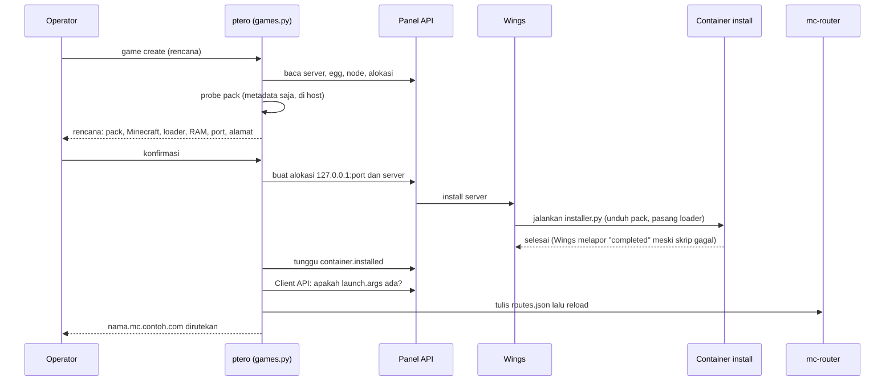

# Arsitektur dan keputusan desain

> **Jenis:** Konsep · **Untuk:** operator dan peninjau yang ingin memahami mengapa sistem dirancang begini · **Diperbarui:** 2026-10-20

Panel dan basis datanya berjalan sebagai container Docker yang hanya mendengar di loopback atau jaringan internal. Wings berjalan sebagai layanan systemd di host (atau, opsional untuk Docker Desktop, sebagai container). Cloudflare Tunnel membawa lalu lintas web masuk tanpa membuka port. Minecraft memakai satu router berbasis nama di satu port publik. Halaman ini menjelaskan komponen, port, alur lalu lintas, versi yang dipatok, dan alasan di balik tiap pilihan. Kontrol keamanan dan risiko sisanya ada di [Keamanan](security.md).

## Komponen

| Komponen | Cara jalan | Jaringan | Data |
|---|---|---|---|
| Panel (`ghcr.io/pterodactyl/panel`) | container; web, queue worker, dan scheduler dalam satu container; `pids_limit` 512 | `edge` dan `backend`; port `127.0.0.1:${PANEL_BIND_PORT}` → 80 | volume `panel_var` (**`APP_KEY`**), `panel_extensions`, `panel_extension_assets`, `panel_logs`, `panel_nginx` |
| MariaDB 11.4 | container; `pids_limit` 256; kata sandi root acak dan tidak disimpan | hanya `backend` (internal, tanpa rute keluar), tanpa port terpublikasi | volume `db_data` |
| Redis 7.4 | container, user 999:1000, `cap_drop ALL`, rootfs read-only, kata sandi lewat berkas di tmpfs | hanya `backend`, tanpa port terpublikasi | volume `redis_data` (AOF) |
| cloudflared | container, `network_mode: host`, rootfs read-only, `cap_drop ALL` | host; hanya koneksi keluar | tidak ada (token dari `secrets/tunnel_token`) |
| Wings | **biner + systemd di host**, root, `127.0.0.1:${WINGS_API_PORT}` | host | `/etc/pterodactyl`, `/var/lib/pterodactyl` (dikelola Wings) |
| Wings (opsional, `WINGS_MODE=container`) | container Wings dan container `egress-guard`, keduanya dari `compose.wings.yml` di balik profil `wings`; Wings memegang `docker.sock` | Wings di jaringan `edge`, `127.0.0.1:${WINGS_API_PORT}` dan SFTP; `egress-guard` di jaringan host daemon dengan `NET_ADMIN` | volume `wings_etc` (config dan token node); bind mount path identik `/var/lib/pterodactyl`, `/tmp/pterodactyl`, `/var/log/pterodactyl`, `/run/wings` |
| mc-router (opsional, `GAMES_ENABLED=yes`) | container, `network_mode: host`, rootfs read-only, `cap_drop ALL`; satu-satunya bind mount adalah tabel nama host (read-only) | host; **mendengar di `0.0.0.0:${GAMES_PORT}`**, meneruskan ke `127.0.0.1:25600-25699` | `runtime/mc-router/routes.json` (nama host ke port; bukan rahasia) |
| Server game | container yang dibuat Wings, alokasi `127.0.0.1:<port>` | jaringan `pterodactyl_nw` (dibuat Wings, nama bridge `pterodactyl0`, subnet `GAME_NET_SUBNET`) dengan egress guard | `/var/lib/pterodactyl/volumes` |

Nama project Compose adalah `pterodactyl` (ubah dengan variabel lingkungan `PTERO_PROJECT`; lihat peringatannya di [Referensi konfigurasi](configuration.md#variabel-lingkungan)). Volume menjadi `pterodactyl_<nama>`. Semua container memakai `no-new-privileges`, batas memori, dan rotasi log (10 MB × 3 berkas).

## Matriks port dan firewall

Tidak ada port masuk yang perlu dibuka untuk Panel maupun Wings API. Dengan `GAMES_ENABLED=yes` ditambah satu: `GAMES_PORT` (25565/tcp) milik mc-router. Server game sendiri (`25600-25699`) tidak pernah dibuka.

| Port | Dengar di | Arah | Dibuka di firewall? |
|---|---|---|---|
| 22/tcp (SSH; port apa pun yang dipakai sshd) | host | masuk | **ya**, dideteksi otomatis; konfigurasi SSH tidak diubah |
| 25565/tcp (`GAMES_PORT`, mc-router; hanya bila `GAMES_ENABLED=yes`) | `0.0.0.0` | masuk | **ya**, satu-satunya port game |
| 25600-25699 (server game) | **127.0.0.1** | lokal | **tidak**, tidak pernah |
| 8081 (Panel) | **127.0.0.1** | lokal | **tidak** |
| 443 (Wings API) | **127.0.0.1** | lokal | **tidak** |
| 20241 (metrik/kesiapan cloudflared) | **127.0.0.1** | lokal | **tidak** |
| 2022 (Wings SFTP) | **127.0.0.1** secara bawaan (`WINGS_SFTP_BIND`) | lokal | **tidak**. SFTP bukan HTTP dan tidak lewat Cloudflare; lihat di bawah bila pengguna membutuhkannya |
| 7844/tcp+udp ke Cloudflare | - | **keluar** | izinkan keluar |
| 443/tcp ke ghcr.io, docker.io, github.com, Cloudflare | - | keluar | izinkan keluar |
| 25/465/587 (SMTP) | - | keluar | hanya bila Anda mengonfigurasi email di Panel |

Bila nanti SFTP diperlukan: set `WINGS_SFTP_BIND=0.0.0.0`, jalankan ulang `sudo ./ptero wings configure <berkas>`, lalu `sudo ./ptero firewall apply` (membuka 2022/tcp).

### Firewall (ufw)

`./ptero firewall` mengelola ufw dan tidak pernah dijalankan otomatis oleh `setup`.

| Perlindungan | Cara |
|---|---|
| SSH tidak terputus | port SSH dideteksi dari `sshd -T`, sshd yang sedang mendengar, dan sesi SSH Anda sendiri; aturan SSH ditambahkan **sebelum** ufw dinyalakan; setelah dinyalakan, skrip memeriksa dari aturan aktif bahwa port SSH diterima dan, bila tidak, mematikan ufw seketika |
| Salah konfigurasi tidak mengunci Anda | bila ufw sebelumnya mati, *dead-man switch* (`systemd-run`, bawaan 300 detik) mematikan ufw lagi **kecuali** Anda menjalankan `sudo ./ptero firewall confirm` dari sesi SSH *baru*. Tanpa `systemd-run`, `apply` menolak berjalan kecuali Anda menyetel `FIREWALL_ROLLBACK_SECONDS=0` |
| Tidak melumpuhkan diri sendiri | menolak berjalan bila port SSH tidak terdeteksi, bila sesi SSH Anda memakai port di luar daftar, atau bila `FIREWALL_SSH_ALLOW_CIDRS` tidak memuat alamat Anda sendiri |
| Tidak menghapus aturan Anda | hanya menambah aturan `ptero: ...`; kebijakan *forwarding* (Docker) tidak disentuh; keadaan sebelumnya disimpan di `backups/firewall-before-<waktu>.txt` |
| Pembatasan opsional | `FIREWALL_SSH_ALLOW_CIDRS` (SSH hanya dari alamat tertentu), `FIREWALL_SSH_LIMIT=yes` (batas laju), `FIREWALL_GAME_ALLOW_CIDRS` (komunitas tertutup) |

Port yang dipublikasikan Docker melewati aturan ufw biasa. Karena semua port di sini terikat ke `127.0.0.1` (dan mc-router memakai jaringan host, sehingga ufw berlaku padanya), itu tidak berdampak. `./ptero audit` memeriksa hasilnya: semua listener di luar loopback dan semua container yang menerbitkan port ke `0.0.0.0`.

### Egress guard

`sudo ./ptero firewall egress install` memasang unit `ptero-egress-guard.service`. Jaringan game (`GAME_NET_SUBNET`; bila config Wings sudah ada, subnet dari sana yang dipakai) tidak boleh membuka koneksi ke `10.0.0.0/8`, `172.16.0.0/12`, `192.168.0.0/16`, `169.254.0.0/16` (termasuk metadata cloud `169.254.169.254`), dan `100.64.0.0/10`, serta tidak boleh membuka koneksi *baru* ke host sendiri (rantai `INPUT`). Balasan untuk koneksi pemain yang masuk tetap lewat karena aturan `conntrack ESTABLISHED,RELATED` dipasang di atas aturan blokir. Aturan dipasang di rantai `DOCKER-USER` dan dipasang ulang setiap boot setelah Docker menyala.

Status verifikasi: **Nyata** dengan iptables asli di network namespace dan trafik sungguhan (2026-10-20); **Otomatis** dengan iptables tiruan; **belum diuji** pada host VPS. Detail dan temuannya di [Verifikasi](verification.md).

## Satu pintu per protokol

| Protokol | Pintu | Aturan |
|---|---|---|
| HTTP(S) dan WebSocket (Panel, Wings, konsol) | Cloudflare Tunnel → `cloudflared` | tanpa port masuk; origin hanya `127.0.0.1` |
| Minecraft Java (TCP) | `mc-router` di `GAMES_PORT` | hanya nama host yang dikenal diteruskan; tabel nama dibangun dari daftar server di Panel |
| Shell admin | SSH | apa adanya; opsional dibatasi alamat sumber |

Tidak ada protokol game lain yang dirutekan; lihat [Server Minecraft](games.md#game-selain-minecraft-java).

## Mengapa Wings bukan container

Pilihan resmi yang didokumentasikan upstream untuk Wings adalah **biner + unit systemd** (halaman *Installing Wings* menyatakan tidak membahas image Docker atau Compose untuk Wings). Pertimbangannya:

| Aspek | Wings di host (dipilih) | Wings di container |
|---|---|---|
| Dukungan upstream | jalur terdokumentasi | tidak dibahas docs v2 |
| Identitas path data | otomatis benar (`/var/lib/pterodactyl` adalah path host) | container dan host harus memakai path identik; salah sedikit berarti server terinstal di satu direktori dan berjalan dari direktori lain |
| Akses Docker socket | proses root di host | container root yang memegang `/var/run/docker.sock` (setara root host juga) |
| Siklus hidup | berjalan sebagai service, restart sendiri, tidak ikut `compose down` | ikut Compose |
| Keamanan | sama (Wings setara root host karena socket) | tidak lebih aman |
| Biaya | satu langkah `sudo` terpisah | satu perintah Compose |

Uji awal mencatat bahwa Wings di dalam container pada Docker Desktop gagal menjalankan server game: bind mount `/etc/machine-id` ke container game gagal (`not a directory`). Penyebabnya kini diketahui, dan itu bukan batasan Docker Desktop. Wings menulis file machine-id per server di `/run/wings/machine-id` lalu meminta daemon me-mount-nya. Daemon menyelesaikan path itu di sisinya sendiri; bila `/run/wings` tidak identik di kedua sisi, daemon membuat **direktori** kosong di path sumber (dua container game sisa uji lama masih memperlihatkannya) dan mount ke berkas gagal. Dengan mount identitas di `compose.wings.yml`, container game berjalan dan `/etc/machine-id`-nya berupa berkas ([Verifikasi](verification.md#wings-sebagai-container-di-docker-desktop-daemon-nyata)). Karena itu mode container tersedia sebagai pilihan **opsional** untuk Docker Desktop (`WINGS_MODE=container`); di VPS pakai host.

Wings tidak lebih aman di container, jadi kesederhanaan dan dukungan resmi menang, dan mode host tetap bawaan. Satu keadaan membuat host tidak cukup: di Docker Desktop, "host" bagi cloudflared adalah VM Docker Desktop, bukan distro WSL, jadi Wings systemd di distro tidak terjangkau dari tunnel (route Wings memberi `502`). Sebagai container, port API Wings dipublikasikan di loopback VM yang sama dengan tunnel. Risiko tambahannya ada di [Keamanan](security.md#wings-sebagai-container-risiko-tambahan). Konsekuensinya: cloudflared memakai jaringan host agar bisa menjangkau Wings di `127.0.0.1` tanpa membukanya ke jaringan lain. cloudflared hanya membuat koneksi keluar; risikonya, bila konektornya dibobol, ia bisa mencapai layanan loopback lain di host. Jangan menjalankan layanan sensitif lain yang hanya mengandalkan "bind ke loopback" di mesin yang sama.

Unit systemd tidak memakai batas laju start upstream (30 start per 180 detik): setelah reboot Wings bisa start sebelum container Panel dan tunnel siap, dan harus terus mencoba. Unit memakai `StartLimitIntervalSec=0`, `Restart=on-failure`, dan `RestartSec=10s`.

## Alur traffic

1. **Browser ke Panel.** `https://PANEL_FQDN` → Cloudflare → tunnel → `cloudflared` → `http://127.0.0.1:8081` → Panel.
2. **Browser ke konsol server (WebSocket).** `wss://WINGS_FQDN` → Cloudflare → tunnel → `http://127.0.0.1:443` → Wings. Origin Wings tidak pernah berupa nama internal Docker; browser memakai nama host publik HTTPS.
3. **Panel ke Wings (server ke server).** Container Panel keluar lewat `edge` ke `https://WINGS_FQDN`, melewati Cloudflare dan kembali seperti jalur browser.
4. **Wings ke Panel.** Kunci `remote` di config Wings. `WINGS_REMOTE_MODE=public` (bawaan, sesuai docs) memakai `https://PANEL_FQDN`; `internal` memakai `http://127.0.0.1:${PANEL_BIND_PORT}` tanpa melewati Cloudflare. Mode `internal`: heartbeat terbukti di stack lama; WebSocket konsol browser belum diuji dengan mode ini.
5. **Pemain ke server Minecraft.** TCP ke `nama.mc.contoh.com:25565` → ufw → `mc-router` membaca nama host di handshake → `127.0.0.1:<port server>` (container Wings).

Panel hanya mempercayai header `X-Forwarded-*` dari subnet jaringan `edge` (`PANEL_EDGE_SUBNET`, bawaan `172.29.250.0/24`): koneksi dari cloudflared ke port loopback Panel datang dari gateway jaringan itu. Wings mempercayai `127.0.0.1` (asal cloudflared) lewat `api.trusted_proxies`, supaya IP klien asli tercatat di log aktivitas. Perilaku header ini pada NAT Docker host nyata **belum diuji**.

### Pembuatan server game

Urutan yang dijalankan `./ptero game create`, dari rencana sampai rute:

## Versi dan risiko beta

`config/versions.env` mematok semuanya **dengan digest**. Hasil verifikasi pada 2026-10-19 dan diperbarui 2026-10-20:

| Komponen | Pin | Status upstream |
|---|---|---|
| Panel | `v2.0.0-beta.2` (14 Okt, *pre-release*) | **Beta.** Rilis stabil terbaru `v1.15.1`. Catatan rilis beta.1: "keep production panels on 1.x for now". Dokumen Docker 2.0 menyatakan memindahkan basis data 1.x ke image ini belum teruji |
| Wings | `v1.13.4` | Stabil. Docs menyebut 1.13.2 sampai 1.13.4 diuji dengan Panel 2.0 |
| MariaDB | `11.4` | LTS; sama dengan contoh Compose upstream |
| Redis | `7.4-alpine` | sama dengan contoh Compose upstream |
| cloudflared | `2026.10.1` | rilis stabil terbaru saat verifikasi |
| mc-router | `1.47.2` (4 Okt; `1.48.0` ada sejak 14 Okt, belum dipakai) | stabil; hanya bila `GAMES_ENABLED=yes` |
| Container install egg | `python:3.12-slim-bookworm` (digest) | Python sudah ada di image, jadi install tidak memakai apt. Java untuk installer Forge, NeoForge, dan Quilt diunduh sementara oleh installer ke folder server dan dihapus setelahnya |
| Image Java server game | `ghcr.io/pterodactyl/yolks:java_N` (tag, bukan digest) | konvensi Pterodactyl; diperbarui upstream |

Konsekuensi memilih beta: skema basis data 2.0 tidak bisa diturunkan ke 1.x; dokumentasi 2.0 berubah antar-beta; update antar-beta harus dibaca catatan rilisnya. Mitigasi di sini: pin digest, backup wajib sebelum `update`, `restore` menolak backup dari image Panel yang berbeda tanpa `--allow-version-mismatch`, dan gerbang `PTERO_ACCEPT_BETA`.

**Memakai Panel 1.x stabil?** Tidak didukung oleh repositori ini. Kontrak image 1.x berbeda (`CACHE_DRIVER`, `QUEUE_DRIVER`, `MAIL_DRIVER`, `MYSQL_*` alih-alih `CACHE_STORE`, `QUEUE_CONNECTION`, `MARIADB_*`), jadi `compose.yml` dan validasinya harus disesuaikan, dan itu belum diverifikasi. Untuk instalasi baru yang tidak membutuhkan fitur 2.0, jalur 1.x lebih konservatif; kerjakan sebagai proyek terpisah.

Mengubah versi: edit `config/versions.env` (tag **dan** digest; untuk Wings juga sha256 kedua arsitektur), jalankan `./ptero update --check`, lalu `./ptero update` dan `sudo ./ptero wings update`. Langkah rinci mengambil digest dan hash ada di [Pengembangan](development.md#menaikkan-versi).

## Keputusan desain

Pilihan berikut membentuk perilaku yang mungkin mengejutkan Anda. Tiap baris menyebut alasannya.

| Keputusan | Alasan |
|---|---|
| Tunnel yang hanya keluar, origin di loopback | tidak ada port web yang bisa dipindai; mengompromikan satu layanan web tidak membuka layanan lain ke internet |
| Router berbasis nama untuk game, bukan port per server | satu port publik, satu record DNS wildcard, dan IP langsung ditolak. Konsekuensinya IP server terlihat lewat DNS (lihat [Jujur soal IP](games.md#jujur-soal-ip)) |
| Digest, bukan tag | tag bisa dipindahkan; digest memastikan yang berjalan sama dengan yang Anda uji |
| Konfigurasi di-*parse*, bukan di-`source` | salah ketik atau `$(...)` yang tertempel tidak pernah menjalankan kode |
| Rahasia di berkas mode 600, tidak di argumen atau riwayat shell | argumen proses terlihat oleh pengguna lain; riwayat shell tersimpan |
| Tanpa `set -e`; setiap langkah yang bisa gagal dicek dan berakhir pada pesan yang menyebut langkah berikutnya | `set -e` membuat kegagalan di tengah operasi tidak terduga; di sini setiap kegagalan harus menjelaskan keadaan data |
| Tidak ada perintah yang menghapus volume, backup, atau data Wings | penghapusan data adalah keputusan manusia setelah backup di luar server terverifikasi |
| Tidak memakai API Cloudflare dan tidak meminta token-nya | mengurangi izin yang berada di server; langkah Cloudflare manual dan didokumentasikan |
| Wings memverifikasi sha256 sebelum memasang biner | rilis GitHub diambil lewat HTTPS, tetapi pin hash melindungi dari biner yang berubah |
| `update` dan `restore` memaksa backup lebih dulu | migrasi Panel tidak bisa dibalik; satu-satunya rollback adalah memulihkan backup |

## Batas resource

Bawaan (ubah di `deploy.env`): Panel 1 GB, MariaDB 1 GB (`innodb_buffer_pool_size` 256 MB, 60 koneksi), Redis 256 MB, cloudflared 128 MB, mc-router 128 MB. Pada stack uji sebelumnya, container idle memakai sekitar 0,3 GB total. Wings dan server game membutuhkan RAM terpisah (modpack besar: 4 sampai 8 GB per server; lihat [Server Minecraft](games.md)); total memori semua server dibatasi oleh memori node di Panel, dan `game create` menolak server yang melebihi kapasitas node.
