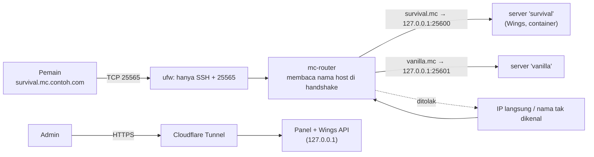

# Server Minecraft: modpack langsung dari CurseForge atau Modrinth, satu gerbang, satu nama per server

> **Jenis:** Konsep + panduan · **Untuk:** operator yang ingin membuat server Minecraft Java dari modpack · **Prasyarat:** Panel dan Wings berjalan ([Instalasi lengkap](installation.md)) · **Status verifikasi:** router, install lewat Wings, dan installer **nyata**; menjalankan server lewat Wings dan CurseForge dengan kunci nyata **belum diuji** (rincian di bagian akhir)

Satu perintah, `./ptero game create`, membaca modpack, menampilkan rencana, membuat server di Panel, menunggu Wings memasang pack dan loader-nya, memverifikasi hasilnya, dan merutekan nama `nama-server.mc.contoh.com` ke server itu. Pemain mengetik nama tanpa port. Seluruh server game hanya mendengar di `127.0.0.1`; satu-satunya jalan masuk dari internet adalah router berbasis nama di port 25565. Fitur ini opsional dan tidak berjalan sebelum `GAMES_ENABLED=yes`.

## Cara kerjanya



- **Satu pintu publik untuk game.** `mc-router` mendengar di `GAMES_PORT` (25565). Klien Minecraft mengirim nama host yang diketik pemain di awal koneksi; router meneruskan ke server yang cocok. **Koneksi lewat IP, nama yang tidak dikenal, atau nama kosong ditolak** (diuji pada image asli dengan handshake Minecraft nyata; lihat [Verifikasi](verification.md)).
- **Server game tidak punya port publik.** Alokasinya `127.0.0.1:<25600-25699>`, sehingga tidak ada jalan masuk selain router.
- **Satu nama per server, otomatis.** Nama server `Survival Utama` menjadi `survival-utama.mc.contoh.com`. Router membaca tabel nama dari daftar server di Panel (`./ptero games sync`, otomatis setiap 2 menit bila timer dipasang, dan langsung saat `game create`). Tidak ada record DNS per server: **satu record wildcard** cukup.
- **Web (HTTP) tetap lewat Cloudflare Tunnel** (gerbang web): Panel dan Wings. SSH tetap seperti biasa.

### Aturan nama host

- Nama host adalah `slug(nama server).GAMES_DOMAIN`. Slug: huruf kecil, setiap rangkaian karakter selain huruf dan angka menjadi satu `-`, maksimum 40 karakter. Nama yang tidak menghasilkan slug ditolak.
- Dua server yang menghasilkan nama host sama membuat `sync` berhenti dengan pesan yang menyebut keduanya; ganti nama salah satu. `game create` menolak nama server atau nama host yang sudah dipakai.
- Server yang *suspended*, atau yang alokasinya bukan `127.0.0.1`, tidak dirutekan. `games sync` dan `games list` mencetak alasannya sebagai `note:` (alokasi bukan loopback akan terjangkau langsung, jadi sengaja tidak dirutekan).
- Hanya server yang egg-nya bernama mengandung "minecraft" yang dirutekan.
- Opsi `--label` pada `game create` saat ini **tidak mengubah nama host yang dirutekan**; lihat catatan di [Referensi perintah](commands.md#opsi-game-create). Beri server nama yang menghasilkan nama host yang Anda inginkan.

### "Port atau path?"

Untuk game TCP **tidak ada path**: path adalah konsep HTTP, dan protokol Minecraft tidak punya. Yang tersedia adalah **nama** (subdomain), dan itu yang dipakai di sini; pemain tidak perlu mengetik port. Add-on web milik server (misalnya peta Dynmap) adalah HTTP biasa: tambahkan hostname sendiri di tunnel (dashboard) yang menunjuk ke port web server itu, atau pakai path di belakang reverse proxy sendiri. Itu tidak diotomatisasi di sini.

### Jujur soal IP

Record DNS wildcard harus **DNS only** (awan abu-abu); proxy Cloudflare tidak membawa Minecraft. Artinya IP server terlihat oleh siapa pun yang me-resolve nama. Yang membatasi akibatnya: firewall (hanya SSH dan 25565 terbuka), router (hanya nama yang dikenal diteruskan), dan egress guard. Menyembunyikan IP sepenuhnya memerlukan relay yang membawa TCP (layanan tunnel game, VPS relay, atau Cloudflare Spectrum pada paket yang mendukung; lihat [Cloudflare](cloudflare.md#trafik-game-tidak-bisa-lewat-tunnel-ini)).

## Menyiapkan (sekali)

```bash
# 1. config/deploy.env
GAMES_ENABLED=yes
GAMES_DOMAIN=mc.contoh.com           # nama khusus; server menjadi <nama>.mc.contoh.com

# 2. Panel: Admin -> Application API -> buat kunci dengan:
#    Servers R+W, Allocations R+W, Nodes R, Eggs R, Users R
./ptero key set panel                # tempel kunci ptla_... (input tersembunyi)
./ptero key set client               # disarankan: Client API (ptlc_) dari akun admin (Account -> API Credentials), untuk memverifikasi install
./ptero key set curseforge           # opsional, hanya untuk sumber CurseForge: kunci milik Anda dari console.curseforge.com

./ptero setup                        # menyalakan mc-router bersama Panel
./ptero egg install                  # memasang egg "Minecraft Modpack (CurseForge / Modrinth)" ke Panel
./ptero games dns                    # mencetak SATU record DNS wildcard yang perlu dibuat (A, DNS only)

./ptero firewall plan                # lihat dulu
sudo ./ptero firewall apply          # lalu konfirmasi dari sesi SSH BARU: sudo ./ptero firewall confirm
sudo ./ptero firewall egress install # server game tidak boleh menjangkau host, LAN, metadata cloud
sudo ./ptero games timer install     # hostname selalu sinkron dengan Panel (tiap 2 menit)
./ptero audit                        # hanya SSH dan 25565 yang terlihat dari luar
```

`GAME_NET_SUBNET` (bawaan `172.18.0.0/16`) harus sama dengan `docker.network.interfaces.v4.subnet` di config Wings. Bila config Wings sudah terpasang, nilai dari sana yang dipakai dan perbedaannya diperingatkan. `preflight` (dan `setup`) menolak subnet game yang tumpang tindih dengan jaringan Docker lain, jaringan `pterodactyl_nw` yang sudah ada tetapi dengan subnet IPv4 berbeda, dan nama bridge `pterodactyl0` bila dipakai jaringan lain.

**Periksa** setelah `setup`:

```bash
./ptero games status
```

```text
mc-router      running
game port      25565 listening
routes         0 entries in /opt/pterodactyl/runtime/mc-router/routes.json
```

Kode keluar 1 bila router tidak berjalan atau port tidak mendengar. Pemeriksaan port dijalankan dari container berjaringan host, karena pada Docker Desktop port host tidak terlihat dari shell.

## Membuat server dari modpack

```bash
# Modrinth: slug dari modrinth.com/modpack/<slug>
./ptero game create --name "Survival" --source modrinth --pack adrenaserver

# CurseForge: slug dari curseforge.com/minecraft/modpacks/<slug> (atau id numerik)
./ptero game create --name "Kampung" --source curseforge --pack all-the-mods-10 --mc 1.21.1

# tautan https langsung ke .mrpack atau zip server-pack
./ptero game create --name "Uji" --source url --pack https://contoh.com/pack.mrpack
```

Opsi lain (`--version`, `--mc`, `--loader`, `--memory`, `--disk`, `--cpu`, `--port`, `--owner`, `--no-wait`) beserta bawaannya ada di [Referensi perintah](commands.md#opsi-game-create).

Urutannya:

1. **Rencana** ditampilkan tanpa mengubah apa pun: pack, versi Minecraft, loader, Java, RAM (otomatis dari jumlah mod: kurang dari 120 mod 4 GB, 120 sampai 199 mod 6 GB, 200 mod atau lebih 8 GB), port, dan alamat pemain.
2. Anda mengonfirmasi (`--yes` untuk otomasi).
3. Alokasi `127.0.0.1:<port>` dibuat bila perlu, server dibuat lewat API Panel, dan Wings menjalankan **install**: mengunduh pack (hash diverifikasi), memasang loader, menulis `launch.args`.
4. `game create` menunggu Wings dan memverifikasi hasilnya (di bawah).
5. Hostname masuk ke router.

Contoh keluaran rencana (nilai berbeda per pack):

```text
probing modrinth:adrenaserver ...
pack    : Adrenaserver 1.2.3  Minecraft 1.20.1  loader forge  mods 87
server   : 'Survival' on node 1, 127.0.0.1:25600 (allocation will be created)
resources: 4096 MB RAM (node 0/16384 used), 20480 MB disk, CPU 400%, image ghcr.io/pterodactyl/yolks:java_17
address  : survival.mc.contoh.com  (players connect to this name on port 25565, no port needed)

plan only. Nothing was created.
```

Setelah konfirmasi, keluaran dilanjutkan dengan `created server id=... uuid=...`, `waiting for Wings to run the install ...`, `install finished.`, `verified: launch.args is in place`, dan `routed: survival.mc.contoh.com -> 127.0.0.1:25600`.

**Server tidak dinyalakan otomatis.** Buka server di Panel dan tekan **Start**. Saat konsol menampilkan persyaratan EULA Mojang, Panel meminta pemilik menerimanya (fitur `eula`); EULA tidak pernah diterima otomatis. Setelah itu pemain terhubung ke `survival.mc.contoh.com` tanpa port.

Dari UI Panel juga bisa: *Admin → Servers → Create*, pilih egg itu, alokasi `127.0.0.1:256xx`, isi variabel *Modpack source / ID*. Hostname-nya muncul lewat timer atau `./ptero games sync`. `game create` lebih praktis karena ia membaca pack lebih dulu untuk memilih image Java dan RAM yang benar.

### Verifikasi install

Wings 1.13.4 menandai install `completed` juga ketika skrip install keluar dengan kode gagal (terlihat saat uji: exit 127 dan traceback). Karena itu, bila `./ptero key set client` sudah diisi, `game create` menunggu Wings melapor selesai (batas 40 menit; 4 menit tanpa laporan dari Wings dianggap gagal) lalu memeriksa lewat Client API bahwa `launch.args` ada. Tidak ada `launch.args` berarti skrip gagal walau Panel berkata selesai: perintah berhenti dengan kode 1, **tidak menulis rute**, dan servernya tetap ada di Panel. Perbaiki penyebabnya di Console server, lalu Reinstall. Tanpa kunci client, perintah hanya mencetak `warning: not verified` dan tetap menulis rute.

### Yang dipasang egg

| Sumber | Perilaku |
|---|---|
| Modrinth | Versi rilis terbaru (atau `MODPACK_VERSION`); `.mrpack` diunduh dan di-hash (sha512); setiap file diunduh dari host yang diizinkan spesifikasi (`cdn.modrinth.com`, `github.com`, `raw.githubusercontent.com`, `gitlab.com`) dan di-hash; file `env.server: unsupported` dilewati; `overrides/` lalu `server-overrides/` diterapkan |
| CurseForge | **Server pack** bila ada (sha1 diverifikasi); bila tidak, mod client pack di-resolve satu per satu lewat API. Mod yang ditandai penulis *client-only* dilewati. Bila penulis menonaktifkan unduhan API untuk sebuah mod, instalasi berhenti dengan daftar mod itu |
| `url` | Tautan https publik ke `.mrpack` atau zip server-pack; alamat privat, loopback, dan metadata ditolak, juga lewat redirect |

Loader: Fabric dan Forge atau NeoForge dipasang otomatis bila pack tidak membawa peluncur sendiri. Quilt memakai installer resminya (kode ada, **belum diuji** pada pack nyata). Java ditentukan dari data resmi Mojang (versi `26.x` memerlukan **Java 25**, `1.20.5` ke atas Java 21, `1.18` sampai `1.20.4` Java 17, `1.16` ke bawah Java 8).

Kontainer instalasi memakai image Python (`python:3.12-slim-bookworm`) yang tidak membawa Java. Untuk loader yang harus menjalankan installer Java (Forge, NeoForge, Quilt), installer mengunduh JRE Temurin sementara dari Adoptium sesuai versi Java yang dibutuhkan, menyimpannya di folder server (`.ptero-jre`), dan menghapusnya setelah install. JRE tidak ditaruh di `/tmp` karena Wings membatasi `/tmp` container (`tmpfs_size`, bawaan 100 MB) dan JRE lebih besar dari itu. Image Docker server (`ghcr.io/pterodactyl/yolks:java_N`) dipilih sesuai kebutuhan Java saat `game create`.

### Variabel egg

| Variabel | Bawaan | Terlihat dan bisa diubah pemilik | Fungsi |
|---|---|---|---|
| `MODPACK_SOURCE` | `modrinth` | ya | `modrinth`, `curseforge`, atau `url` |
| `MODPACK_ID` | kosong | ya | slug atau id pack, atau tautan untuk `url` (wajib, maksimum 500 karakter) |
| `MODPACK_VERSION` | kosong | ya | versi atau id berkas; kosong = rilis terbaru |
| `MODPACK_MC_VERSION` | kosong | ya | filter versi Minecraft (angka dan titik) |
| `JAVA_FLAGS` | `-XX:+UseG1GC -XX:+ParallelRefProcEnabled -XX:MaxGCPauseMillis=200 -XX:+DisableExplicitGC` | ya | tambahan argumen JVM |
| `CURSEFORGE_API_KEY` | kosong (diisi dari `secrets/curseforge_api_key`) | **tidak** | kunci CurseForge; disembunyikan di UI, tetapi terlihat oleh proses game (lihat keamanan) |

Perintah startup: `java -Xms128M -XX:MaxRAMPercentage=80.0 {{JAVA_FLAGS}} -Dterminal.jline=false -Dterminal.ansi=true $(cat launch.args) nogui`.

### Reinstall dan update pack

Ubah `MODPACK_VERSION`, lalu *Settings → Reinstall*. Hanya file yang dulu dipasang installer di `mods/` dan `libraries/` yang dihapus; mod yang Anda taruh sendiri, dunia (`world*`), `server.properties`, `config/`, `ops.json`, `whitelist.json`, daftar ban, `eula.txt`, log, dan backup **tidak** ditimpa. Buat backup di Panel sebelum update besar.

## Keamanan yang perlu Anda tahu

- **Mod adalah kode bebas** di JVM server. Pertahanan di sini: server hanya `127.0.0.1`, egress guard memblokir jaringan game ke host, LAN, dan metadata cloud, serta `online-mode=true` dan `enable-rcon=false` secara bawaan. Tetap pakai pack dari sumber yang Anda percaya dan uji di server cadangan. Container game masih dapat mengakses internet umum.
- **Kunci CurseForge terlihat oleh proses game.** Semua variabel egg menjadi environment container; variabel itu disembunyikan dari pemilik server di UI, tetapi mod yang berjalan dapat membacanya. Pakai kunci khusus berprivilese rendah dan putar bila perlu, atau pakai sumber Modrinth atau `url` yang tidak memerlukannya.
- **Pemilik server dapat mengubah `MODPACK_SOURCE` dan `MODPACK_ID`** dan reinstall. Sumber `url` sudah menolak alamat privat; server game sendiri juga diisolasi oleh egress guard. Batasi siapa yang boleh membuat atau mengatur server di Panel.
- Server melihat sambungan dari router (alamat lokal), bukan IP asli pemain: **ban dan whitelist berdasarkan akun (UUID), bukan IP**. Batas laju koneksi baru router: `GAMES_CONN_RATE` per detik (bawaan 10).
- Server publik tanpa whitelist menerima siapa saja yang tahu nama host. Untuk komunitas tertutup: whitelist di server, atau `FIREWALL_GAME_ALLOW_CIDRS` untuk membatasi alamat sumber di firewall.
- Ekstensi Panel berbayar seperti *Modpack Installer for Blueprint* ([BuiltByBit](https://builtbybit.com/resources/modpack-installer-for-blueprint.40083/)) dibuat untuk Blueprint di Panel 1.x. Panel 2.0 punya sistem ekstensi sendiri dan upstream menyatakan modifikasi addon 1.x tidak terbawa; kompatibilitasnya **tidak diuji** di sini dan tidak dibutuhkan: egg ini bekerja tanpa ekstensi.

Model ancaman lengkap: [Keamanan](security.md).

## Status verifikasi

| Hal | Status |
|---|---|
| Router: nama terdaftar diteruskan; IP langsung, nama tak dikenal, nama kosong ditolak | **Nyata** (handshake Minecraft sungguhan pada image asli) |
| `games sync` dari data Panel nyata | **Nyata** |
| Install modpack lewat Wings (Forge 1.20.1) termasuk `launch.args` dan penghapusan JRE sementara | **Nyata** |
| Installer dengan jaringan nyata: Fabric (Modrinth, Minecraft 26.2 → Java 25), Forge 1.20.1, NeoForge 1.21.1, Forge 1.12.2 (JRE 8 sementara) | **Nyata**; keempatnya memuat loader dan mod lalu berhenti di persyaratan EULA (EULA tidak diterima oleh pengujian) |
| Menjalankan server game lewat Wings | **Nyata** di Docker Desktop dengan Wings sebagai container (server uji dengan image `yolks`, bukan Minecraft); **belum diuji** dengan modpack nyata dan di VPS |
| CurseForge dengan kunci nyata | **Belum diuji** (diuji dengan mock) |
| Quilt dan pack Forge atau NeoForge berukuran besar | **Belum diuji** |
| Logika `game create`, `games sync`, installer | **Otomatis** (mock Panel, Modrinth, CurseForge, CDN) |

## Game selain Minecraft Java

Tidak diotomatisasi. Protokol lain tidak membawa nama host di handshake (Bedrock memakai UDP 19132), jadi tidak bisa dibagi satu port dengan router ini. Untuk itu: alokasi dengan port sendiri, aturan `ufw allow <port>/udp` (atau tcp), dan record SRV atau `A` ke port itu; semuanya keputusan terpisah. `./ptero audit` menandai port publik baru sebagai tak terduga sampai Anda memasukkannya ke daftar yang diharapkan.

## Pemecahan masalah

| Gejala | Penyebab | Tindakan |
|---|---|---|
| `game create`: `the egg ... is not installed` | egg belum diimpor | `./ptero egg install` |
| `game create`: `cannot read the pack` | slug salah, kunci CurseForge kosong, pack tanpa file yang cocok | periksa slug dan `--mc`; `./ptero key set curseforge` untuk CurseForge |
| `game create`: `not enough node memory` | total RAM server di node melebihi kapasitas node | kecilkan `--memory` atau hapus server lain (di Panel) |
| `the Panel rejected the API key` | kunci salah jenis (`ptlc_`), atau izin kurang | buat kunci Application (`ptla_`) dengan izin pada daftar di atas |
| `games sync`: `not routed ... Allocations: Read?` | kunci tanpa izin Allocations | tambahkan izin, lalu `./ptero games sync` |
| `... not routed (it would be reachable directly)` | alokasi server bukan `127.0.0.1` | pakai alokasi `127.0.0.1:256xx` |
| Server **Install failed** | pack tidak bisa diunduh atau diverifikasi, mod diblokir penulis, loader tidak tersedia | baca output install di Panel; pesan diawali `[modpack]` |
| `game create`: `launch.args is missing` | Wings menandai install selesai, tetapi skrip install gagal | buka Console server di Panel, perbaiki penyebabnya, lalu Reinstall; rute belum ditulis |
| `warning: not verified` setelah `game create` | belum ada kunci client, jadi `launch.args` tidak diperiksa | `./ptero key set client`, atau cek Console sebelum Start |
| Install gagal dengan `No space left on device` | disk host penuh (versi lama memakai tmpfs 100 MB untuk JRE; itu sudah dihapus) | `df -h`; bersihkan ruang, lalu Reinstall |
| Pemain: koneksi langsung ditutup | nama host tidak ada di tabel (salah ketik, server baru belum disinkronkan, server ditangguhkan), atau konek lewat IP | `./ptero games list`; `./ptero games sync` |
| Pemain: `Can't resolve hostname` | record wildcard belum ada atau belum menyebar | `./ptero games dns`; `nslookup x.mc.contoh.com` |
| Server berhenti segera setelah Start | EULA belum diterima, atau Java atau RAM tidak cukup | konsol Panel; naikkan RAM, periksa image Java |
| `games status`: `NOT listening` | router tidak jalan, atau port bentrok | `./ptero logs mc-router`; `./ptero status` |
