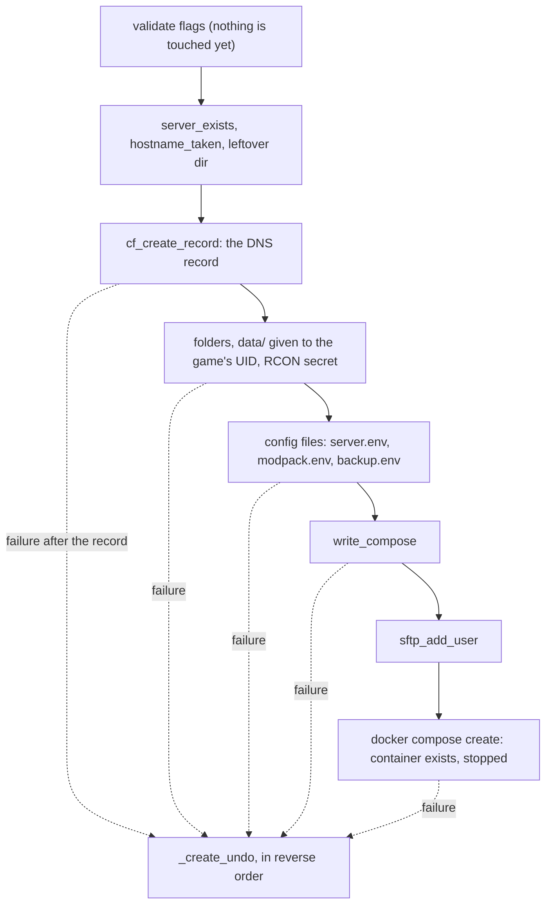
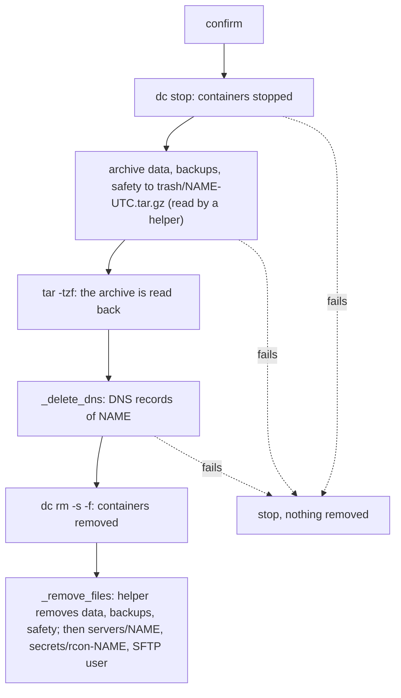
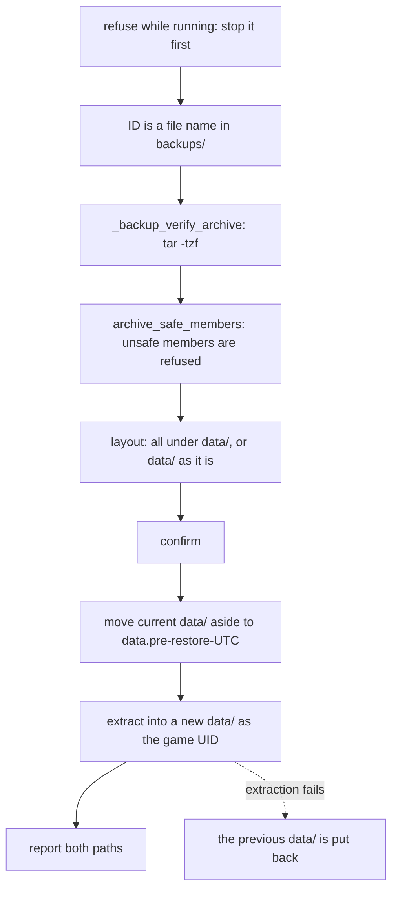
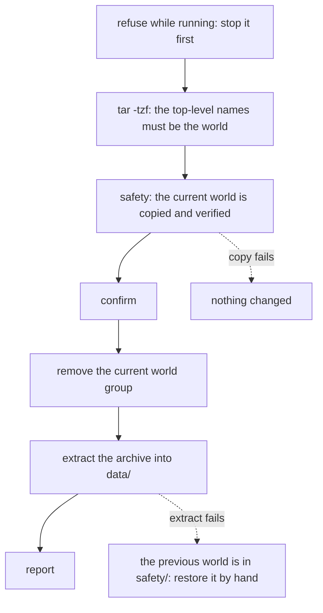
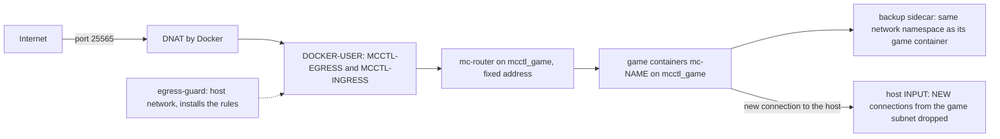
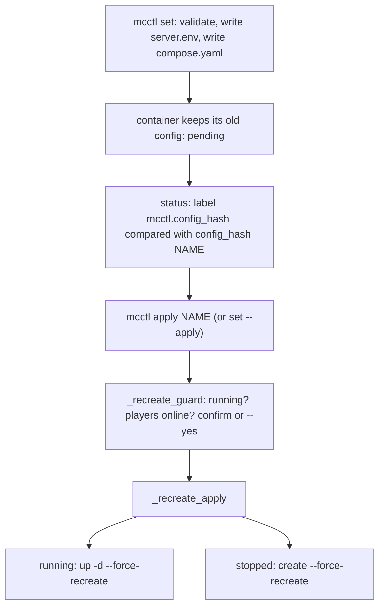

history# Architecture

How mcctl changes the host, drawn from the code. Each diagram is the order the code runs the steps. Where a step can fail, the text under the diagram says what is left behind.

Docker is the only record of what exists: the containers and their labels. Folders under `servers/` hold the files a server needs. Nothing else is kept.

## create

Nothing is sent to mc-router: it follows Docker's events and adds or drops a route when the container starts or stops. It must never get a `kill -s HUP`: its reload panics, and the router stays down.

Validation and the Docker checks run before anything is written. A failure there changes nothing. Once the DNS record exists, a failure runs `_create_undo`: the containers go first, and only if that worked do the record, the folder and the secret. If the containers cannot be removed, everything is kept and `mcctl delete NAME` finishes the job. A failed SFTP user is a warning only: the server is created and `mcctl sftp repair` fixes SFTP later.

## delete

The DNS step comes before the containers are removed, so no record is left pointing at a server that is gone. When the archive or the DNS call fails, nothing has been removed: the server is stopped, and running `mcctl delete NAME` again starts clean. When `dc rm` fails, the DNS record is already gone, and the folder stays. The helper that removes `data/` runs only after the archive has been read back, so a failure there leaves the archive as the copy of the world.

## backup restore

`mcctl backup NAME restore ID` replaces the server's `data/` with an archive from `backups/`.

Every check runs before `data/` is touched. A failed extraction puts the previous `data/` back; what was extracted is kept for a look. After a successful restore, the previous data is in `data.pre-restore-UTC` and nothing removes it.

## world restore

`mcctl world NAME restore WORLD ARCHIVE` replaces one world (with its nether and end) and needs the server stopped.

The copy into `safety/` must succeed before anything is removed. The archive is checked by `tar -tzf` and by its top-level names before that.

## router and egress

Game containers publish no port. Only `mc-router` publishes 25565, and it routes by the host name a player types. The egress guard runs on the host network and writes the rules: MCCTL-EGRESS stops game containers from reaching the LAN, other Docker networks and the metadata address; MCCTL-INGRESS applies the per-source connection and rate limits on 25565. The guard is healthy only when every rule exists, and `mcctl up` waits for that before the router starts. Under Docker Desktop the "host" network is the Docker VM, not Windows.

## drift

A setting change is written to disk first and applied later. `status` compares the configuration the container runs with the one the files describe.

A refusal at the guard (players online without `--yes`, or a "no" to the confirm) leaves the files as written and the container as it was. `status` keeps saying pending until `apply` runs. The one-shot flags (`*_FORCE_REINSTALL`, `FORCE_REDOWNLOAD`, `REMOVE_OLD_MODS`) are not pending configuration.

## Spike results

- S1 (router reaches a game container with the guard healthy; a game container cannot reach the gateway or `169.254.169.254`): not yet recorded. Task 23 runs it on Ubuntu and on WSL.
- S2 (whether the backup sidecar can read the RCON password without a shared file): not yet recorded. Task 23 runs it.
